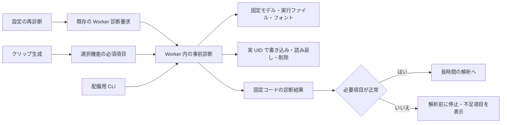

# ネイティブ編集機能の事前診断

設定が存在することと、Worker がその設定を使えることは別です。クリップ生成を始める前に、実際の Worker プロセスの権限・マウント空間で必要な実行ファイル、モデル、フォント、一時保存先を確認します。GPU とローカル LLM の接続・モデル診断には既存の Gateway 診断を使います。

## 契約

- 診断は推論、素材の読み込み、クラウドジョブの作成を行いません。
- モデルは固定されたバイト列と設定を検証します。Python は固定バージョンと必要なパッケージの import を確認しますが、モデルはロードしません。
- 一時保存先では診断専用の空ディレクトリと小さなファイルを排他的に作り、読み戻してから削除します。他のファイルやアクセス権は変更しません。
- 診断結果にはコンポーネント名と固定コードだけを含めます。パス、資格情報、例外本文、端末出力は設定画面へ送りません。
- 未診断・失敗・期限切れを正常と扱いません。既存の編集・書き出しや Worker の別機能を一括停止しません。
- LOCAL_STORY の生成には字幕 OFF でも ASR と VAD が必要です。字幕付き生成では追加で強制アライナーとフォントを確認します。
- CLI と生成処理は同じ診断関数を使います。CLI の成功は、その CLI を実行した UID・マウント空間での結果です。root の実行結果を Worker の証明に流用できません。



## 検証方針

欠落ファイル、読み込み拒否、モデルの不一致、Python 依存の不一致、書き込み拒否、端末出力への秘密混入を再現するテストを先に追加します。診断を省略した状態、無関係な機能の失敗、期限切れの成功が必要項目の正常判定にならないことも確認します。

実環境では候補の Worker と同じ systemd 制限・UID・環境設定で CLI を動かし、プロセス ID、実効 UID/GID、umask、マウント空間の識別子と診断結果を保存します。CLI 単独では本番配備やクラウド出力の成功を証明しません。

## 操作方法

リポジトリの候補版で、次のコマンドを使います。通常の SSH ユーザーで成功しても、Worker の検証にはなりません。

```sh
# クリップ生成の全依存項目と、既存のローカル GPU モデル診断
pnpm --filter @bitovp/worker native:preflight

# VOD 入力プレビューだけを診断（ASR・LLM は要求しない）
pnpm --filter @bitovp/worker native:preflight --vod-input
```

終了コード 0 は、その実行コンテキストで必要項目を確認できた場合だけです。root の実行結果は終了コード 1 になります。JSON の `context` に実効 UID/GID、umask、プロセス ID、Linux のマウント空間が入り、`native.checks` に項目ごとの固定コードが入ります。パスや環境変数の内容は出力しません。

本番切り替え前の一時診断用 systemd unit は、配備先の既存 Worker unit と drop-in から実行ユーザー、環境ファイル、権限・マウント・一時ディレクトリ制限を引き継ぎ、`WorkingDirectory` と `ExecStart` だけを候補版へ向けます。`sudo -u` だけで実行しても、`ProtectSystem` や `ReadWritePaths` の再現にはなりません。まず次の読み取り結果と実効 unit を確認し、診断用 unit の条件と照合します。環境ファイルの中身をログへ出力しないでください。

```sh
systemctl show bitovp-worker.service \
  -p User -p Group -p MainPID -p UMask -p EnvironmentFiles \
  -p WorkingDirectory -p ProtectSystem -p ProtectHome -p PrivateTmp \
  -p ReadOnlyPaths -p ReadWritePaths -p InaccessiblePaths -p NoNewPrivileges
```

切り替え後は、設定 → クリップ編集 → 接続を診断を使います。この要求は既存の診断バスを通り、実際に稼働している Worker の中で実行されます。ローカルモデルの状態と実行環境の状態を別々に表示し、詳細を開くと不足項目を確認できます。古い Worker からの応答や未診断の状態は、正常とは表示しません。

ASR はモデルの SHA-256、固定版の CLI、利用する VAD・品質制御オプション、専用品質アダプターのバイナリ内識別子を確認します。字幕は固定モデルの全ファイルと Python 依存を検証し、固定 CJK フォントの SHA-256 を確認したコピーで、小さな ASS 字幕を FFmpeg/libass へ渡します。これらは音声認識やモデル推論を実行するテストではありません。
