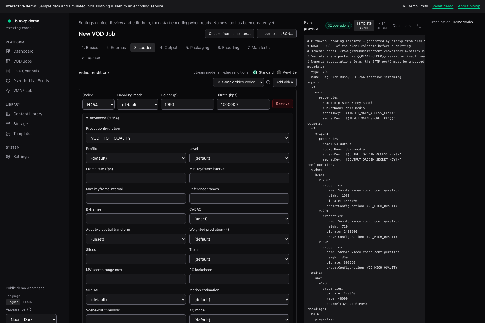
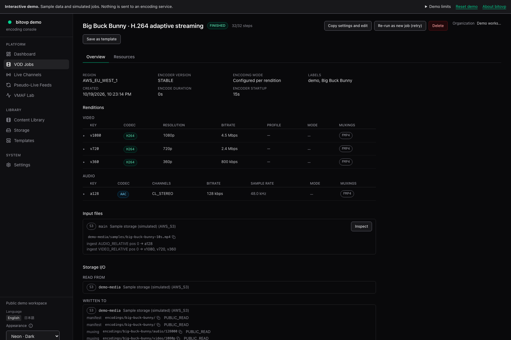
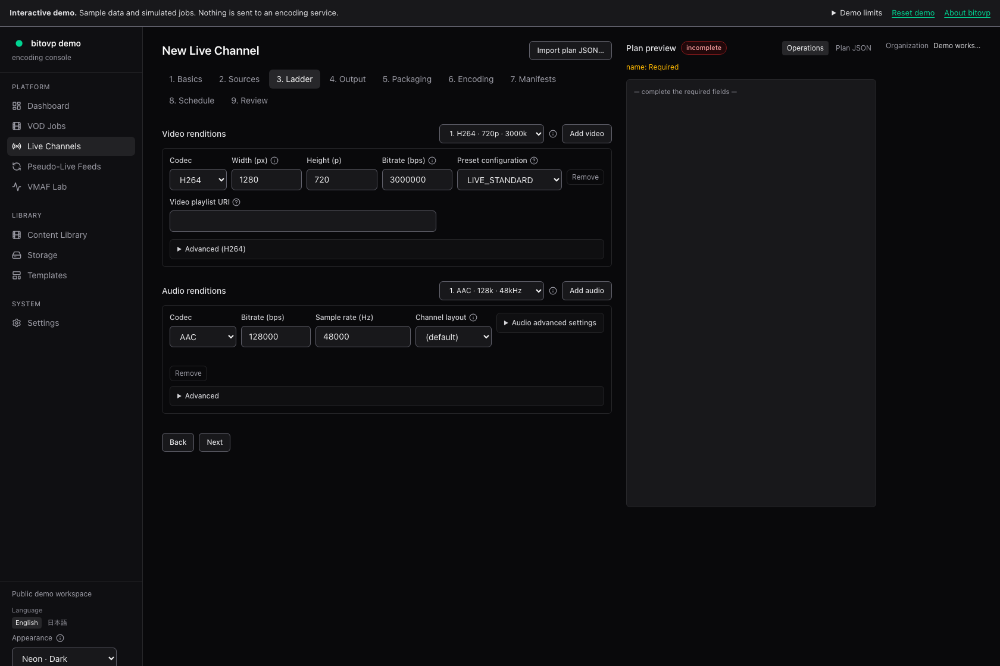
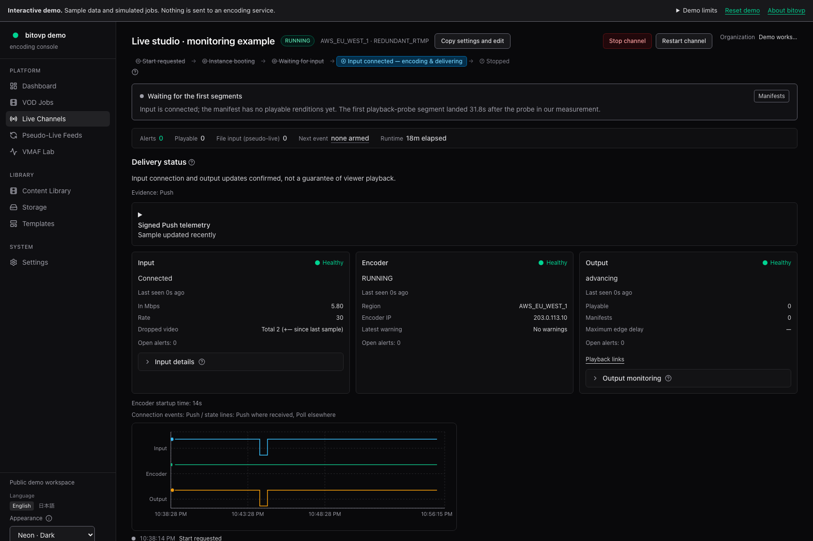
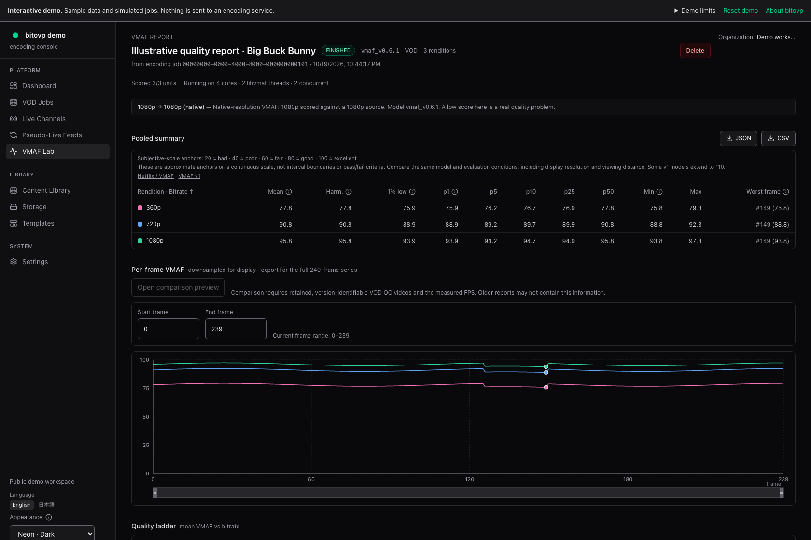
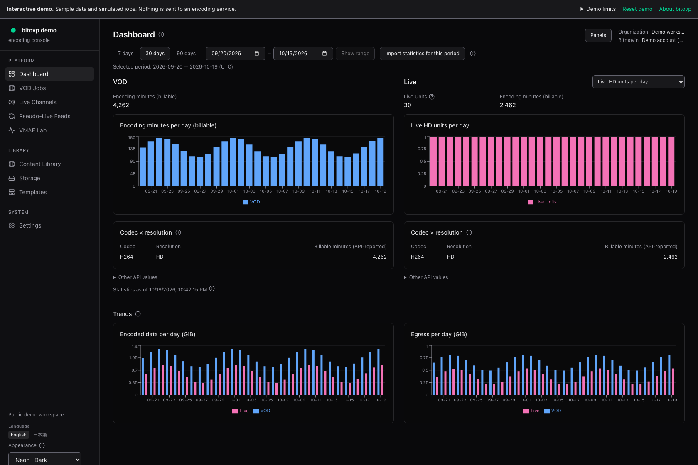

# bitovp user guide

## 1. Installation and first run

Start here to install bitovp, create the first administrator, and connect Bitmovin and storage. Once those connections are ready, you can create your first VOD job or Live channel in the browser.

If an administrator has already installed bitovp, obtain the application URL and sign-in method and continue at [Signing in](#signing-in). You do not need to install another copy. The public demo uses sample data and does not require these connections.

### Installation and first sign-in

The following steps describe a new Docker installation on macOS or Linux. For an existing installation, read [Upgrades, backups, and shutdown](https://kazuhide.github.io/bitovp/guide/appendix/#upgrades-backups-and-shutdown) before changing its database.

Install Docker Engine or Docker Desktop and Docker Compose 2.30.0 or later. Initial setup also uses Git, Node.js 24 or later, and pnpm 11. The default ports are 3100 for Web, 5432 for PostgreSQL, and 6379 for Redis.

Compose 2.30.0 or later is required because `env_file.format: raw` preserves the `$` characters in password hashes. The Web container's default memory limit is 1 GiB. If an older `.env` still contains `WEB_MEMORY_LIMIT=512m`, changing the default does not update that value. Change it to `1g` if needed.

#### Getting the app

```sh
git clone https://github.com/kazuhide/bitovp.git
cd bitovp
corepack enable
pnpm install --frozen-lockfile
cp .env.example .env
chmod 600 .env
```

#### Encryption keys and authentication

Generate separate values for the encryption key and session secret with the following commands.

```sh
openssl rand -base64 32
openssl rand -base64 48
```

Set the first value as `MASTER_KEY` and the second as `AUTH_SESSION_SECRET` in `.env`. Do not save these values in a public repository. Losing `MASTER_KEY` prevents decryption of saved credentials.

The following example is for access only from your own computer. Replace `<generated-session-secret>` with the value you generated.

```dotenv
AUTH_MODE=users
AUTH_SESSION_SECRET=<generated-session-secret>
PUBLIC_BASE_URL=http://localhost:3100
AUTH_ALLOW_INSECURE_HTTP=true
INGRESS_MODE=none
COMPOSE_PROFILES=
```

In raw format, quotes and comments after a value remain part of the string. Do not quote values or add comments at the end of the same line.

#### Preparing the database

For a new installation, run the following in order.

```sh
pnpm --filter @bitovp/db db:runtime:init
docker compose up -d postgres redis
pnpm --filter @bitovp/db db:runtime:prepare
```

Administrative connection information is saved in `.env.migrate`, and the restricted runtime URL in `.env`. Keep both private with file permissions of 0600. Do not run Web or Worker with a PostgreSQL superuser or a role that bypasses row-level access control.

#### Startup and first sign-in

```sh
export GIT_COMMIT=$(git rev-parse HEAD)
docker compose config --quiet
docker compose build migrate worker web
docker compose up -d --no-build
```

If configuration validation, the build, or migration fails, fix the cause before continuing.

```sh
curl --connect-timeout 2 --max-time 5 -fsS \
  http://127.0.0.1:3100/api/health
docker compose ps
docker compose ps --all migrate
```

Check for HTTP 200 from the health endpoint, successful migration completion, healthy PostgreSQL and Redis services, and running Web and Worker services. The health check alone does not verify Bitmovin or storage connections, encoding, or playback.

1. Open `http://localhost:3100/setup` in a browser.
2. After opening the page, use the following command to retrieve the one-time setup code.
3. Enter the code, email address, display name, and a password of at least 12 characters.
4. Confirm that the dashboard opens and the role is ADMIN.

```sh
docker compose logs web | grep setup-code
```

Run the log command from the installation directory, using the same Compose project, Compose files, and environment file that started Web. If you used `-p`, `-f`, or `--env-file` at startup, use the same options for `logs`. A different project shows different containers' logs.

The code is printed only when it is created and is valid for 60 minutes. A refresh or container restart does not reprint an active code. If it is missing, first check the project and earlier Web logs; after expiration, visit `/setup` again to issue a new one. Do not reinitialize the database or replace encryption keys to retrieve a setup code.

The first account becomes the platform owner and administrator of the Main organization. Setup does not reopen after users exist or after a data reset.

### Signing in

Open the installed application and sign in using the method specified by your administrator. With individual user authentication, the first administrator is created at `/setup`; subsequent sign-ins use `/login`. There is no shared initial password for all users. Use `/change-password` to change your own password when needed.

If you belong to more than one organization, select the one you intend to use. When an operation is unavailable, check the selected organization and your role in it, as well as whether you are signed in.

### Registering a Bitmovin account

ADMIN users register and edit accounts and test their connections.

1. Open "Settings" → "Bitmovin accounts" (`/settings/bitmovin`).
2. Enter an account name and Encoding API key. If the account requires a Bitmovin organization ID, enter it too.
3. Save the account and test the connection. This makes a real request to Bitmovin.
4. Check that the account is available in the VOD and Live creation screens.

A successful connection test does not establish that every region, codec, or feature is available. Supported configurations depend on the account's entitlements and the encoder's capabilities.

### Input and output credentials

ADMIN users register storage and other connection credentials under "Settings" → "Credentials" (`/settings/credentials`). Select the destination type first, then enter the endpoint and authentication settings appropriate to it. An S3-compatible service does not necessarily use the same configuration as AWS S3.

Secrets are encrypted at rest and cannot be displayed again after saving. Distinguish connection metadata, such as names and endpoints, from fields for secrets. Chapters 15 and 16 explain credential updates and key management.

| Purpose | What to check |
|---|---|
| Input | Permission to read the bucket or container and the object. Listing permission is also required when using the browser. |
| Output | Permission to write to the specified bucket or container and path. |
| Playback and quality measurement | The browser or measurement environment that will read the manifests and media must be able to retrieve them. |

OPERATOR users and above can use "Storage" to browse supported destinations and files. A successful listing does not establish that a file can be read or that outputs can be written. The credential types you can register also differ from those supported by the storage browser.

Use a dedicated output path that distinguishes each run. An object storage prefix is the beginning of an object path, such as `encodings/example/`. If outputs are written into a watched input folder, the generated files may be detected as new inputs.

#### AWS S3

Use an existing bucket and a small input video already stored in it. The app selects stored objects; it does not create an S3 bucket or upload a local file from this screen.

1. In "Credentials", add **AWS S3**. Enter a name, the bucket's AWS region, the access key ID, and the secret access key. This storage region is separate from the encoding region.
2. Save the credential. Use the same credential for input and output only if its permissions cover both; otherwise register them separately.
3. Open "Storage" (`/storage`), choose the credential and bucket, and locate the input object. If bucket enumeration is not allowed, type the bucket name directly.
4. Choose an output bucket and a prefix such as `encodings/first-run/`. A prefix is part of an object name, so an empty folder does not need to be created first. Keep the output separate from the input.
5. In the VOD or Live wizard, select the saved credential, bucket, and input object or output prefix. You can save a frequently used output location as an `OUTPUT` preset in Storage.

The storage browser uses key-based AWS S3 credentials. S3 role-based inputs and outputs have different requirements and are not supported by this browser.

### Preview playback

Configure VOD and Live previews under "Settings" → "Player & Analytics". Standard HLS playback uses hls.js and DASH playback uses Shaka Player. By default, neither sends data to Bitmovin Analytics.

If you select Bitmovin Player, configure its public browser license key. Analytics also uses a browser client key. Do not enter an Encoding API key or storage secret in these fields.

The browser must be able to access both manifests and media. If it cannot retrieve them, check public access, authentication, and CORS. CORS is the permission that allows a browser to retrieve files from another origin.

### Before your first run

For your first run, a short source of about 10 seconds and a dedicated output path make it easier to check input, encoding, output, and playback in order. Start with one video and one audio stream, then choose the delivery formats you need. Continue with [VOD encoding](https://kazuhide.github.io/bitovp/guide/vod-encoding/) or [Live encoding](https://kazuhide.github.io/bitovp/guide/live-encoding/). After the run, check that the expected video and audio play correctly, as well as checking the final status.

## 2. About bitovp

bitovp is a graphical application for the Bitmovin Encoding API. In your browser, you can configure and run VOD encoding, which converts stored video into files for delivery, and Live encoding, which receives and encodes incoming media for live delivery. You can specify detailed codec parameters, delivery formats, and output destinations, then inspect the processing history and delivery status.

The project aims to support all features of the Bitmovin Encoding API. Some features are not yet supported. Even when a setting appears in the interface, its availability can depend on your account and encoder version. Chapter 15 explains the API coverage screen.

Quality evaluation, pseudo-live streaming from stored video, and the content library help you prepare encodings and review their results. You do not need to configure all of these tools to perform basic VOD or Live operations.

### Scope of this guide

This guide describes bitovp as of October 2026. It covers VOD and Live configuration and operation, quality measurement, shared settings, and installation procedures for administrators. It assumes that the interface language is English. Status codes and API parameter names use the same English identifiers as the interface.

The screenshots show the English interface of the public demo. Jobs, delivery states, usage figures, and quality scores are illustrative samples, not results from real cloud encodings or measurements. Use the figure links to open the complete screenshots at their original size.

Paths such as `/vod/new` refer to screens in the installed application. For example, if the application is running at `http://localhost:3100`, the VOD creation screen is `http://localhost:3100/vod/new`. The GitHub Pages demo uses a different URL.

### Interactive demo

The [English interactive demo](https://kazuhide.github.io/bitovp/#/demo) requires no registration. You can browse the dashboard, VOD jobs, Live channels, and quality reports, configure VOD and Live plans, and create simulated jobs.

The demo does not connect to the Bitmovin Encoding API or storage, and it does not create cloud resources. Scheduled execution, runtime caps, media playback, and quality computation require the installed application. You do not need to enter credentials or signed media URLs in the demo.

Jobs you create in the demo are stored in the current browser tab. "Reset demo" removes added jobs and demo drafts while keeping display preferences such as language and theme. The language links open the same demo screen in another language.

### What you need for real encoding

Install the application in your own environment. Administrators performing the installation should follow Chapter 1. If the application is already installed, obtain its URL and sign-in method from your administrator.

Real encoding requires an eligible Bitmovin account, credentials to read the input, and permission to write to the output destination. Running VOD jobs, creating Live channels, and starting cloud compute resources may incur charges from the services you use. Live provisioning begins when you create a channel.

## 3. Layout and basic operations

### Navigation

Use the menu on the left to open the main screens. The menus and controls you see depend on the current organization, your permissions, and enabled features.

| Menu | Main purpose |
|---|---|
| Dashboard | VOD and Live usage for a Bitmovin account |
| VOD Jobs | File encoding, processing status, and output |
| Live Channels | Live configuration, delivery monitoring, and run history |
| Pseudo-Live Feeds | Sending stored video and managing feeder sessions |
| VMAF Lab | Quality measurements, reports, and comparisons |
| Content Library | Content, metadata, and scene analysis results |
| Storage | Browsing and inspecting files on supported storage |
| Templates | Saved settings, delivery presets, and samples |
| Settings | Language, theme, accounts, operational settings, and administration |

Open a row in a list to view its details. Job IDs and status codes help distinguish jobs with the same name and match records to their Bitmovin counterparts. Do not paste credentials or private input names into public support requests.

### Organizations and permissions

With individual user authentication, the application separates data and permissions by organization. Before creating or changing anything, check the selected organization. An organization in the application is separate from an organization in your Bitmovin account.

| Role | Basic scope |
|---|---|
| VIEWER | View jobs, channels, the library, reports, and similar information |
| OPERATOR | VIEWER access, plus encoding creation and operation, storage browsing, and operations on templates and watch folders |
| ADMIN | OPERATOR access, plus management of credentials, feature enablement, organization members, API tokens, and data resets |

Not every settings screen is restricted to ADMIN. Permission to open a screen can also differ from permission to change its settings. Chapters 15 and 16 explain the differences between operations. The platform owner has additional permissions, including user management across organizations.

Shared-password authentication does not provide separate roles for individual users. Changes are also disabled in view-as mode, regardless of the original user's permissions.

### Language, theme, and field help

Choose the display language and theme in "Settings". Display preferences are stored in your browser. Open the help button beside a field to read about its meaning, units, and conditions of use. Some advanced fields show API parameter names so that you can match them to the Bitmovin API.

A blank field often means "not specified". It does not necessarily mean disabled or zero. Some fields behave differently when left unspecified and when explicitly set to `0`, `false`, or `null`, so read the help before entering a value.

### Configuring, saving, and running

Opening a wizard, loading a template, or copying an existing job's settings does not start an encoding. Creating or running the plan from the review screen registers new work. Some operations outside encoding, such as starting infrastructure, also create external resources.

While configuring a plan, use its preview to check the input and output destinations, renditions, and resources to be created. A rendition is one output with its own resolution, bitrate, or other characteristics. After changing a plan, check the updated output paths and warnings rather than relying on an earlier review.

Browser drafts do not save every setting. They are kept for 7 days and are separated by user, organization, and creation context. Secrets, URLs, DRM, filters, imported JSON, and similar settings are excluded. After restoring a draft, fill in the omitted settings before running it.

### Reading status

`RUNNING` means processing is in progress, and `FINISHED` means the encoding process has finished. Check input reception, output updates, and browser playback separately. For stop operations, also distinguish acceptance of the request from confirmation that external resources have stopped. Chapters 8 and 17 describe the checks in detail.

## 4. VOD encoding

### Creating a VOD job

VOD converts stored video or audio into files for delivery. One encoding operation is called a "job". Starting an encoding incurs Bitmovin processing charges and writes files to the specified output destination. Prepare a dedicated output path for the job, separate from the input file.

1. Open "VOD Jobs" in the navigation and choose to create a new job.
2. Start with a new configuration, a preset, a saved template, or plan JSON.
3. Work through the following 8 steps.
4. In "Review", check errors, warnings, and the output destination, then select "Start encoding".
5. Check progress on the detail screen for the newly created job.

| Step | Main settings and checks |
|---|---|
| Basics | Name, Bitmovin account, cloud region, and encoder version |
| Sources | Input files; video, audio, and subtitle tracks; optional trimming and concatenation |
| Ladder | Output video, audio, and subtitles, with their codec and quality settings |
| Output | Credentials, bucket or container, output path, access settings, and delivery mirrors |
| Packaging | Containers, segments, DRM, thumbnails, and sprites |
| Encoding | Encoding mode, Per-Title, quality measurement, AI Scene Analysis, and related settings |
| Manifests | HLS and DASH structure, audio groups, and generation timing |
| Review | Plan validation results, resources to be created, filenames, and paths |



Figure 4-1. VOD ladder and detailed codec settings in the demo. The screen uses sample settings; it does not show execution results or measured values.

### Basic settings and input files

Choose a name that identifies the job. New configurations start with region `AUTO`, which lets Bitmovin select a region. Select a specific region when required, and check any saved account or copied settings. Then select an encoder version. The usual options are `STABLE` and `BETA`. If you pin a version, also check that it supports the features you need.

In "Sources", specify the input file's credentials, bucket, and path. For supported destinations, use "Browse storage…" to select from a list. Enter paths directly for destinations that do not support browsing. For HTTPS inputs, provide a URL from which the source can be retrieved.

If a file contains multiple video or audio tracks, check the stream type, selection mode, and position. If video and audio are in separate files, register each file and assign it as the source for the appropriate output rendition. Adding a file and using that file in an output are separate operations.

### Ladder and output destinations

A ladder is a set of outputs with different resolutions or bitrates. Each output is called a "rendition". Add the video, audio, and subtitle renditions you need. You can duplicate existing rows and adjust them.

| Field | What to check when entering a value |
|---|---|
| Bitrate | The unit is bps. For example, 2 Mbps is `2000000` bps. |
| Width and height | The unit is pixels. Check each row's "Advanced" section for width and other detailed settings. |
| Frame rate | The unit is fps. Distinguish matching the input from setting a fixed value. |
| Audio sample rate | The unit is Hz. Check it together with the channel layout. |
| Output path | Use a dedicated path that does not overlap the input or previous jobs. |

Specify the bucket, container, and output path appropriate to the credential type. Requesting public read access does not by itself make the output playable through a CDN or browser. Check the storage policy, delivery URL, and access controls too.

The output path may update to follow the job name. Once you edit a path manually, changing the name may no longer update it in the same way, so check the final path in "Review". If you use additional delivery destinations, avoid duplicate writes to the same destination and path.

### Presets, plan JSON, and drafts

Presets and templates are starting points. After loading one, adapt the account, input, output, DRM, quality measurement, and other settings to your actual use. If placeholders remain, review the displayed list and replace them. Loading or copying settings does not create a new job.

If plan JSON includes settings that the form cannot represent, keep it in JSON editing mode to preserve the original content. Avoid forcing it into the form and losing settings; check the validation results instead.

Drafts are stored in the current browser for 7 days. They are separated by user, organization, and creation context. Secrets, URLs, DRM, filters, imported JSON, and similar settings are excluded. After restoring a draft, check omitted settings and output destinations. A draft does not replace a shared template or a complete configuration backup.

## 5. Advanced VOD settings

### Input clips, concatenation, and source assignments

Use "Add input clip" to encode only part of an input. Trimming methods include time, timecode, and H.264 picture timing. Each method has different semantics, so do not confuse seconds with timecodes.

| Setting | Purpose and checks |
|---|---|
| Time-based trimming | Specify the start offset and duration in seconds. |
| Timecode-based trimming | Specify start and end timecodes. |
| Picture timing | Trim using H.264 timing information. |
| Concatenation | Arrange input streams in order and configure padding before and after them and aspect handling. |
| Keyframes | Request keyframes at specified times in seconds. |
| Multiple encodings | Assign outputs to different encodings or regions. |

1. Register the original input files and streams.
2. Create the clip or concatenation stream.
3. In "Ladder", select that stream as the source for the rendition that will use it.
4. If you use multiple encodings, also check the encoding assigned to each rendition.

Check the concatenation order, the units for padding before and after each source, and the correspondence between video and audio. Dolby Vision and Dolby Atmos inputs require their metadata or dedicated streams in addition to the video or audio media itself.

### Video codecs and quality settings

Open each video row's "Advanced" section to configure its profile, level, frame rate, GOP, rate control, color, and related settings. A GOP is a group of pictures between keyframes. The keyframe interval also affects seeking and segment boundaries.

| Codec or category | Main advanced settings |
|---|---|
| H.264 | Profile, level, reference frames, B-frames, CABAC, motion search, look-ahead, AQ, and related settings |
| H.265 | Profile, level, High Tier, CTU, look-ahead, motion search, AQ, SAO, and related settings |
| HEVCv2 | Dedicated presets, pixel format, MCTF, perceptual quality, and dedicated Per-Title QP settings |
| VP9 | Quality and speed, tiles, quantization range, AQ, ARNR, and related settings |
| AV1 | Preset, frame rate, automatic level selection, and dynamic range (SDR, HDR10, Dolby Vision Profile 10.0 or 10.1) |
| Color and HDR | Color space, primaries, transfer characteristics, copying input values, HDR10, and Dolby Vision metadata |

A blank field often means "not specified", rather than zero or disabled. "Default", "Auto", and "OFF" also have different meanings.

For AV1, leave "Dynamic range format" at its default to omit the setting. Dolby Vision Profile 10.0/10.1 uses the fMP4 path in this application. Bitmovin added these profiles and Dolby Vision-to-SDR/HDR10 conversion in Encoder 2.287.0; encrypting Dolby Vision AV1 fMP4 requires the feature introduced in 2.290.0 (BETA). Check the selected encoder version and account availability before running a job. See the [official encoder release notes](https://developer.bitmovin.com/encoding/docs/encoder-22500-22990). Selecting a format does not establish playback or display compatibility.

Use one conversion format per Dolby Vision input stream within an encoding. Different resolutions can share that format, but mixing Profile 10.0 with 10.1, or Dolby Vision with SDR/HDR10 conversions of the same input stream, is rejected before the job starts. This also applies through trimming or concatenation. Create separate encodings when that input needs multiple conversion formats.

HEVCv2 appears for eligible accounts. Selecting a BCF is separate from selecting an encoder version. MCTF reduces temporal noise using motion compensation; choose `AUTO`, `OFF`, or `ON`. Conventional H.265 CRF and x265 settings are not automatically converted into HEVCv2 values. If incompatible settings remain after changing codecs, explicitly remove them.

When using H.264 or H.265 presets or rendition-level modes, avoid conflicting settings at the job level. If the interface displays "Use ladder encoding modes / presets", configure them in the ladder.

### Audio, subtitles, and watermarking

For audio, choose a suitable codec such as AAC, Opus, Dolby Digital, Dolby Digital Plus, or Dolby Atmos. In addition to bitrate, sample rate, and channel layout, supported codecs provide loudness measurement methods and dialogue detection. "Audio channel mix" defines the mapping and gain from input channels to output channels.

The ladder's `AUDIOSTREAMCOUNT > 0` guard creates audio only when the input contains an audio stream. Use it when handling files without audio. This is different from a file that contains an audio stream whose content is silent.

Distinguish subtitle tracks for delivery from subtitles burned into the video. IMSC uses a TTML source and `.ttml` output. HLS subtitles use WebVTT. "Burn in SRT subtitles" draws subtitles into the video, so they cannot be hidden during playback like a separate subtitle track.

HLS WebVTT keeps a boundary-crossing cue's full interval in both segments: a 1.75–2.25-second cue belongs in the 0–2-second and 2–4-second segments. A segment with no cues is valid. These rules follow [RFC 8216 §3.5](https://datatracker.ietf.org/doc/html/rfc8216#section-3.5). Do not delete repeated cues or rewrite outputs to force the files to match.

NexGuard is configured per rendition; Kantar is configured per encoding. Prepare the credentials, presets, identifiers, and report destination required by your service agreement. The presence of a setting in the interface does not establish that your account is entitled to use it.

### Filters and processing order

Define a filter with "Add filter", then assign it to the target rendition with "Attach filter". Defining a filter alone does not apply it.

| Processing | Main settings |
|---|---|
| Deinterlace, crop, and rotate | Field order, processing mode, crop amounts, and angle |
| Images and text | Input image, text, font, position, color, opacity, outline, and shadow |
| Volume and EBU R128 | Volume, loudness, and peak targets. Distinguish %, dB, LUFS, and dBTP. |
| HQDN3D | Luma and chroma noise reduction in the spatial and temporal dimensions |
| Unsharp | Sharpening or blurring through processing area and strength |

Filter order matters. For operations whose results change with order, such as cropping and drawing text, check the filter sequence on each rendition.

### Containers, muxed audio, and DRM

Packaging combines encoded streams into files or segments. To create more than one format from a rendition, use "Add container format".

| Item | Main checks |
|---|---|
| fMP4, TS, and WebM | Segment length is in seconds. Also check initialization filenames, segment names, and paths. |
| MP4 | Filename, fragment duration in milliseconds, and compatible manifest types |
| CMAF | Check the H.264/AAC and DASH TEMPLATE/TIMELINE compatibility requirements for dedicated CMAF muxings. |
| Muxed-in audio | Select the audio included in a video container. |
| Standalone container | Create an audio-only container and reference it from an audio group. |
| Thumbnails and sprites | Generation positions and intervals, units, image dimensions, layout, image names, and the VTT output destination |

Avoid having a video variant that already carries audio also reference an external group for that same audio. When turning off "Standalone container", check that the required audio is carried in video containers. Use Opus in supported WebM/DASH configurations; if you also generate HLS, provide another supported audio output. Do not confuse dedicated CMAF with fMP4 when using HLS or the applicable DRM configurations.

Configure DRM on the target container. Depending on whether you use CENC, FairPlay, or SPEKE, specify key credentials, KID, PSSH, IV, license URI, and related values. KID identifies a key; PSSH is DRM initialization information used mainly in manifests. Secret content keys are stored in credentials, and the plan holds references to them.

For SPEKE, select the key provider and DRM systems. A Content ID is generated if omitted. Matching Content ID and KID values request the same keys. A FairPlay IV is 32 hexadecimal characters. Check that the encryption scheme, license service configuration, and player support agree.

Encrypted segments and DASH encryption metadata must agree. When a DASH manifest selects a DRM configuration, bitovp uses its encrypted output path and adds ContentProtection, the DASH element that identifies encryption, to the selected audio and video representations. This also applies when adaptation sets are configured explicitly.

For local diagnostics, a separately configured player can use [ClearKey](https://shaka-project.github.io/shaka-player/docs/api/tutorial-drm-config.html) with a known test key. Apple's [TN2454 identity-key procedure](https://developer.apple.com/library/archive/technotes/tn2454/_index.html) instead uses a test HLS playlist and a key file to help distinguish content-authoring problems from FairPlay key-delivery problems. These checks do not establish production license acquisition or Dolby Vision display support. Keep identity-key delivery limited to testing.

### Manifests and generation timing

A manifest lists the video, audio, and subtitles available for playback and the locations of their files. Configure HLS, DASH, and additional formats such as SMOOTH as needed. Creating a container and including it in a manifest are separate settings.

For HLS, check audio group IDs, languages, media URIs, and variant names. If you create multiple master playlists, give their child playlists unique paths too. Changing only the master filename does not prevent child files from being overwritten.

A DASH adaptation set groups streams that a player can switch between. In multi-ladder or multilingual configurations, assign each rendition to a declared set. Do not put different video codecs in the same video adaptation set.

Distinguish post-encoding manifest generation from just-in-time generation. Just-in-time start placement can target VOD, preview, or both. Preview placement requires a compatible generation timing setting.

### Per-Title, quality measurement, and scene analysis

Per-Title analyzes the source and creates outputs with resolutions and bitrates suited to its content. A fixed ladder uses values you specify; Per-Title uses templates and analysis conditions.

1. Select a Per-Title stream mode in the ladder.
2. In "Encoding", open the Per-Title settings for that codec.
3. Specify minimum and maximum bitrates, quality targets, spacing between adjacent bitrates, and other required settings.
4. Include `{uuid}` or `{bitrate}` in the output path. You can also use `{height}` and `{width}`, but these alone do not distinguish outputs and will cause a validation error.
5. Check that manifests are configured to be generated after the result renditions are known.

`PER_TITLE_TEMPLATE_FIXED_RESOLUTION` fixes the resolution. `PER_TITLE_TEMPLATE_FIXED_RESOLUTION_AND_BITRATE` also handles bitrate conditions. Set the fixed bitrate to `null` for ordinary Per-Title templates. `minBitrateStepSize` is a ratio, not a difference in bps: `1.5` requires the higher of two adjacent output bitrates to be at least 1.5 times the lower. HEVCv2 QP values cannot be treated as equivalent to conventional quality targets.

Automatic rendition generation includes `autoRepresentations` and configuration-adoption thresholds. Advanced fixed-resolution and fixed-bitrate settings provide conditions and calculation methods for adding higher outputs. Complexity factors and codec bitrate factors are separate from the basic minimum and maximum values.

See Chapter 11 for VMAF, PSNR, execution profiles, budgets, and interpreting results. The wizard's "VMAF only (skip delivery outputs)" mode disables delivery packaging, manifests, and AI Scene Analysis. A quality gate can either mark a result or block manifest generation; distinguish these behaviors. Holding delivery requires post-encoding manifest generation. It does not retract outputs that have already been published.

AI Scene Analysis supports scene analysis and placement of ad breaks. Analysis output always includes English. Add `ja` for Japanese, or leave additional languages blank for English only. Configure the asset description file, languages, automatic insertion at scene boundaries, and cue points at specified times. Positions, maximum allowed offsets, and durations are in seconds, and accept zero and fractional values. Even a zero allowed offset does not guarantee identical cut frames across codecs. View completed analysis in the Content Library.

For Cloud Connect, specify the infrastructure ID together with its region. The overall job region changes to `EXTERNAL`. If you need a dedicated pool or label-based reporting, check those settings against the configuration prepared by your administrator.

## 6. Managing VOD jobs

### Filtering the list and bulk operations

Filter the job list by status, quality gate result, and labels. Use the column selection menu to choose which columns are visible. Select rows already loaded in the list for bulk operations. Changing the filters clears the selection, so check the targets before proceeding.

OPERATOR users and above can perform the following operations on selected jobs.

| Operation | Targets and considerations |
|---|---|
| Re-run | Create new jobs. Check output destinations and costs before proceeding. |
| Cancel | Stop queued or running jobs. |
| Delete | Remove application records for terminal jobs. This does not delete cloud output files or stop running jobs. |

Rows that could not be processed or were ineligible may remain selected after an operation. Check the results and review the selection before repeating the same operation.

### Checking progress and output

Open a job from the VOD job list. Its detail screen has "Overview" and "Resources" views.



Figure 6-1. VOD job details in the demo. The screen uses sample data and does not show actual encoding performance or measured quality.

| Area | Information |
|---|---|
| Status and steps | Current processing, the last successful step, and failure locations and messages |
| Renditions | Codec, resolution, bitrate, and Per-Title results |
| Input and output | Sources actually used, output destinations, manifests, and supporting images |
| Analysis and quality | Scene analysis, quality gate, VMAF progress, and reports |
| Resources | Bitmovin encoding IDs and the IDs of individual resources |

In "Resources", inspect references between related resources and the details of recorded requests and responses. "Copy as cURL" is for inspecting a request; copying it does not execute an API call.

`FINISHED` means that encoding has completed. It does not mean CDN delivery or browser playback has been verified.

1. Check the expected output destination and manifests.
2. Play the video and audio in the preview.
3. Check switching between the expected resolutions, audio tracks, and subtitles.
4. If you use DRM, also verify license acquisition in the target player.

Per-Title results are matched to their original renditions using output identifiers and settings. Results that cannot be matched unambiguously are not assigned by guesswork. If any remain unmatched, check their output paths and settings together.

### Copying settings, re-running jobs, and templates

"Copy settings and edit" opens the wizard without starting new work. For "Re-run as new job (retry)", check input and output paths, the account, and enabled features. If you want to retain earlier outputs, do not reuse the same output path.

Save settings as a template if you intend to reuse them. Check that referenced credentials are still available and that inputs and delivery destinations are within the same organization's permitted scope. If the form cannot represent a loaded plan, keep it in JSON editing mode.

Some failed jobs can be retried using their existing resources. The recovery window is 2 hours. Resources for which automatic recovery has already recorded a stop request are no longer eligible for a retry using those same resources. Create a new job in that case.

### Cancellation and confirmation of completion

To stop processing, cancel the job and check its subsequent status. `CANCELED` is the application's cancellation record. Confirm that processing has stopped on Bitmovin by checking the provider's terminal status.

If a start request fails, you may not immediately know whether it never reached the provider or whether only the response was lost. If a request is already in flight, wait for its outcome and match it to the relevant encoding. If a failed stop or status request leaves confirmation pending, inspect the details rather than treating the operation as complete. Deleting a local record does not establish that cloud processing has stopped or that stored files have been deleted.

## 7. Live encoding

### Creating a Live channel

New configurations start with region `AUTO`, which lets Bitmovin select a region. Review the selected account and region before creating the channel; saved or copied settings may specify a different region.

Live encoding continuously processes incoming video and audio and writes output for delivery. Creating a channel starts provisioning immediately and incurs charges. Creating it in the wizard is not a reservation that delays processing until the planned input feed time.

1. Open “Live Channels” and choose the action to create a channel.
2. Configure the following 8 steps in order.
3. Review the plan, warnings, destinations and stop conditions, then create the channel.
4. Send your feed to the input endpoint shown on the detail page, and follow Chapter 8 to confirm reception and delivery.

| Step | Main settings |
|---|---|
| Basics | Name, Bitmovin account, region and encoder version |
| Input | Protocol, connection direction, redundancy, authentication and encryption |
| Video and audio encodes | Video and audio renditions, codecs and containers |
| Destinations | Storage or delivery service, mirror and MP4 archive |
| Output groups and manifests | HLS, DASH, DVR, publication delay, time and ad information |
| Automatic restart and stop | Monitoring conditions, timeouts, scheduled restarts and caching |
| Schedule actions | Planned input feed, program start and stop times, and a pre-program slate |
| Review | Validation results, Live HD or Custom Live assessment, schedule and paths |



Figure 7-1. Live video and audio encoding settings in the demo. The screen uses sample settings.

Settings outside the Live HD conditions produce a Custom Live warning. In addition to this assessment, check the account's eligibility and the provider's acceptance. As with VOD, copying settings or loading a plan does not start a new broadcast. Use JSON editing for settings that cannot be represented in the form. After restoring a draft, also check the settings excluded from draft storage.

### Input protocols and connection direction

| Input | Configuration and operational checks |
|---|---|
| RTMP | Input endpoint and stream key. Omitting the input ID uses the account default |
| Redundant RTMP | Each ingest point, its key and the delay threshold used for switching |
| SRT | Caller or Listener, host, port, latency, passphrase, key length and stream identifiers |
| Redundant SRT | Connection direction and authentication for each ingest point, and the failover threshold |
| Zixi | Host, port, stream, authentication, decryption, latency and minimum bitrate |
| HLS Pull | Source URL and input-side SCTE-35 ad information |

An SRT Caller initiates the connection; a Listener waits for it. Check the pairing with the sender. Listener ports must be in the range 2088–2091. Latency is specified in milliseconds, and both endpoints' values affect the connection. When using encryption, match the stored passphrase and key length.

Stream keys are secrets. If the configuration uses a key from a managed ingest point, use the key assigned to that point. Do not substitute a channel name or a key from another broadcast run. Sending a stored MP4 is configured separately under “File input (pseudo-live)”; it is not an input type. See Chapter 10 for the procedure.

### Ladders and delivery destinations

The Live form supports H.264 and H.265 video, and AAC, Dolby Digital and Dolby Digital Plus audio. The VOD codec and DRM options do not all apply to the Live form. Check each rendition's resolution, bitrate, preset and advanced settings. Also review any warning shown when you select a VOD preset.

Configure the audio bundled with video, independent audio containers and segment length. Match TS, fMP4, CMAF and other packaging choices to the codec and manifest compatibility conditions. Segment length is in seconds, bitrate in bps and audio sample rate in Hz.

Choose storage or a supported delivery service as the destination. For Akamai MSL, match the credential's stream ID and event name with the output's MSL version and stream format. MSL5 requires a compatible numeric encoder version of `2.283.0` or later. MSL5 publishing supports HTTP Digest or no authentication; Header-only authentication is not supported. Digest publishing is for MSL5 and must not be used with MSL4.

MSL playback links use the public edge base URL configured in the credential. The input encoder's IP does not determine the playback hostname. Use a distinct path for each broadcast, and check that an earlier publisher is no longer sending to the same destination.

### HLS, DASH, and latency

| Setting | Meaning and unit |
|---|---|
| DVR / timeshift | How far back viewers can seek. Specified in seconds |
| HLS live-edge offset | Delay before publishing segments, in seconds. Separate from the player's starting position |
| DASH presentation delay and update interval | Milliseconds in the form; converted to the corresponding values in seconds when submitted |
| PDT | Maps HLS media time to a date and time. Configure the time source and insertion interval |
| SCTE-35 | Signals intervals such as ad breaks. Configure the HLS tag or DASH event format |

Blank HLS fields use the provider's defaults. Omitting the live-edge offset does not remove latency. A blank HLS DVR field does not necessarily mean no DVR either. In contrast, a blank DASH DVR field means live edge only. Check the field help for each setting.

The DVR gauge estimates the number of manifest elements from the segment length and output configuration. If the estimate exceeds the limit, revise the window or configuration. Do not assume that entered values will be silently reduced to fit the limit.

### Automatic restart, automatic stop, and advanced settings

Automatic restart settings cover periods without segment, byte or frame writes, stalled HLS or DASH updates, and scheduled restarts. Automatic stop settings cover a lack of incoming bytes, the wait for a first connection and total running time. Distinguish a channel intended to wait without input from one intended to stop after input loss.

The incoming-byte timeout is in seconds; the first-connection wait and total running time are in minutes. These conditions or a maximum run time can stop the channel before the program's planned stop time.

For manifest and initialization-file reuploads, distinguish an unspecified value, a number and explicit `null`. Unspecified uses the default behavior; `null` means no reupload. Numeric interval fields require at least 30 seconds. Cache control is configured separately for HLS master and media playlists, DASH, initialization files and segments.

Other optional settings include static IPs, labels, Cloud Connect, ESAM POIS endpoints, authentication and identifiers, ad insertion, and clock synchronization. Estimates are based on the settings and do not determine the final bill. Chapter 9 covers scheduling and recording.

## 8. Live broadcast operations

### Input connection and delivery checks

Open the channel and check its input endpoint under “Input & pseudo-live”. Configure your sending software or external encoder with the endpoint, stream key, protocol, encryption and other required settings.

1. Check the channel's startup progress and confirm that the provider reports `RUNNING`.
2. Send video and audio to the specified input endpoint.
3. Confirm that the input card shows `CONNECTED` and a recent check time.
4. Confirm that the output manifests and segments are updating.
5. Play the preview and check video, audio and rendition switching.



Figure 8-1. Live monitoring in the demo. The states and charts use sample data, not observations from an actual broadcast.

| Check | What it establishes and what to check separately |
|---|---|
| Channel `RUNNING` | The encoder is running. Check input connection and viewer playback separately |
| Input `CONNECTED` with a recent sample | Input is being received. Check output updates separately |
| Output monitoring | HLS updates, ENDLIST and live-edge delay. Check actual playback separately |
| Preview playback | Video and audio in that playback environment. Check any other required destinations and devices separately |

HLS output monitoring is separate from channel state and input heartbeat observations. Do not apply the HLS observation indicator to a DASH-only output. Generated Akamai links also require a separate delivery check.

To preview `PRIVATE` S3 output in Live, you need a delivery URL the browser can play. In the storage credential's **Public base URLs (optional)**, an administrator maps each bucket to an existing delivery service's base URL (for example, a CDN), one `bucket = base URL` entry per line, and configures delivery authentication and CORS for browser access. Open **Show every manifest URL** to check each link or the reason a URL is unavailable. HLS output monitoring uses saved storage credentials, while the preview loads the delivery URL directly; verify output updates and actual playback separately.

### Heartbeat and history

Heartbeat information provides periodic checks of input and encoding activity. On supported versions, the application registers signed Push notifications and prefers them while they are fresh. Otherwise, it uses fresh information retrieved from the provider. Missing Push notifications alone do not establish input loss.

The administrator-configured default Push interval is 20 seconds; zero disables registration. The interval is fixed for each broadcast run. The screen shows the last receipt time, provider sample time, receive rate, frame rate and events. Do not mistake delayed information or a duplicate delivery for a new input sample.

Detailed history separates receipt time from sample time. Polling history is retained for 7 days while polling continues, and ended broadcast runs retain a summary. Stale data is not evidence that the encoder has stopped. `HEARTBEAT_STALE` is an alert about missing monitoring information.

The detail page groups information into operations, program, input, output, diagnostics and other sections. Depending on the screen width, use the side navigation or “Jump to”. Initial visibility and expanded states change with the stage of the broadcast; expand any section you need if it is closed.

### DVR, DNS, and diagnostics

“DVR / timeshift” shows the window and element count for each manifest. A reset while running takes the window to retain and the start-position offset in seconds. If no manifests are selected, the reset applies to all of them. Before resetting, check that it will not remove a viewing window you still need.

The DNS section lets you view and copy hostnames pointing to the running channel's encoder. Create and delete mappings in the account-level Live settings. These hostnames serve a different purpose from public playback URLs.

If there is a problem, review alerts, broadcast-run history, step logs, the ladder, heartbeat logs and provider diagnostics in order. Live VMAF capture is for a running channel with a file-input source available as the reference. It covers the most recent 10–600 seconds. See Chapter 11 for results and measurement conditions.

### Stop, startup cancellation, and repeat broadcasts

The maximum run time is measured in minutes from the point at which the channel was observed running. On the detail page, specify 1–10080 minutes, or save a blank field to remove the cap. This is separate from existing stop schedules and provider-side automatic stop settings, so review every stop condition when making a change.

1. If you are using a file input, stop its sending session.
2. Stop the channel.
3. Confirm the provider's terminal state.
4. Confirm that output updates have ended. If recording is enabled, check the files for the relevant broadcast run.

The time a stop is requested is different from the time billable processing ends. Cancellation during startup also requires an in-flight start request to settle. Failed responses or status checks can leave termination unconfirmed.

Restarting a running encoding interrupts the broadcast until the encoder returns. A terminal Bitmovin encoding cannot be restarted. Broadcasting the same channel again creates a new broadcast run and encoding. Insertable content, including slates, is registered for each broadcast run. “Copy settings and edit” opens the wizard for a new channel; that action alone does not start it.

Stopping the channel, stopping the file input, stopping the current insertion and cancelling a schedule are separate operations. Deleting local records is not a substitute for those stops or for cloud resource cleanup.

## 9. Program scheduling and recording

### Planned input feed, program start, and stop times

The Live creation wizard's “Schedule actions” step sets the planned input feed, program start and channel stop times. Channel provisioning and billing begin at creation. Connect your external input or file input by the planned input feed time.

| Time | Meaning |
|---|---|
| Planned input feed time | The time by which input should be connected; also the reference point for starting a pre-program slate |
| Planned program start | When the pre-program slate ends |
| Planned channel stop | When a stop is requested for the channel |

Set the input feed time at or before program start, and the stop time after program start. A slate requires a time window between the input feed and program start. The form takes local dates and times and converts them to the corresponding timestamps when saved. Review the displayed schedule before broadcasting.

On the detail page, “Schedule actions” lets you schedule or cancel individual starts, stops, slate insertions and other actions. The time a start command runs is separate from the on-air deadline. Auto-lead derives the action's execution time from regional startup measurements and a margin, using a default when there are too few measurements.

Each scheduled action runs once. Starts or slates that are too late may be marked not run; a late stop remains eligible for execution. Distinguish “Reserved”, “Requested”, acceptance by the provider and confirmation in the media. A successful dispatch does not establish that the intended video appeared on schedule.

A maximum run time or an automatic stop after input loss can end the broadcast before the planned time. When changing a schedule, review both the stop reservation and the cap. See Chapter 10 for starting and switching file inputs.

### Slate registration and insertion

A slate is a still image or video inserted in place of the incoming program. It is different from input switching, a still-image overlay or an input-loss replacement. It cannot render a slate on an empty channel without input.

1. Choose the source under “Content insertion”.
2. Run the compatibility check and review differences from the current input.
3. If conversion is needed, check the destination and convert the source.
4. Register the source and confirm `READY`.
5. Set the insertion time and duration.
6. Confirm insertion and the return to the program in the actual output.

Use the incoming Live input as the compatibility reference for inserted video. Match its video codec, resolution and frame rate, with video at stream position 0. Match the number of audio streams and their sample format, channel count and sample rate. Supported sources can be converted to MPEG-TS. See [Bitmovin’s content requirements](https://github.com/bitmovin/bitmovin-api-sdk-javascript/blob/v1.285.0/src/models/InsertableContent.ts).

`READY` describes the registered asset’s preparation state. After registration or acceptance of a schedule request, confirm the actual broadcast by watching the output before, during and after insertion. Check both picture and sound, and the return to the live program.

A pre-program slate waits until the input connects. If the insertion window closes while input is still disconnected, it becomes `MISSED`. To cancel a future insertion, cancel its reservation. To end the insertion currently playing, use “Emergency stop: inserted content”. [Stopping the current insertion](https://github.com/bitmovin/bitmovin-api-sdk-javascript/blob/v1.285.0/src/encoding/encodings/live/insertableContent/stop/StopApi.ts) does not cancel other reservations.

### Ad cues, SCTE-35, and ESAM

To signal intervals such as ad breaks, configure both manifest signaling and the actual signal insertion. Check the HLS tags, DASH in-band events, period configuration, XML or binary format, and other relevant options.

Under “Insert SCTE-35 cue”, specify a duration in seconds and select the target manifests. No selection means all manifests. Under “Insert ESAM media point”, specify the time, offset and SCTE-35 signal. ESAM integrates with external systems such as ad-decision services and is used with the POIS endpoint and authentication settings. Check signal submission separately from downstream ad insertion and viewing results.

### Storage mirrors and MP4 archives

| Feature | What it stores |
|---|---|
| Storage mirror | Segments and manifests using the primary output's paths and public-access setting |
| MP4 archive | An MP4 combining existing H.264 video and AAC audio |
| Live-to-VOD | VOD manifests referencing segments from the live broadcast |

A mirror does not create an independent ladder. Choose a different storage credential or bucket from the primary output to avoid duplicate writes. Also check the mirror's permissions and delivery paths.

For an MP4 archive, first add 1 H.264 video stream and AAC audio to the ladder, then select the streams to save. Choose dedicated storage or an available existing storage output, and set the path, filename and access permissions. No separate encode is created. MSL cannot be used as the archive destination.

Archive access is configured separately from the delivery mirror. Repeat broadcasts use paths that distinguish the broadcast run. Also avoid duplicate destinations when copying a channel.

1. Stop the channel at the end of the broadcast.
2. Wait for the provider to finish and finalize the file.
3. Select the relevant broadcast run and open its archive destination and inspection results.
4. Play the file and check video, audio and duration.

The ordinary file inspection has a limited scope. It does not guarantee whole-file playback or audio/video synchronization.

### Live-to-VOD

Live-to-VOD creates VOD manifests from segments saved during the broadcast. It does not record a new MP4.

1. Stop the channel and confirm provider termination.
2. Under “Live-to-VOD”, check which output formats can be generated.
3. Specify the relative output-manifest path and the required HLS or DASH formats.
4. Check the result for each format and play the output.

Recorded TS segments support HLS; fMP4 supports HLS and DASH. A progressive MP4 archive is not added to these manifests. If a destination or output format cannot be generated, review the displayed reason. If only some formats fail, check each format's result before retrying.

## 10. Pseudo-live broadcasting

### File inputs and Live encoders

Pseudo-live repeatedly sends a stored MP4 at real-time speed as input to a live channel. The process sending the file is a “feeder”; a “session” covers 1 sending operation. This does not add a Live input type; it sends media to an existing RTMP or SRT input.

VIEWER users can view sessions. OPERATOR or ADMIN users can start, switch, stop and delete them. Prepare a credential that can read the input file and a live channel in advance. Chapter 7 covers channel configuration and startup; Chapter 8 covers monitoring during a broadcast.

### Source length and preparation time

For an initial input and playback check, choose a source lasting several minutes, such as the roughly 10-minute Big Buck Bunny sample. This gives you time to observe reception, output progression and playback without frequent returns to the start. A 10-second clip is useful for checking repeated loop boundaries; its short duration does not by itself prevent pseudo-live use.

Before sending, the worker waits for the channel to reach `RUNNING`, downloads the entire source and prepares a local MP4 for looping. Preparation uses CPU and can take several minutes for a long or high-resolution source. Allow time before the intended broadcast and enough temporary storage for both the downloaded source and the prepared file.

AAC audio is encoded in blocks of 1,024 samples, so its end does not necessarily coincide with the final video frame. Audio extending past the video can lengthen each repetition. bitovp prepares a constant-frame-rate loop with timestamps starting at zero and trims audio on AAC frame boundaries to keep it within the video span. This aligns timing; it does not make the ending and opening scenes join naturally. Check the loop boundary in playback as well as the middle of the source.

### Starting a file input

1. Open “Pseudo-Live Feeds” in the navigation and choose “Start file input”. You can also start it under “File input (pseudo-live)” on the channel detail page.
2. Use “Browse storage…” to choose the input MP4. Check that the credential, bucket and object name identify the intended source.
3. Choose the channel and wait for the current broadcast run's input endpoint to be ready. Check this run's endpoint rather than reusing an IP or stream key from an earlier broadcast.
4. Choose “RTMP push” or “SRT Caller”, the initiating side, and check the destination.
5. Once the required fields are complete, select “Start file input” and check the session state.

RTMP requires a URL and stream key. Redundant RTMP uses application names and keys specific to each ingest point; do not substitute a simple RTMP input URL. Static ingest uses an assigned stream key. Use “Reveal key & fill” to check the key; if there are multiple candidates, select the appropriate one in the “Live” settings.

SRT Caller initiates a connection from the feeder to the receiver. Specify the host and port for the receiving SRT Listener, and select a stored passphrase credential if encryption is required. Check the destination and the pairing of initiating and listening sides.

### Progress and source switching

`DOWNLOADING` covers waiting for the channel, retrieving the source and preparing the loop; `PUSHING` means the feeder is sending it. Check fresh input information on the channel detail page too, followed by output progression and playback. `PUSHING` alone does not establish that the encoder is receiving the feed or that viewers can play it.

To replace the source, choose the new MP4, enable “Switch from the active feeder (stage first, then swap)” and select “Stage and switch”. The application downloads and probes the new source and checks format compatibility before stopping the old session. It starts the new sender after confirming that the old sender has ended. This can leave a gap during the switch to avoid overlapping sends. It does not guarantee a seamless transition.

Distinguish “staging” and “ready — holding for the switch” from active sending. If startup is refused, check for an active session or one whose termination remains unconfirmed. Do not start another independent sender over it.

### Stop and history

Select “Stop” in the session list or detail page, then “Stop session” in the confirmation dialog. A stopped session cannot be resumed. Create a new session to send the file again.

Continue checking the state after submitting a stop request. A stopped or error state can still have a pending sender-exit confirmation; starting another sender or deleting the session is restricted while that confirmation is pending. “Diagnostics” on the detail page is for ADMIN users and shows the exit-confirmation time, recorded errors, loop boundaries and log tail.

Stopping the feeder and stopping the live encoder are separate operations. At the end of a broadcast, stop both and confirm termination on the channel side as well. Deleting history is not a substitute for stopping the sender.

## 11. Quality measurement and assessment

### Preparing for measurement

VMAF is a quality metric comparing a reference video with encoded video. bitovp calculates it using FFmpeg and libvmaf; it is not a value returned by the Bitmovin Encoding API. PSNR is a separate metric calculated from errors between corresponding pixels.

Quality measurement is disabled initially. An ADMIN enables “VMAF lab and QC” under “Settings” → “Features” and selects “Reload now”. QC means quality control. OPERATOR or ADMIN users can create, rerun and delete measurements; VIEWER users can read saved reports. Cloud execution also requires an execution profile enabled by an administrator.

### VOD measurement

For a new VOD job, enable VMAF on the creation wizard's “Encoding” step. A “QC mirror”, an unencrypted file output for measurement, is created for each video rendition and compared with the reference after encoding finishes. It normally uses MP4, or WebM for VP9. Check the QC mirror's destination and read permissions too.

To measure a completed job later, follow these steps.

1. In “VMAF Lab”, open “Measure an existing job…”.
2. Select the target under “Finished job”. Load more candidates if needed.
3. Choose the “Model” and “Run on” target. For cloud execution, also enter a “Budget (USD)”.
4. Under “Measurement options”, review the measurement source and PSNR. Normally, use “Automatic (use the job settings)”.
5. Select “Measure”, then follow the link to the new report.

For jobs without a QC mirror, eligible existing MP4 outputs can be used. The job must use a fixed ladder and allow direct reference to the entire original video, with exactly 1 unencrypted progressive MP4 for each video rendition. Plans with trimming, concatenation, filters or ambiguous outputs are not eligible for this method. It does not measure arbitrary MP4 files or HLS/DASH URLs entered by the user.

Remeasurements from job details and reports created in the lab do not change the original encode's automatic quality-gate verdict. If a measurement for the same job is in progress, wait for it to finish or fail before starting another.

### Execution targets and measurement methods

“Local” calculates scores on the application's worker. The worker chooses the number of calculation threads and concurrent tasks based on the reference video's size, CPU and available memory. Decoding a large reference still requires memory even when the measured output is small. More parallel tasks do not necessarily run faster.

For cloud execution, select the administrator's profile and specify a USD budget greater than 0 for 1 measurement run. The budget covers measurement across all outputs and is used to decide whether new tasks can start. It does not guarantee the final bill, including transfer, startup and interruption costs. Ask an administrator if you do not know an appropriate amount. Chapter 15 covers the configuration.

Cloud execution shows progress for video retrieval, corresponding-frame checks, scoring, result storage and other stages. Resource cleanup can continue after you select “Stop cloud measurement”. Confirm “Cleaned up”, and do not delete required credentials while confirmation is pending.

The “Frame index · BT.709 · 10-bit” option under “Measurement method” appears when cloud execution and “Existing MP4 outputs” are selected in the lab. It pairs frames by index and compares them under common BT.709, 10-bit conditions. It requires correspondence between the entire original video and the output, and cannot be used with trimming, concatenation or filters. It uses a different scoring generation from the standard method, so do not interpret the numerical change after switching methods as a quality difference. It is not a general-purpose method that automatically detects HDR or other color conditions.

### Live capture

Live measurement compares pseudo-live output with the known MP4 sent by the feeder. It cannot infer the original video from an external live input with no reference video.

On a `RUNNING` channel's detail page, open “VMAF capture”, enter an integer from 10–600 in “Capture window (s)” and select “Capture VMAF”. The initial value is 120 seconds. Output segments corresponding to the current broadcast run must be available and readable for every video rendition. If they are not ready yet, check input and output, wait briefly and retry.

The feeder source used as the reference and a readable storage destination for that broadcast are required. If the primary output cannot be read, explicitly configure a supported storage mirror. Do not substitute an MP4 archive for live segments. If output names or destinations cannot be identified, the application does not treat the measurement as successful.

### Reports and comparison



Figure 11-1. Quality report in the demo. The scores are sample values, not measured results.

First check the report's target job, model, scoring generation, reference resolution, number of measured renditions and warnings. Read the following values alongside the mean.

| Display | Interpretation |
|---|---|
| Mean | Mean across all scored frames. Brief quality drops can be hidden |
| Harmonic mean (Harm.) / 1% low | Supplementary values that help show the effect of low scores |
| p1, p5, p10, p25, p50 | The distribution of frame scores. For example, p5 is the score at the 5th percentile |
| Min / Worst frame | The lowest score in the measured range and the corresponding frame position |
| Per-frame VMAF | Check drops, loop boundaries and missing intervals |

With the same model and reference conditions, a higher VMAF score indicates greater similarity to the reference. Do not use a common pass threshold across different models, viewing conditions or reference resolutions. Evaluating a low-resolution output against a high-resolution reference also includes the effect of upscaling.

The displayed chart is reduced to at most 1,500 points, retaining the worst frame in each interval. This is display downsampling. In contrast, when a measurement samples every few frames, the intervening frames are not scored. Its minimum is therefore not necessarily the worst score across all frames. All stored scored frames can be downloaded as JSON or CSV, including PSNR values when measured. If a download is interrupted, discard the partial file and download it again.

To compare reports, select reports with results in the lab and open “Compare selected”. Up to 6 reports can be overlaid at once. Match the reference, time range, model, scoring generation and sampling stride. Do not interpret higher and lower curves as encoder superiority while mixed-condition warnings or renditions without results remain unresolved.

In a single report, “Open comparison preview” lets you select up to 2 VOD QC videos whose retained versions can be identified, and seek to a scored frame's time. Browser seeking or decoding may display a neighboring frame. This is unavailable for older reports or Live captures that were not retained. It does not show the current live stream as a substitute for previously measured frames.

### Frame boundaries and alignment

Video and audio are not divided into units of the same duration. For AAC, 1 frame normally contains 1,024 samples, or about 21.33 milliseconds at 48 kHz. A 2-second interval corresponds to 93.75 audio frames, so a whole number of audio frames cannot fit exactly into every 2-second video interval. Encoder priming (startup delay), end padding and timestamps also affect the starting position and duration. Container trim information can exclude priming and padding from playback. See [Apple’s explanation of AAC track timing](https://developer.apple.com/documentation/quicktime-file-format/using_track_structures_to_represent_encode_delay_explictly).

In the provider-encoded sample recorded on October 20, 2026, the joint MP4 had 10.000 seconds of video and 10.005 seconds of AAC audio. The concatenated AAC track in the separate fMP4 output contained 471 frames over 10.042667 seconds. Consider AAC frame boundaries, encoder delay and padding when interpreting these duration differences; they alone do not establish desynchronization.

Do not assess synchronization from segment duration or packet counts alone. Check timing information and decoded video and audio. VMAF compares video frames; it does not measure audio/video synchronization.

In a quality comparison, even a 1-frame mismatch can produce a large difference in a moving scene. Frame-rate conversion and pseudo-live loop boundaries can also cause the alignment offset to change between intervals. bitovp records alignment confidence, correction offsets, drift and intervals that could not be measured. Diagnostic values with unconfirmed correspondence are not treated as verified quality differences. If scores are low, check the reference source and alignment warnings before changing compression settings.

### Quality gates

A quality gate applies configured criteria to VMAF or PSNR results. `PASS` means all specified criteria are met. `FAIL` includes scores below the criteria, missing target renditions or required PSNR values that are unavailable. Review each rule's value and the reason for any unmeasured result, separately from a failure of the measurement process itself.

Holding manifest publication requires post-encoding manifest generation. It does not make already published manifests private again. Review the verdict in job details. If you manually continue delivery, understand that the action is recorded separately from an automatic pass. Playback checks are still required after a gate passes.

## 12. Usage and operational status

### Usage dashboard

The dashboard shows account-wide encoding statistics for the selected Bitmovin account, including jobs created outside bitovp. VIEWER users can read it; OPERATOR or ADMIN users can import historical statistics and retry failed imports.



Figure 12-1. Dashboard in the demo. The numbers are sample values, not actual usage or charges.

1. Select the account. If only 1 account is registered, its name is displayed.
2. Select 7, 30 or 90 days, or specify the start and end dates, then select “Show range”. Day boundaries use UTC.
3. Check the statistics retrieval time and the number of missing days.
4. Review the daily charts, codec × resolution breakdown, transfer and other values separately for VOD and Live.

Under “Panels”, choose which charts and tables to show. Hiding a panel does not delete the underlying statistics.

Missing statistics for a day do not mean zero usage. Totals and trends over a period with missing days are based on partial data. Provider aggregation can be delayed, and previously collected values can be revised later. Compare changes after a refresh using the same account and date range.

### Metrics and historical statistics

“Encoding minutes (billable)” and “Live Units” (Live HD Units) are separate metrics. Do not convert minutes into Units or interpret Live minutes as Custom Live-only usage. The codec × resolution table breaks down encoding usage; feature and transmuxing values are shown separately. SD, HD and UHD are provider classes, not the actual width and height.

To retrieve historical values, select the account and period, then choose “Import statistics for this period”. Check “Waiting to import”, “Importing” and “Import complete”, and retry if the import fails. Previously imported statistics are refreshed too. Reloading the page alone does not necessarily retrieve all missing history.

Label filtering selects 1 label at a time and retrieves its combined VOD and Live usage for up to 90 days. Because 1 encoding can have multiple labels, adding values from separate labels can double-count usage. Label statistics do not include Live Units. While label candidates are loading, search covers only those already retrieved. Labels containing commas cannot be selected individually.

This screen is for checking usage, not a replacement for invoices or incident monitoring. Check job and channel details for current queue waits, input problems and stopped delivery. See Chapter 8 for live monitoring.

## 13. Content and storage

### Library records

Use "Content Library" to find completed VOD jobs and their analysis, then organize them with titles and tags. VIEWER can browse the library; registration, editing, and retries require OPERATOR or higher.

| Term | Stored information | Purpose |
|---|---|---|
| Source | An import record containing a completed job, output locations, playback metadata, analysis results, and related information | Identify the processing result being referenced |
| Content | A title, description, tags, language, and links to sources | Organize entries into a searchable catalog |
| Revision | A record of the content when it was registered or updated | Review changes to metadata and linked sources |

Completed VOD jobs are normally imported automatically, with a content entry created using the job name as its title. For jobs that requested AI Scene Analysis, available analysis results are also imported. The library does not copy or back up video files. Moving or deleting files in output storage, or allowing a playback URL to expire, can make an entry unplayable even though its library record remains.

1. Open "Content Library" from the navigation.
2. Search content by title or tag. If needed, filter by archive status or the presence of playback metadata. Choose grid or list view as preferred.
3. Open an entry and review its linked sources, language, playback metadata, and analysis. "Playback metadata" means that a URL or other playback information is recorded; it does not establish that the current destination is reachable.
4. Edit the title, description, tags, and language in the metadata editor, then save. Separate tags with commas.

To group a source under different content, use the source registration action and choose either new or existing content. You can search existing content by title or tag. If another user updates the same content first, your save is rejected to prevent overwriting their changes. Keep a copy of your edits, reload the latest content, and apply your changes again.

Archiving organizes the catalog; it does not delete output videos from storage, and archived entries can be restored. Check source imports for queued, running, ready, or error states. After an error, correct the permissions or destination before retrying. Imported QC information is a snapshot of the information available at that time, not a new quality measurement. See Chapter 11 for quality assessment and remeasurement.

### Scene search

Scene search requires AI Scene Analysis results for the source. Use it to find scenes within a video that may be difficult to locate through title search alone.

1. Select "Scenes" in the library and enter search words separated by spaces.
2. Under "Match", choose "All words" or "Any word".
3. Select the analysis language and sort order. The language filter selects analysis results; it does not translate your search words.
4. Review the content name, scene start and end times, and language, then open a result. If playback is available, you can seek to that scene.

Search covers scene titles, keywords, summaries, and shot descriptions. The relevance score of 0–100 ranks results within the same search. It is not a probability of correctness or an AI confidence score. Zoom in on the timeline to inspect scenes and shots more easily. If an old link no longer identifies a scene, select it again from the current list. A missing thumbnail does not establish whether playback is available; check playback separately.

### Credential types and storage browsing

Credentials contain the information used to connect to external services. You can register 20 credential types, but only 7 support bucket and object browsing in the storage screen.

| Category | Available credential types |
|---|---|
| Storage and ingest: 12 types | AWS S3, AWS S3 (role-based), Akamai Object Storage, OCI Object Storage, Generic S3, Google Cloud Storage (HMAC keys), Google Cloud Storage (service account), Azure Blob Storage, SFTP (encoding output), Akamai NetStorage, Akamai MSL (live delivery), Live Media Ingest |
| DRM and watermarking: 3 types | DRM content key (CENC/FairPlay), SPEKE key provider, Nagra NexGuard license |
| Live connections: 2 types | SRT passphrase (live ingest), Zixi credentials (live ingest) |
| External integrations: 3 types | POIS endpoint (ESAM basic auth), Kantar audio watermarking, Notification webhook (Slack/generic) |

The 7 types that support browsing are key-based AWS S3, Akamai Object Storage, OCI Object Storage, Generic S3, Google Cloud Storage using HMAC keys, Google Cloud Storage (service account), and Azure Blob Storage. AWS S3 (role-based), SFTP, and NetStorage are not included. Some types without browsing support can still be used for encoding inputs or outputs. Enter the path directly in the corresponding field. See "Registering and updating connections" in Chapter 15 for credential creation and secret handling.

### Selecting input files and output destinations

The "Storage" screen uses saved credentials to access external storage, so it requires OPERATOR or higher.

1. Open "Storage" and select a credential.
2. Choose a bucket or container and browse its prefixes. A prefix is the beginning of an object name, displayed much like a folder.
3. If your permissions allow access to a bucket but not listing buckets, enter the permitted bucket name directly.
4. For input, select a file; for output, select a destination prefix. Name and save frequently used locations, keeping input and output locations distinct. Copy the URI if needed.

Search, extension filters, and pagination have limits on the range they retrieve. An object missing from one view may still exist elsewhere in the bucket. Successful listing or reading also does not establish that you have permission to create or delete output files.

Use "Inspect" on an object to examine its media structure. The processing service reads part of the actual file and examines its media information. This does not create an encoding, but it does make storage read requests. Inspection reads up to 8 MB from the beginning and, when needed, up to 4 MB of additional data including the end of the file, for a maximum of 12 MB.

Once inspection moves from queued or running to complete, review the container, duration, video and audio streams, resolution, frame rate, audio channels, and other reported properties. Reopening the inspection shows the latest saved result; up to 20 historical results are available. Whole-file bitrate is not calculated from this result because estimating it from a partial read can be misleading. Missing information or an error can be caused by permissions, header placement, or the read limit as well as file damage. Successful inspection does not verify decoding of the entire file, audio/video synchronization, or actual playback.

## 14. Templates and automation

### Templates, delivery presets, and samples

"Templates" has the following tabs. VIEWER can browse them; saving, editing, deleting, and running require OPERATOR or higher.

| Tab | Contents | What to check first |
|---|---|---|
| Saved | Saved complete VOD plans and Live plans | Whether the account, credentials, input, and output destination are still suitable |
| Delivery presets | Settings that build a plan around requirements such as a delivery format | The requirements and whether the selected configuration meets them |
| Samples | Starting points for trying features and combinations | Whether placeholder values have been replaced with the actual account, inputs, and outputs |

1. Select an item in the appropriate tab and review its contents.
2. To edit it, make changes in the wizard and save. Saving records the configuration; it does not start an encoding.
3. Check the name, update time, and revision to select the intended version. If a concurrent edit causes your save to be rejected, reload the latest version and apply your changes again.

In the VOD run dialog, check the input, output prefix, and job name for this run. For Live, check the channel name and scheduling conditions. Make sure the expanded output destination does not overlap another run. The final creation action creates a new job or channel and can start billable work in an external service. Treat it separately from loading or saving a plan. A saved plan referenced by a watch folder cannot be deleted until that reference is removed.

### Creating a watch folder

A watch folder periodically lists a location and automatically creates VOD jobs when it finds stable input objects. VIEWER can browse rules; creating, enabling, disabling, deleting, and re-encoding require OPERATOR or higher. A continuously running processing service and credentials with permission to list the target storage are required.

1. Save a complete VOD plan with 1 input first. Use one of the 7 browsable credential types described under "Credential types and storage browsing" in Chapter 13 for the watched location.
2. Open "Settings" → "Watch folders", enter a rule name, and choose the bucket and prefix to watch, allowed extensions, and saved plan. Use lowercase letters, numbers, and hyphens in the name.
3. Configure the output prefix template. It must contain `{basename}` or `{uuid}`. Include `{uuid}` as well if inputs may share a name, and keep the expanded output outside the watched input range.
4. Review the scope and create the rule. Rules created through the GUI are enabled immediately. Existing matching files are also detected, so actual processing can begin as soon as the rule is created.

The default check interval is 120 seconds. An object becomes a processing candidate after its key, size, and last-modified time remain the same across 2 observations. This is not a content hash comparison and does not guarantee that an upload has finished. Each sweep examines up to 500 objects and resumes on the next sweep, so large collections or connection errors can delay detection.

Open a rule to review detection status, linked jobs, and errors. Monitoring does not move input files or write processed markers. Disabling a rule stops new detection and submission; stopping jobs already created requires a separate job stop action.

"Re-encode" makes that file a processing candidate again. After confirmation, a new billable job may be created. If the result of the previous submission is uncertain, check the job list for duplicates first. Resetting a rule's detection history disables the rule, and enabling it again requires confirmation of re-detection. Objects whose history was removed become eligible again. Updates to the saved plan apply to future jobs; plans in jobs already created do not change.

## 15. Shared settings and infrastructure

### Settings areas and permissions

"Settings" contains 17 areas. Permission to view an area is separate from permission to save or execute changes. ADMIN can also perform the OPERATOR actions shown below. Users, organizations, and access audit areas are hidden in configurations without individual user authentication.

| Settings area | Main purpose | Permission to change or execute |
|---|---|---|
| App name and icon | Display name and icon for the current organization | ADMIN |
| Bitmovin accounts | Encoding API keys, Bitmovin organization IDs, defaults, and connection tests | ADMIN |
| Features | Enable or disable VMAF lab and QC | ADMIN |
| Player & Analytics | Preview player and public client keys | ADMIN |
| Notifications | Destinations, event and label filters, enable/disable controls, and history | OPERATOR; ADMIN is required to create connection credentials |
| VMAF compute profiles | Cloud execution profiles and credentials | ADMIN, including viewing |
| Credentials | Non-secret connection settings and secret values | ADMIN; VIEWER can read metadata |
| Webhooks | Registration status, re-registration, deletion, and receipt history | OPERATOR for registration actions; ADMIN for detailed receipt and audit logs |
| Infrastructure | Cloud Connect, regions, static IPs, and prewarmed pools | OPERATOR for regular actions; ADMIN to create, start, stop, delete, or schedule pools |
| Live | Stream keys, DNS, alerts, heartbeat, standby pools, and startup probes | OPERATOR for keys, DNS, and alerts; ADMIN for heartbeat, standby pools, and probes |
| Watch folders | Periodic input detection and automatic VOD creation | OPERATOR |
| API coverage | Counts of SDK operations and calls found in source code | VIEWER for viewing |
| Organizations | Organization list, creation, deactivation, and view switching | ADMIN screen; platform owner for platform-wide organization management |
| Access history | Organization access decisions and allowed IPs | ADMIN |
| API tokens | Issue, list, and revoke tokens | ADMIN |
| Users | Membership, roles, and active status | ADMIN; some actions, including creating users, are owner-only |
| Reset data | Delete selected organization data and related settings | ADMIN signed in as a user; API tokens are not accepted |

Select the language and theme on the Settings home screen to suit your display preferences. The app name and icon apply to the current organization within the app. Web build information at the bottom of the screen identifies the application serving that page, not the processing service or Bitmovin encoder version.

### Registering and updating connections

Bitmovin accounts are used for encoding operations; credentials are used for storage and external integrations. An organization within the app is separate from a Bitmovin organization ID.

1. As ADMIN, open "Bitmovin accounts" or "Credentials" and choose the action to add an entry.
2. Give it a descriptive name. Enter non-secret settings such as the endpoint, region, and bucket, along with secrets such as the API key.
3. After saving, select the entry in the job or execution profile that will use it. A Bitmovin account connection test makes an actual external request. Success does not verify every storage permission or contracted feature.

Secrets are stored encrypted and are not returned in later reads. When updating an entry, existing secrets are retained unless you choose to replace them. To change the credential type, create a new credential and update its references. Metadata such as endpoints and buckets is stored as readable information. Do not put confidential strings in names or descriptions.

An indication that a secret is stored does not mean the connection has succeeded. Some credential types do not require secrets. Losing the server's encryption key prevents recovery of saved secrets. Administrators must retain the key and data so that they can be restored together. Changing only the key setting does not re-encrypt existing secrets. The sign-in session secret is separate: changing it invalidates existing sign-ins, and it cannot replace the key used to decrypt credentials.

### QC, cloud execution, and preview

To use QC, an ADMIN enables "VMAF lab and QC" under "Features", saves, and reloads the page as instructed. It is disabled by default. Disabling it restricts new measurements and creation of plans containing QC, but actions to release existing jobs held at a gate and retrieve their evidence remain available.

For cloud execution, create an execution profile under "VMAF compute profiles". Check the compute credential, working storage, region, pinned execution image, queue and run timeouts, working space, and cost settings. Compute and working storage can use different credentials. Saving a profile does not start compute resources. Enabled profiles are available for new measurements; disabled profiles are excluded from new selections. Starting a measurement requires a budget greater than 0. The displayed budget is an admission limit, not a guarantee of the final bill. See Chapter 11 for preparation and measurement steps.

Under "Player & Analytics", choose the default hls.js/Shaka Player or Bitmovin Player. Bitmovin Player requires a Player license key; configure an Analytics key if needed. These are public client keys sent to the browser. Do not enter an Encoding API key. Configure the permitted domains appropriately, and use a separate Analytics key if test views should not be included in production viewing data. hls.js/Shaka Player previews do not send data to Bitmovin Analytics. Saved player settings take effect on the next page load. Destination reachability and CORS permission are still required regardless of the selected player.

### Notifications and webhooks

Before creating a notification destination, an ADMIN saves its URL in a notification webhook credential. Under "Notifications", an OPERATOR selects "Slack" or "Generic webhook", then chooses that credential, the target events, and optional label filters before saving. Enable or disable delivery as needed, and review success or failure, attempt counts, and failure reasons in delivery history. There is no dedicated test-send button. Deleting a notification destination also deletes its related rules, but retains its connection credential.

"Webhooks" configures incoming status notifications from Bitmovin. Managed registrations are normally created automatically for each encoding and cleaned up when it ends. The receiver must be reachable externally. Manually registering the same notification type does not give it the same treatment as an app-managed signed registration. Do not paste administrative URLs or signature-related values into shared material.

When investigating registration problems, check the account, registration status, and last receipt time before re-registering. Re-registration updates the external registration. Deleting external registrations on a shared account can affect other installations, so check the target before deletion. Polling may continue tracking an encoding even when notifications are not received. Check registration status, receipt freshness, and encoding outcome separately.

### Shared infrastructure and Live resources

Under "Infrastructure", select a Bitmovin account and manage Cloud Connect with its regions and static IPs. Cloud Connect registers a connection to your own cloud environment. Prepare the required cloud permissions and resources first. Creation and deletion affect the external service; they do more than save a name in the app.

When using prewarmed pools, an ADMIN reviews the region, instance count, and schedule before creating or starting them. Started resources can incur charges while idle, even when no encoding is using them. After stopping a pool, distinguish acceptance of the stop request from confirmed shutdown of the external resources, and check the final state.

The items under "Live" have the following purposes.

| Item | Actions and checks |
|---|---|
| Reserved stream keys | Create, unassign, and delete keys. Treat a revealed key as a secret used to connect the stream source |
| DNS mappings | Manage the mapping between a hostname and an input encoder's IP. Registration alone does not guarantee external DNS propagation or stream reachability |
| Alerts | Configure monitoring conditions. If notifications are also needed, check the notification destination and target events |
| Heartbeat | Configure periodic notifications for each encoding. The default interval is 20 seconds; 0 disables registration. Reset restores the deployment default |
| Standby pools | Keep started Live encodings ready for use. These are separate from prewarmed pools and incur charges while waiting |
| Startup profiles and probes | Review observations from normal starts and, when needed, measure startup time with a dedicated test start |

Saved heartbeat settings apply to the next run. The interval of a run already in progress does not change, and the app does not need to be restarted to apply the setting. Monitoring may use polling alone when the encoder does not meet the requirements or registration fails. That display alone does not indicate an input video fault.

A startup probe starts an actual Live encoder, unlike observation of a normal broadcast. First designate a dedicated output credential, bucket, and prefix. Saving this destination also performs actual storage operations: a verification object is used within that dedicated area to check delete permission. Choose a prefix that is not shared with other streams.

In the probe destination settings, set an abandon deadline of 1–15 minutes, with a default of 8 minutes. At execution, select 1 region and a probe count of 1–10. Read the displayed worst-case cost estimate and confirmation before launching. Test compute, transfer, and storage can incur charges. Afterward, also confirm shutdown and cleanup results.

"API coverage" compares operations defined in the SDK with calls found in the source code. Finding a call does not mean the operation has been verified through the GUI or executed successfully in Bitmovin.

The current body-model inventory lists top-level SDK properties by API operation. Search by property name, model, or API. Direct property evidence identifies an explicit key in an argument passed to an SDK call; it does not establish that the value is set, configurable in the GUI, or sent successfully. Nested properties, variables, and helper results are not expanded. SDK models can share request and response properties, so not every listed property is writable. Unexpanded bodies are shown separately. The older parameter survey has a different scope and remains separately dated reference information.

## 16. Users, organizations, and API tokens

### Roles and organizations

With individual user authentication, check the current organization and your role within the app before acting. Single-owner configurations, such as a shared password, do not manage individual memberships or roles. By default, sessions expire after 12 hours of inactivity or a maximum of 7 days from sign-in, requiring a new sign-in. Follow your administrator's settings if these periods have been changed.

| Role | Main permissions |
|---|---|
| VIEWER | View jobs, channels, the library, and permitted settings |
| OPERATOR | VIEWER permissions, plus creating and stopping jobs, editing content, and changing operational settings |
| ADMIN | OPERATOR permissions, plus managing connection secrets, users, tokens, features, data resets, and related settings |

The platform owner has administrative authority separate from an organization's ADMIN role. The owner can create and disable organizations and manage users across the platform. An ordinary ADMIN does not automatically have authority over every organization.

Check the target under "Organizations". Switching to an organization you belong to is different from the owner's View-as function. View-as opens another organization as VIEWER. While viewing it this way, you cannot create jobs or change settings. To make changes, leave that view and return through the appropriate membership. Reusing the same external account or credentials across app organizations can still give access to the same external resources. Separation within the app does not itself separate permissions in storage or Bitmovin accounts.

### Users and organization members

1. As ADMIN, open "Settings" → "Users" to check membership, roles, and active status in the current organization.
2. The platform owner creates new users or adds existing users to another organization when needed.
3. Securely pass the temporary password to a new user when it is displayed. It is shown only once and expires after 72 hours. The user changes it to their own password after the first sign-in.
4. When responsibilities change, update membership roles or active status. Changes that would remove the last active ADMIN are protected.

Adding a membership to an existing user does not issue a new temporary password. The owner resets other users' passwords. When changing their own password, users must choose one with at least 12 characters. Disabling membership in the current organization has a different scope from the owner disabling the user across the platform.

### Issuing and revoking API tokens

An API token is a key for automating bitovp. It is separate from a Bitmovin Encoding API key.

1. An ADMIN signed in as a user opens "Settings" → "API tokens" and chooses the issue action. An API token cannot be used to issue another token.
2. Enter a descriptive name and, if needed, an expiry in days. A blank expiry means no expiration.
3. Save the secret in a secure location before closing the screen. It is displayed only once after issuance and cannot be revealed again later.
4. Revoke unneeded tokens from the list. A revoked value cannot be reactivated; issue a new token and update its consumers if necessary.

Issued tokens belong to the current organization and operate with OPERATOR permissions. They do not perform ADMIN management actions. Disabling the issuing user or their membership also restricts use of the token. Before issuing a replacement in response to an error, check the expiry, current organization, and issuer's membership status.

### Access history and allowed IPs

An ADMIN can review access decisions and allowed IPs for their organization under "Access history". These records show whether access to the app was allowed or denied; they are not a record of every completed external service operation.

For IP restrictions, first check the client IP shown on the screen, then enter permitted IPv4/IPv6 address ranges in CIDR notation, 1 per line. CIDR combines an address with a prefix length that defines its range. Leaving the field blank disables IP restrictions. If a proxy is involved, first check that the app recognizes the expected client address. The owner can also manage policies for other organizations. See Chapter 17 for help after saving an incorrect range.

### Data reset

An ADMIN signed in as a user can reset data for the current organization. API tokens cannot perform this action. It cannot be undone, so use the selection screen to distinguish the history you want to delete from the connections and settings you want to keep.

1. Open "Settings" → "Reset data" and select the data categories.
2. Check the related items added automatically and their counts. For example, deleting credentials also includes jobs, channels, presets, library entries, watch folders, and other records that reference them. Deleting a Bitmovin account also includes related execution history and other records. Application settings include QC execution profiles, so review the actual targets rather than relying only on category names.
3. If processing is in progress, understand that reset also requests shutdown and cleanup. Enter `RESET` in the confirmation field and execute the reset.
4. If the result reports incomplete cleanup, retain the displayed resource information and check the external resources. See Chapter 17 for investigation and recovery.

Users, organizations, memberships, other organizations, and platform settings remain after reset. Reset does not restart initial sign-in setup. It also does not delete output media or deployment environment files.

Jobs disappearing from the screen does not mean that external encoders have stopped or cloud resources have been released. Information needed for cleanup is retained until cleanup is complete. Keep the processing service running and the required connection permissions available while checking the result. Repeating the reset does not confirm shutdown.

Deleting watch-folder detection history disables the affected rules. Re-enabling them can cause existing files to be processed again. Deleted library content does not automatically return from completed jobs that were retained. Restore needed entries explicitly with "Register in library again" in the job details. Before removing history, check that any required analysis results have already been imported into the library.

## 17. Troubleshooting

### Investigation order

When a problem occurs, identify the operation time and time zone, organization, and specific job or run. Trace "browser request" → "queue and worker" → "provider" → "input" → "encoding" → "storage" → "delivery and player" → "quality measurement", recording how far each check has reached.

| Symptom | First checks |
|---|---|
| Cannot sign in, or protected pages return 503 | Ask the administrator to check the authentication mode and required settings. Also check for quotes or end-of-line comments in setting values. |
| Initial setup does not open | Check that individual user authentication is selected, no user already exists, and the connection uses HTTPS or explicitly permitted local HTTP. A data reset does not reopen initial setup. |
| Another page signs you out | Check whether multiple installations use different ports on the same host. Cookies for the same hostname are shared across ports. |
| A button or setting is missing | Check the organization, role, read-only View-as state, and whether optional features are enabled. |
| A job remains queued | Check queue submission errors in the details, worker availability, and processing capacity. Avoid repeatedly creating new jobs. |
| VOD fails | Check the last failed step, error category, input read permission, output write permission, and paths. |
| Cannot select an input | Check the credential type and browsing support. Some types support encoding inputs or outputs but not storage browsing. |
| Processing finished, but playback fails | Check the manifest, child playlists, media, storage permissions, CORS, CDN, and player, in that order. |
| Live is running, but there is no video | Check the current run's input endpoint, connection state and information freshness, output progress, and playback. |
| Pseudo-live remains in the sending state | Check reception on the channel. Check the assigned static input key, RTMP application name, and SRT listener settings. |
| A slate or scheduled action ran, but the video did not change | Check the operation result, target run, insertion compatibility results, and actual output. |
| Cannot select a VMAF target | Reload after enabling the feature. Check that the job completed, a QC mirror or supported existing MP4 is available, and the reference media is accessible. |
| Cannot start a cloud measurement | Check the enabled profile, a USD budget greater than 0, working storage, and execution permissions with the administrator. |
| Scores are low or outputs are missing | Check source/output identity, alignment, model, resolution, measurement generation, sampling, expected output count, and read permissions. |
| Library results are missing | Check the organization, search mode, words, language, archive filters, and analysis import status. |
| A watch folder does not work | Check that the rule is enabled, the input range and preset are supported, and the latest sweep succeeded. Keep output outside the watched input prefix. |
| Cannot overwrite saved settings | Check whether another operation updated them. Keep your edits, then reload the latest version. |
| Notifications or webhooks do not arrive | Check destination settings, the public receiver, registration status, and receipt times. Registration and successful receipt are separate checks. |
| Cannot save an infrastructure change | Check whether the resource requires deletion and recreation rather than an update. First check encodings using it and other dependencies. |
| Processing continues after closing the page | The worker runs separately from the page. Check enabled operational settings, such as watch folders and automatically replenished pools, with the administrator. |
| Token authentication or organization access is denied | Check expiry, revocation, role, selected organization, and allowed IPs with the administrator. Do not paste secrets into the support request. |

### Lost creation responses

If a VOD or Live creation response is interrupted, keep the same form in the same tab and retry without changing the settings. The wizard and template launch screen retain that tab's creation request and return the resource already created for the same request.

Changing settings, creating from another tab, or clearing browser session data can lead to a new creation. Check the list before starting again. After reloading, restore settings that are not saved in drafts and recheck the output destination. If browser session storage is unavailable, creation stops before sending the request; allow site storage and retry.

If a created row has a queue error, use that row's retry or start action. An old creation request cannot be reused after its original resource has been deleted. Review the output destination and cost before creating a new job or channel.

### Output, playback, and HTTP 404

Use the URL for the intended job or run, and check the manifest separately from the media it references. If the files exist in storage but the CDN returns 404, check the hostname, base path, delivery configuration, propagation, and cache. If the files are also missing from storage, check the output destination, placeholders, and created resources. Finding files from another run does not verify the intended output.

CORS allows a browser to retrieve media from a different origin. Successfully listing storage does not establish browser playback or write permission. The player's public license key and the Encoding API key also have different purposes.

Immediately after an HLS stream starts, the first manifest and segments may not yet be available. Check the input and publication buffer, address the cause, then use the player's retry action. Waiting for output is not successful playback.

### Status and shutdown confirmation

| Status | Meaning and next check |
|---|---|
| `QUEUED` | Waiting for processing. Check queue submission and the worker. |
| `RUNNING` | Processing or an encoder is running. Check input, output, and playback separately. |
| `CONNECTED` | An input connection was observed. Check the observation time and output. |
| `PUSHING` | The feeder is sending. Check the receiving input. |
| `FIRED` | A scheduled action was handed to the executor. Check the resulting video. |
| `FINISHED` | Encoding finished. Check the required files, renditions, and playback. |

Heartbeat updates stopping means that monitoring information is unavailable. It does not by itself establish input disconnection or encoder shutdown. Investigate Push receipts, Poll checks, and direct output observations separately.

Recording a stop or cancel request is not completion. If a start request has already been sent, the app may need to wait for its result before identifying and stopping the encoding. For pseudo-live, confirm the sending process has ended; for Live, confirm the channel and provider encoding have stopped; for cloud measurement, confirm compute cleanup is complete. Deleting a local row does not verify shutdown of external resources. If shutdown remains unconfirmed, hand the situation to an administrator and retain the worker and credentials needed for cleanup.

### Information for a support request

Include the screen, app build, time and time zone, expected behavior, actual state, error code, last step, input/output types, and results of retries, shutdown, and cleanup. State which storage and delivery checks have been completed.

Do not include API keys, storage secrets, stream keys, signed URL queries, private hostnames, account identifiers, customer names, or confidential media names in a public issue. Check screenshots, copied URLs, JSON/CSV exports, and logs before attaching them. Keep any resource identifiers needed for investigation in a private record.

## 18. Appendix

### Installation and first sign-in

Installation and first-run setup are now in [Chapter 1: Installation and first run](https://kazuhide.github.io/bitovp/guide/getting-started/#installation-and-first-sign-in). Follow it from Docker startup through the first administrator, Bitmovin API key, storage, and first encoding. The links below preserve existing bookmarks.

#### Getting the app

Continue at [Getting the app in Chapter 1](https://kazuhide.github.io/bitovp/guide/getting-started/#getting-the-app).

#### Encryption keys and authentication

Continue at [Encryption keys and authentication in Chapter 1](https://kazuhide.github.io/bitovp/guide/getting-started/#encryption-keys-and-authentication). The first-run instructions use individual user accounts. Other authentication choices are listed below.

| Authentication mode | Behavior |
|---|---|
| `users` | Individual accounts, organizations, and roles. Create the first administrator at `/setup` |
| `password` | A shared team password. Requires `AUTH_PASSWORD_HASH` and the session secret |
| `oidc` | Not implemented. Rejects requests with HTTP 503 rather than bypassing authentication |
| `none` | Explicitly disables authentication for local development. Anyone who can reach the app can use its API without a session |

A blank mode selects `password`. Copying `.env.example` without completing the required authentication settings results in HTTP 503. Generate the shared password hash with `pnpm --filter @bitovp/web auth:hash`. Supply the password through standard input, not a command argument.

The HTTP example in Chapter 1 is intended for a trusted local environment. For network access, configure an HTTPS `PUBLIC_BASE_URL`, accepted hosts, and a reverse proxy, and remove `AUTH_ALLOW_INSECURE_HTTP=true`. See the [operations guide](../OPERATIONS.md) for details.

#### Preparing the database

Continue at [Preparing the database in Chapter 1](https://kazuhide.github.io/bitovp/guide/getting-started/#preparing-the-database). For an existing database, use the upgrade procedure rather than initializing it again.

#### Startup and first sign-in

Continue at [Startup and first sign-in in Chapter 1](https://kazuhide.github.io/bitovp/guide/getting-started/#startup-and-first-sign-in). Retrieve the one-time setup code from the Web logs of the same Compose project that started the app.

#### Public receivers and multiple installations

Signed webhooks and Live Heartbeat require a public receiver reachable from Bitmovin. To use the optional quick tunnel, configure the following before startup.

```dotenv
INGRESS_MODE=quick-tunnel
COMPOSE_PROFILES=quick-tunnel
INGRESS_ORIGIN_URL=http://web:3100
INGRESS_QUICKTUNNEL_METRICS_URL=
```

The resolved public hostname normally accepts only `/api/webhooks/*` and `/api/health`. This configuration does not automatically expose the management GUI. See Chapter 8 for heartbeat checks when a tunnel is unavailable.

When running multiple installations on the same computer, separate their Compose project names, ports, databases, and environment files. Browser sign-in cookies are shared across ports on the same hostname. For example, use `localhost:3100` for the first installation and `127.0.0.1:13100` for the second, and use each hostname consistently.

If you change the database host port, the initialization option `--database-port` must match. See the [installation guide](./INSTALLATION.md) for examples.

### Upgrades, backups, and shutdown

Keep encrypted backups of the database, `.env`, and `.env.migrate` outside the repository. Having both the database and encryption key permits credential decryption, so restrict access to both. Test restoration in a separate database rather than overwriting a running database.

Before upgrading, record the current app and image versions and active external resources. Stop accepting new work, review migration notes, and update Web and Worker to the same version. While any resource still has unconfirmed shutdown or cleanup, retain the Worker and credentials it needs.

See the [database upgrade procedure](../DATABASE-UPGRADES.md) for requirements on existing databases. Reverting an image to an earlier version does not necessarily reverse database changes already applied.

Simply replacing `MASTER_KEY` makes existing credentials unreadable. Changing `AUTH_SESSION_SECRET`, on the other hand, invalidates sign-in sessions. Do not treat them as the same key.

Before shutting down the app, check feeders, channels, jobs, and shared cloud compute resources, and confirm external processing has ended. Closing the browser does not stop Worker job monitoring or enabled watch-folder processing.

```sh
docker compose down
```

This preserves the database volumes. Use `--volumes` only when you intend to delete saved data. Stopping the app is not a substitute for stopping external resources.

### Units and unspecified values

| Item | Unit or example | Interpretation |
|---|---|---|
| Video and audio bitrate | bit/s, shown as bps in the GUI | `4500000` is 4.5 Mbit/s. Do not confuse it with kbit/s |
| Video width and height | Pixels | Also check source/output resolution and aspect ratio |
| Frame rate | fps | Video frames per second. Conversion also affects frame correspondence in quality comparisons |
| Audio sample rate | Hz | `48000` means 48,000 samples per second |
| Segment length | Seconds | Target split length for HLS/DASH. It may not coincide with audio frame boundaries |
| MP4 fragment duration | Milliseconds | `fragmentDuration`. Distinguish it from segment length in seconds |
| Live edge offset | Seconds | Delay in publishing media, separate from the player's start position |
| DASH presentation delay and update interval | Milliseconds in the GUI | Converted to seconds when sent to the API |
| Per-Title minimum bitrate step | Ratio | `1.5` requires at least a 1.5-fold step between adjacent outputs |
| Scene-analysis cue position and tolerance | Seconds | 0 and fractional values are allowed. They do not guarantee exact coincidence with a video frame |
| Heartbeat registration interval | Seconds | Default 20 seconds. 0 disables Push registration, not all monitoring |
| Live quality capture window | Seconds | 10–600 seconds. Reference and output requirements also apply |
| Cloud quality measurement budget | USD, US dollars | A budget greater than 0, not a guarantee of the final bill |
| Dashboard dates | UTC | Date boundaries differ from Japan time |
| Blank field | Often unspecified | Does not necessarily mean 0, disabled, or unlimited. Read the field's help |

### A short-media verification example

Published local media verification includes a 10-second Big Buck Bunny excerpt. The following results were recorded in [Linux CI on October 19, 2026](https://github.com/kazuhide/bitovp/actions/runs/39211595682). They do not come from new cloud jobs run while preparing the PDF.

| Check | Recorded result |
|---|---|
| Media | 320×180, 24 fps, AAC 48 kHz, 10 seconds |
| Video frame count | 240 |
| HLS/DASH video segments | 5 each, 2 seconds and 48 frames per segment |
| Full audio/video decode of MP4, HLS, and DASH | Passed |
| VMAF coverage | All 240 frames in each comparison, `vmaf_v0.6.1` |
| Mean VMAF: identical video / encoded / deliberately degraded | 98.282 / 93.142 / 5.088 |

This example checks media conversion, segmentation, decoding, and the evaluation process. It does not establish Bitmovin API execution, browser playback, or a quality target for other content. See the [quality and monitoring guide](./QUALITY-AND-MONITORING.md) for detailed conditions and reproduction commands.

Audio boundaries and alignment are explained in Chapter 11. Big Buck Bunny is from the [Blender Foundation](https://peach.blender.org/about/) and is licensed under Creative Commons Attribution 3.0. Media credit: © copyright 2008, Blender Foundation / www.bigbuckbunny.org.

### Provider-encoded samples: October 20, 2026

Ten-second Big Buck Bunny inputs were encoded through Bitmovin using the JavaScript API SDK 1.284.0. The following measurements describe those outputs separately from the local example above.

| Output sample | Recorded result |
|---|---|
| H.264 and HEVC with AAC in fMP4 HLS/DASH; H.264/AAC joint MP4 | Each segmented video track contained 240 frames over 10 seconds and five 2-second video segments. All concatenated fMP4 tracks decoded completely. |
| VP9 / Opus, WebM DASH | Complete concatenated-track decoding passed; video contained 240 frames over 10 seconds. |
| English WebVTT in H.264 / AAC HLS | Five subtitle segments preserved all four source cues, including a cue crossing a segment boundary and an empty segment. Chrome displayed all four cues during complete playback. The HLS tracks and joint MP4 decoded completely. |
| Local quality measurement of the provider-encoded H.264 / AAC joint MP4 | All 240 consecutive frames had finite VMAF and PSNR scores. Model `vmaf_v0.6.1`; mean VMAF 98.018, mean PSNR 50.763 dB. |

Chrome playback reached the end with 240 decoded video frames for HLS using hls.js 1.6.16 and for both DASH presentations using Shaka Player 5.2.8. It used unchanged downloaded files served locally. For the H.264/HEVC sample, direct FFmpeg reading of the DASH manifest was not qualified; the unchanged files passed concatenated-track decoding and browser playback.

These scores describe one reference/output pair and measurement method. They do not establish a quality target for other content or audio/video synchronization. These checks do not qualify AV1 output.

### Glossary

| Term | Meaning |
|---|---|
| VOD | Video on Demand. Encoding stored video and audio into a form that can be watched later. |
| Live channel | A unit that retains live-stream settings and history. Broadcasting again creates a new run. |
| Run | One broadcast on a channel. Its encoding, input endpoint, output, and observations are associated with that run. |
| Input / Ingest | Video and audio received by the encoder, from stored media, an external sender, or an existing stream. |
| Rendition | One video or audio output with a particular resolution, bitrate, or other configuration. |
| Ladder | A set of renditions from which the player selects. |
| Codec | A method of compressing and decoding video or audio, such as H.264 or AAC. It is separate from the container. |
| Bitrate | Data per unit of time. bps means bits per second. |
| Frame rate | Video frames per second, expressed in fps. |
| Keyframe / GOP | A frame that can serve as an independent decoding starting point, and the group of video frames containing it. They affect switching and seeking. |
| Sample rate | The number of audio samples per second. 48 kHz means 48,000 samples per second. |
| Container / Muxing | Combining video, audio, and other streams in a format such as TS or MP4, or the output configuration for doing so. |
| Segment | A short media interval retrieved and played in sequence in HLS/DASH. |
| Manifest | An HLS playlist or DASH document describing media locations and relationships between renditions. |
| HLS / DASH | HTTP-based segmented delivery formats that let a player select a suitable quality. |
| fMP4 / CMAF | fMP4 is MP4 divided into fragments. CMAF is a common specification for compatible fragmented media. The GUI may treat them as separate container settings. |
| Audio group | An HLS mechanism linking a separate audio playlist to a video variant. |
| DVR / Timeshift | The available playback window going back from the current live position. |
| Live-to-VOD | Generating VOD manifests from live output after a broadcast. It is separate from an MP4 archive. |
| Heartbeat | Periodic information about encoder input and state. It does not directly confirm viewer playback. |
| Push / Poll | Push is a notification received from another system; Poll is a periodic status request sent by the app. |
| Pseudo-live / Feeder | Sending stored media repeatedly at real-time speed as a live input, and the process that sends it. |
| Slate | A still image or video inserted into a live stream. Registration is separate from successful insertion and playback. |
| RTMP | A protocol for sending video and audio to a live input, using a URL and stream key. |
| SRT Caller / Listener | The initiating and listening sides of an SRT connection. Match the destination, port, and required encryption settings. |
| Per-Title | Analysis of source media to create resolutions and bitrates suited to its content. |
| VMAF | A video quality metric comparing reference and output. bitovp calculates it with libvmaf. It does not measure audio synchronization. |
| PSNR | A metric calculated from errors between corresponding pixels. Its scale and interpretation differ from VMAF. |
| QC mirror | An unencrypted file output for quality measurement, usually MP4, or WebM for VP9. Its purpose is separate from delivery media. |
| Quality gate | Rules comparing measurements against thresholds to produce a verdict or hold manifest publication. |
| Alignment / Drift | Alignment matches corresponding frames in reference and output. Drift is a change in that correspondence over time. |
| Model / Measurement generation | The model defines quality evaluation conditions; the measurement generation identifies the comparison method. Results from different conditions are not directly comparable. |
| Preset / Template | Reusable encoding settings. Delivery presets also retain checks for output requirements. |
| Credential | Access settings for storage, DRM, input, or an integration. It may include secrets that cannot be displayed after saving. |
| Bucket / Container / Prefix | A storage unit and the beginning of an object name. For example, `encodings/example/` is a prefix grouping output objects. |
| CORS | Permission for a browser to retrieve media from a different origin. |
| DRM | Encryption and license-based playback control. Encryption keys do not belong in plans or public documents. |
| SCTE-35 / ESAM | Signals and integration methods for program or advertisement insertion. Corresponding output settings are also required. |
| Organization | A scope for data and roles within bitovp, selected and managed separately from a Bitmovin organization. |
| VIEWER / OPERATOR / ADMIN | Roles for viewing, encoding operations, and administration. The required role depends on the screen or action. |
| Step history | The processing history of a job or run. Distinguish recorded requests from confirmed provider completion. |

### Screen reference

`[id]` is replaced by the ID of the selected job, channel, or other resource. Access to a screen does not imply permission to use every button. This table shows normal viewing access; check the text and on-screen guidance for permissions to make changes.

| Screen path | Contents | Access requirements |
|---|---|---|
| `/` | Usage dashboard | VIEWER or higher |
| `/vod/jobs` | VOD list | VIEWER or higher |
| `/vod/new` | VOD creation | OPERATOR or higher |
| `/vod/jobs/[id]` | VOD details | VIEWER or higher |
| `/live` | Live list | VIEWER or higher |
| `/live/new` | Live creation | OPERATOR or higher |
| `/live/[id]` | Channel details and run history | VIEWER or higher |
| `/live/feeders` | Pseudo-live session list and creation | VIEWER to view; OPERATOR or higher to create |
| `/live/feeders/[id]` | Sending session details | VIEWER or higher |
| `/qc` | Quality report list and measurement | QC enabled; VIEWER to view; OPERATOR or higher to measure |
| `/qc/[id]` | Quality report details | QC enabled; VIEWER or higher |
| `/qc/compare` | Report comparison | QC enabled; VIEWER or higher |
| `/library` | Content and scene search | VIEWER or higher |
| `/library/[id]` | Content details | VIEWER or higher |
| `/storage` | Storage browsing and inspection | OPERATOR or higher |
| `/presets` | Templates, delivery presets, and samples | VIEWER to view; OPERATOR or higher for actions |
| `/settings` | Language, theme, and settings entry points | VIEWER or higher |
| `/settings/branding` | App name and icon | VIEWER to view; ADMIN to change |
| `/settings/bitmovin` | Bitmovin accounts | VIEWER to view; ADMIN to change |
| `/settings/credentials` | Connections and secrets | VIEWER to view; ADMIN to change |
| `/settings/features` | Optional features | VIEWER to view; ADMIN to change |
| `/settings/player` | Preview playback | VIEWER to view; ADMIN to change |
| `/settings/notifications` | Notifications and delivery history | VIEWER to view; OPERATOR or higher for actions |
| `/settings/webhooks` | Webhook registration and receipts | VIEWER to view; OPERATOR or ADMIN depending on the action |
| `/settings/watch-folders` | Watch folders | VIEWER to view; OPERATOR or higher for actions |
| `/settings/infrastructure` | Cloud Connect and shared resources | VIEWER to view; OPERATOR or ADMIN depending on the action |
| `/settings/live` | Shared Live settings | VIEWER to view; OPERATOR or ADMIN depending on the action |
| `/settings/vmaf` | Quality compute environment | ADMIN |
| `/settings/tokens` | API tokens | ADMIN |
| `/settings/users` | Users and organization members | users mode; ADMIN or higher. Some actions are owner-only |
| `/settings/organizations` | Organization management | users mode; ADMIN screen. Some actions are owner-only |
| `/settings/access-audit` | Access decisions and IP restrictions | users mode; ADMIN |
| `/settings/api-coverage` | API coverage | VIEWER or higher |
| `/settings/reset` | Data reset | ADMIN signed in as a user; API tokens are not accepted |
| `/setup` | First administrator setup | users mode; initial setup available |
| `/login` | Sign-in | Depends on the installation's authentication mode |
| `/change-password` | Change your password | Individual user sign-in |

The compatibility paths `/templates`, `/settings/basic`, `/verification`, and `/verification/[id]` redirect to other screens. They do not need to be used as separate operational screens.

### References

- [Project page and demo](https://kazuhide.github.io/bitovp/)
- [English user guide](../USER-GUIDE.md)
- [Supported features and limits](../BITMOVIN-API-COVERAGE.md)
- [API usage](../API-USAGE.md)
- [Operations, upgrades, and backups](../OPERATIONS.md)
- [Authoring delivery presets](../DELIVERY-PRESET-AUTHORING.md)
- [Source code for the features covered in this guide](https://github.com/kazuhide/bitovp/tree/56f230502efc35ef74e619fdc54eb71afd46f3ec)

bitovp is published under the MIT license.
