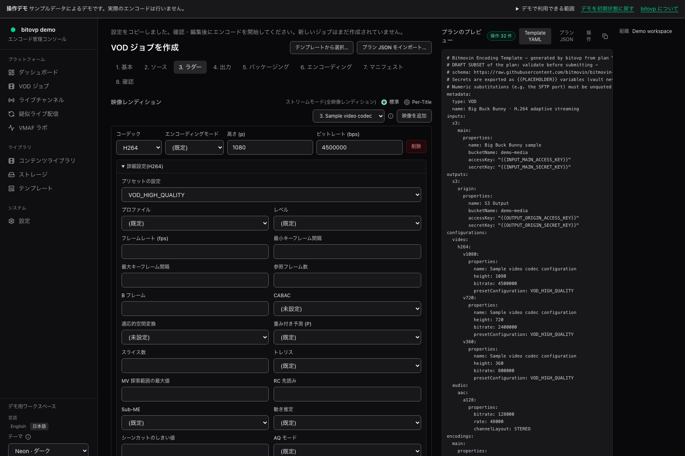
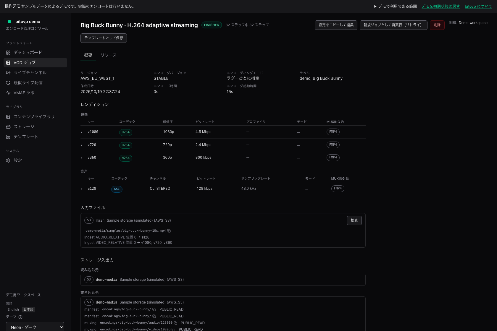
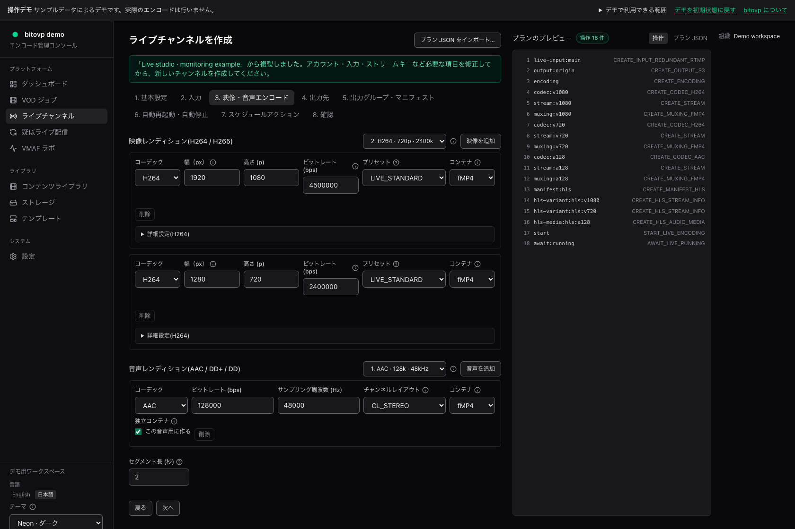
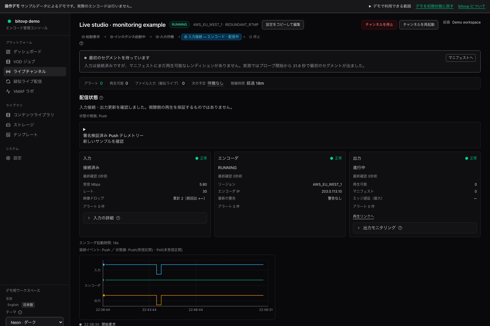
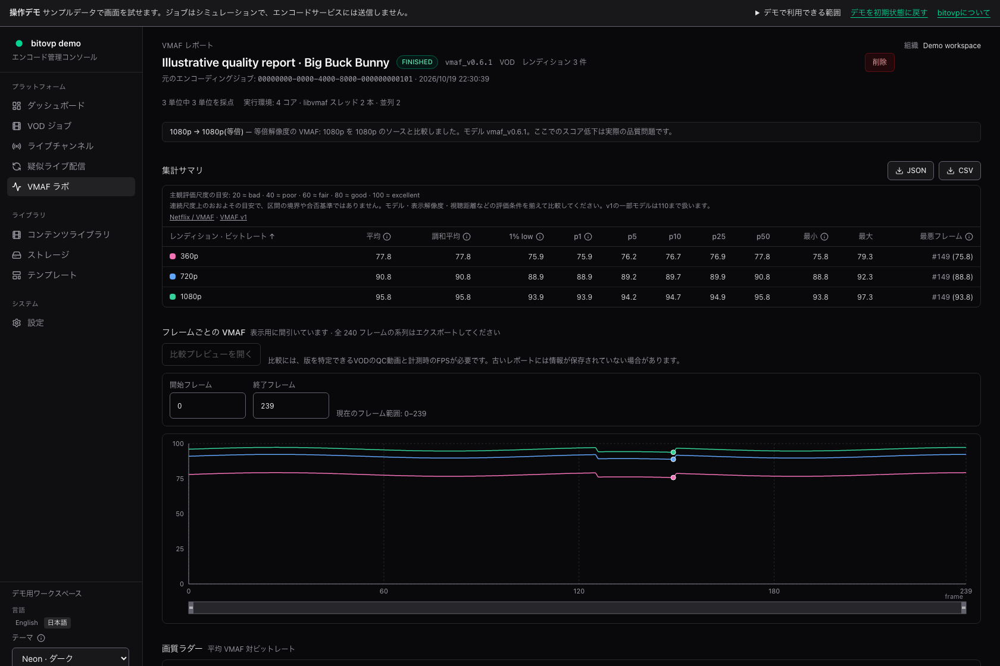
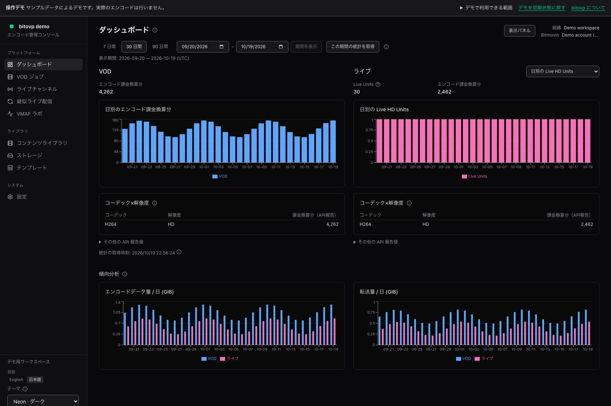

# bitovp ユーザーガイド

## 1. 導入と初回設定

bitovp のインストールから、初回管理者の作成、Bitmovin とストレージへの接続までを順に説明します。接続の準備ができたら、ブラウザで最初の VOD ジョブまたは Live チャンネルを作成します。

導入済みのアプリを使う場合は、管理者から URL とログイン方法を受け取り、[ログイン](https://kazuhide.github.io/bitovp/ja/guide/getting-started/#signing-in)から進めてください。改めてインストールする必要はありません。公開デモはサンプルデータで動くため、ここで説明する接続設定は不要です。

### インストール

以下は、macOS または Linux に Docker で新しく導入する場合の手順です。導入済みの環境を更新する場合は、データベースを変更する前に[第18章の更新・バックアップ](https://kazuhide.github.io/bitovp/ja/guide/appendix/#upgrades-backups-and-shutdown)を確認してください。

Docker Engine または Docker Desktop と、Docker Compose 2.30.0 以降を用意します。初期設定には Git、Node.js 24 以降、pnpm 11 も使います。既定のポートは、Web が3100、PostgreSQL が5432、Redis が6379です。

Compose 2.30.0 以降が必要なのは、パスワードハッシュ内の `$` をそのまま読み込む `env_file.format: raw` を使っているためです。Web コンテナーのメモリ上限は既定で1 GiBです。以前の `.env` に `WEB_MEMORY_LIMIT=512m` が残っている場合は、既定値の更新だけでは変わりません。必要に応じて `1g` に変更します。

#### アプリの取得

```sh
git clone https://github.com/kazuhide/bitovp.git
cd bitovp
corepack enable
pnpm install --frozen-lockfile
cp .env.example .env
chmod 600 .env
```

#### 暗号鍵と認証

次のコマンドで、暗号鍵とセッション用の秘密値を別々に生成します。

```sh
openssl rand -base64 32
openssl rand -base64 48
```

1つ目を `.env` の `MASTER_KEY`、2つ目を `AUTH_SESSION_SECRET` に設定します。値を公開リポジトリへ保存しないでください。`MASTER_KEY` を失うと、保存した認証情報を復号できなくなります。

自分のコンピューターだけから利用する例です。`<generated-session-secret>` は、生成した実際の値に置き換えます。

```dotenv
AUTH_MODE=users
AUTH_SESSION_SECRET=<generated-session-secret>
PUBLIC_BASE_URL=http://localhost:3100
AUTH_ALLOW_INSECURE_HTTP=true
INGRESS_MODE=none
COMPOSE_PROFILES=
```

raw 形式では、引用符や値の後ろのコメントも文字列として残ります。値を引用符で囲んだり、同じ行の末尾にコメントを書いたりしないでください。

#### データベースの準備

新規導入では、次の順序で実行します。

```sh
pnpm --filter @bitovp/db db:runtime:init
docker compose up -d postgres redis
pnpm --filter @bitovp/db db:runtime:prepare
```

管理用の接続情報は `.env.migrate`、権限を制限した実行用 URL は `.env` に保存します。どちらも公開せず、ファイルのアクセス権を0600に保ちます。Web と Worker に、PostgreSQL のスーパーユーザーや行単位のアクセス制御を無視するロールを使わないでください。

#### 起動と初回ログイン

```sh
export GIT_COMMIT=$(git rev-parse HEAD)
docker compose config --quiet
docker compose build migrate worker web
docker compose up -d --no-build
```

設定確認、ビルド、マイグレーションのいずれかが失敗した場合は、原因を解消してから進めます。

```sh
curl --connect-timeout 2 --max-time 5 -fsS \
  http://127.0.0.1:3100/api/health
docker compose ps
docker compose ps --all migrate
```

ヘルス確認の HTTP 200、マイグレーションの正常終了、PostgreSQL・Redis の正常状態、Web・Worker の稼働を確認します。ヘルス確認だけでは、Bitmovin やストレージへの接続、エンコード、再生までは確認できません。

1. ブラウザで `http://localhost:3100/setup` を開きます。
2. 画面を開いた後に、次のコマンドで一度限りのセットアップコードを確認します。
3. コード、メールアドレス、表示名、12文字以上のパスワードを入力します。
4. ダッシュボードが開き、ロールが ADMIN であることを確認します。

```sh
docker compose logs web | grep setup-code
```

ログのコマンドは、導入先のディレクトリで、Web の起動に使った Compose プロジェクト・設定ファイル・環境ファイルを指定して実行します。起動時に `-p`、`-f`、`--env-file` を指定した場合は、`logs` にも同じ指定を付けてください。別のプロジェクトでは、別のコンテナーのログが表示されます。

コードは発行時に一度だけログへ出力され、有効期限は60分です。画面の再読み込みやコンテナーの再起動では、有効なコードは再出力されません。見つからない場合は、対象のプロジェクトと以前の Web ログを確認します。期限が切れた後に `/setup` を開くと、新しいコードが発行されます。コードを取り出すために、データベースを初期化し直したり、暗号鍵を変更したりする必要はありません。

初回アカウントは全体管理者（プラットフォームオーナー）と Main 組織の管理者になります。ユーザーが存在するようになった後や、データリセット後に、セットアップが再開するわけではありません。

### ログイン

導入済みのアプリを開き、管理者が指定した方法でログインします。個別ユーザー認証の初回管理者は `/setup` で作成し、以後は `/login` を使います。ユーザーには共通の初期パスワードはありません。必要に応じて `/change-password` で自分のパスワードを変更します。

複数の組織に所属している場合は、対象の組織を選びます。操作できないときは、ログインの成否だけでなく、選択中の組織とその組織でのロールも確認します。

### Bitmovin アカウントの登録

アカウントの登録・変更・接続テストは ADMIN が行います。

1. 「設定」→「Bitmovin アカウント」（`/settings/bitmovin`）を開きます。
2. アカウント名と Encoding API のキーを入力します。Bitmovin の組織 ID が必要なアカウントでは、その値も指定します。
3. 保存後に接続をテストします。この操作は Bitmovin へ実際に問い合わせます。
4. VOD・Live の作成画面で、そのアカウントを選べることを確認します。

接続テストの成功は、すべてのリージョン・コーデック・機能を使えることの確認ではありません。実際に利用できる構成は、アカウントの利用条件とエンコーダー側の対応によって異なります。

### 入力・出力の接続情報

ADMIN は「設定」→「認証情報」（`/settings/credentials`）で、ストレージなどの接続情報を登録します。接続先の種類を先に選び、その種類に合うエンドポイントや認証方式を指定します。S3 互換ストレージであっても、AWS S3 と同じ設定で使えるとは限りません。

秘密値は暗号化して保存され、後から再表示はできません。名前やエンドポイントなどの接続メタデータと、秘密値の保存欄は区別します。認証情報の更新や鍵の管理は第15・16章で説明します。

| 用途 | 確認すること |
|---|---|
| 入力 | 対象のバケット・コンテナーとオブジェクトを読み取れること。参照画面を使う場合は一覧権限も必要 |
| 出力 | 指定したバケット・コンテナーとパスへ書き込めること |
| 再生・画質測定 | マニフェストやメディアを、実際に読むブラウザ・測定環境から取得できること |

OPERATOR 以上は「ストレージ」で、対応する接続先の一覧とファイルを参照できます。一覧が表示できても、そのファイルを読める、あるいは出力を書き込めるとは限りません。登録できる認証情報の種類と、ストレージ画面で参照できる種類も異なります。

出力には、実行ごとに区別できる専用パスを使います。オブジェクトストレージの prefix は、`encodings/example/` のようなパスの先頭部分です。入力の監視フォルダーに出力を混ぜると、生成したファイルが次の入力として検出されることがあります。

#### AWS S3

既存のバケットに、短い入力動画を置いておきます。この画面では保存済みのファイルを選びます。S3 バケットの作成や、手元のファイルのアップロードは行いません。

1. 「認証情報」で **AWS S3** を追加し、名前、バケットの AWS リージョン、アクセスキー ID、シークレットアクセスキーを入力します。このリージョンは、エンコードを行うリージョンとは別の設定です。
2. 接続情報を保存します。同じキーに入力の読み取りと出力の書き込みの両方を許可していれば、共通の接続情報を使えます。権限が別の場合は、それぞれ登録します。
3. 「ストレージ」（`/storage`）で接続情報とバケットを選び、入力ファイルを探します。バケットの一覧権限がない場合は、バケット名を直接入力します。
4. 出力先のバケットと、`encodings/first-run/` などの prefix を決めます。prefix はファイル名の先頭部分なので、空のフォルダーを先に作る必要はありません。入力とは別の場所を使ってください。
5. VOD・Live の設定画面で、保存した接続情報、バケット、入力ファイルまたは出力 prefix を選びます。よく使う出力先は、ストレージ画面で `OUTPUT` プリセットとして保存できます。

ストレージ画面の参照には、キー方式の AWS S3 接続情報を使います。ロール方式の S3 入出力は必要な設定が異なり、この参照画面では扱いません。

### プレビュー再生

「設定」→プレーヤーで、VOD・Live のプレビューを設定します。標準の HLS 再生は hls.js、DASH 再生は Shaka Player を使い、既定では Bitmovin Analytics へデータを送りません。

Bitmovin Player を選ぶ場合は、ブラウザ用の公開ライセンスキーを設定します。Analytics を使う場合も、ブラウザ用のクライアントキーを使います。Encoding API のキーやストレージの秘密値を、これらの欄に入力しないでください。

ブラウザからマニフェストとメディアへアクセスできる必要があります。取得できない場合は、公開・認証設定と CORS を確認します。CORS は、別の配信元にあるファイルをブラウザが取得するための許可設定です。

### 最初の実行前の確認

最初は10秒程度の短い素材と、専用の出力パスを使うと、入力・エンコード・出力・再生を順に確認しやすくなります。映像と音声を1組ずつ用意し、必要な配信形式を選びます。準備ができたら、[VOD エンコード](https://kazuhide.github.io/bitovp/ja/guide/vod-encoding/)または[Live エンコード](https://kazuhide.github.io/bitovp/ja/guide/live-encoding/)に進んでください。実行後は、終了状態だけでなく、期待する映像と音声を再生できるかまで確認します。

## 2. bitovp の概要

bitovp は、Bitmovin Encoding API 用の GUI アプリケーションです。保存済みの動画を配信用に変換する VOD エンコードと、入力映像を受信しながら配信する Live エンコードを、ブラウザで設定・実行します。コーデックの詳細パラメーター、配信形式、出力先を指定し、実行後は処理の履歴や配信状態を確認できます。

Bitmovin Encoding API の全機能への対応を目標に開発しています。現時点では未対応の機能もあり、画面にある設定でも、アカウントやエンコーダーのバージョンによって利用条件が異なります。API 対応状況の画面は第15章で説明します。

画質評価、保存済み動画による疑似ライブ配信、コンテンツライブラリは、エンコードの準備や結果確認に使う補助機能です。VOD・Live の基本操作に、これらすべての設定が必要なわけではありません。

### このガイドの対象

本書は、2026年10月時点の bitovp の操作を説明します。VOD・Live の設定から運用、画質測定、共通設定、管理者向けの導入手順までを扱います。画面の表示言語は日本語を前提とし、状態コードや API のパラメーター名は画面と同じ英語表記を使います。

掲載した画面は、公開デモの日本語画面です。ジョブ、配信状態、利用量、画質スコアは説明用のサンプルで、実際のクラウドエンコードや測定の結果ではありません。図のリンクから、画面全体を原寸で開けます。

本書内の `/vod/new` などは、インストールしたアプリの画面パスです。たとえば、アプリが `http://localhost:3100` で動いている場合、VOD の作成画面は `http://localhost:3100/vod/new` です。GitHub Pages のデモは別の URL を使用します。

### 操作デモ

[日本語の操作デモ](https://kazuhide.github.io/bitovp/ja/#/demo)は、登録せずに利用できます。ダッシュボード、VOD ジョブ、Live チャンネル、画質レポートを閲覧し、VOD・Live の設定と模擬ジョブの作成を試せます。

デモでは Bitmovin Encoding API やストレージに接続せず、クラウドリソースも作成しません。スケジュール実行、稼働時間の上限設定、メディア再生、画質の計算などは、インストールしたアプリで利用します。認証情報や署名付きのメディア URL を、デモへ入力する必要はありません。

作成したデモジョブは現在のブラウザタブ内に保存されます。「デモを初期状態に戻す」で、追加したジョブやデモの下書きを消せます。言語・テーマなどの表示設定は残ります。画面の言語リンクで切り替えると、同じデモ画面を別の言語で開けます。

### 実際のエンコードに必要なもの

アプリ本体は、ご自身の環境にインストールして使います。管理者が導入する場合は、第1章の手順を参照してください。導入済みのアプリを使う場合は、管理者から URL とログイン方法を受け取ります。

実際のエンコードには、利用可能な Bitmovin アカウント、入力を読むための接続情報、出力先への書き込み権限が必要です。VOD の実行や Live チャンネルの作成、クラウド計算基盤の起動には、利用サービスの料金がかかる場合があります。Live はチャンネル作成時に起動準備が始まります。

## 3. 画面構成と基本操作

### ナビゲーション

左側のメニューから、主な画面を開きます。表示されるメニューや操作は、現在の組織、権限、有効な機能によって変わります。

| メニュー | 主な用途 |
|---|---|
| ダッシュボード | Bitmovin アカウントの VOD・Live 利用量 |
| VOD ジョブ | ファイルのエンコード、実行状況と出力 |
| ライブチャンネル | Live の設定、配信監視、実行履歴 |
| 疑似ライブ配信 | 保存済み動画の送出と送出セッション |
| VMAF ラボ | 画質測定、レポート、比較 |
| コンテンツライブラリ | コンテンツ、メタデータ、シーン解析結果 |
| ストレージ | 対応ストレージのファイル参照と検査 |
| テンプレート | 保存済み設定、納品プリセット、サンプル |
| 設定 | 言語・テーマ、アカウント、運用・管理設定 |

一覧の行から詳細画面を開きます。ジョブ ID や状態コードは、同名のジョブを区別したり、Bitmovin 側の情報と照合したりするときに使います。公開の問い合わせに、そのまま認証情報や非公開の入力名を貼り付けないでください。

### 組織と権限

個別ユーザー認証では、アプリ内の組織ごとにデータと権限を分けます。作成・変更する前に、現在選択されている組織を確認します。アプリの組織と、Bitmovin アカウント側の組織は別のものです。

| ロール | 基本的な操作範囲 |
|---|---|
| VIEWER | ジョブ、チャンネル、ライブラリ、レポートなどの閲覧 |
| OPERATOR | VIEWER の操作に加え、エンコードの作成・運用、ストレージ参照、テンプレート・監視フォルダーなどの操作 |
| ADMIN | OPERATOR の操作に加え、認証情報、機能の有効化、組織のメンバー、API トークン、データリセットなどの管理 |

設定画面のすべてが ADMIN 専用というわけではありません。画面を開ける権限と、変更できる権限も異なります。操作ごとの違いは第15・16章を参照してください。全体管理者には、組織をまたぐユーザー管理などの追加権限があります。

共有パスワード方式には、個別ユーザーごとのロール分離はありません。また、代理閲覧中は、元のユーザーの権限にかかわらず変更操作ができません。

### 言語・テーマ・項目の説明

「設定」から表示言語とテーマを選べます。表示設定はブラウザに保存されます。項目の横にある説明ボタンを開くと、入力する値の意味、単位、適用条件などを読めます。詳細設定では、Bitmovin API と照合できるように、パラメーター名を英語で表示する項目もあります。

空欄は、多くの場合「未指定」です。必ずしも無効やゼロを意味しません。明示的な `0`、`false`、`null` と未指定で動作が異なる項目があるため、説明を確認して入力します。

### 設定・保存・実行

ウィザードを開く、テンプレートを読み込む、既存ジョブの設定をコピーするといった操作だけでは、エンコードは始まりません。確認画面で作成・実行すると、新しい処理が登録されます。インフラの起動など、エンコード以外でも外部リソースを作る操作はあります。

設定中は、プランのプレビューで入力・出力先、レンディション、生成するリソースを確認できます。レンディションとは、解像度やビットレートなどが異なる1つの出力です。プランを変更した後は、以前の確認内容に頼らず、変更後の出力パスや警告を見直します。

ブラウザの下書きには、すべての設定が保存されるわけではありません。保存期間は7日間で、ユーザー、組織、作成元ごとに分かれます。秘密値、URL、DRM、フィルター、読み込んだ JSON などは保存対象外です。復元後は、省かれた項目を補ってから実行します。

### 状態の読み方

`RUNNING` は実行中、`FINISHED` はエンコード処理の終了を示します。入力が届いているか、出力が更新されているか、ブラウザで再生できるかは、それぞれ別に確認します。停止操作も、要求を受け付けた時点と、外部リソースの停止を確認した時点を分けて読みます。具体的な確認順序は第8・17章にまとめています。

## 4. VOD エンコード

### VOD ジョブの作成

VOD は、保存済みの映像や音声を配信用のファイルに変換する処理です。1 回の処理を「ジョブ」と呼びます。エンコードを開始すると Bitmovin の処理料金が発生し、指定した出力先にファイルが書き込まれます。入力ファイルとは別の、ジョブ専用の出力パスを用意してください。

1. ナビゲーションから「VOD ジョブ」を開き、新規作成を選びます。
2. 新しい設定、プリセット、保存済みテンプレート、プラン JSON のいずれかを使って設定を始めます。
3. 次の 8 ステップを順に設定します。
4. 「確認」でエラー、警告、出力先を確認し、「エンコーディングを開始」を選びます。
5. 作成されたジョブの詳細画面で進行状況を確認します。

| ステップ | 主な設定・確認内容 |
|---|---|
| 基本 | 名前、Bitmovin アカウント、クラウドリージョン、エンコーダーバージョン |
| ソース | 入力ファイル、映像・音声・字幕トラック、必要に応じた切り出し・連結 |
| ラダー | 出力する映像・音声・字幕と、それぞれのコーデックや品質設定 |
| 出力 | 接続情報、バケットまたはコンテナー、出力パス、公開設定、配信ミラー |
| パッケージング | コンテナー、セグメント、DRM、サムネイル、スプライト |
| エンコーディング | エンコード方式、Per-Title、画質測定、AI Scene Analysis など |
| マニフェスト | HLS・DASH などの構成、音声グループ、生成タイミング |
| 確認 | プランの検証結果、作成予定のリソース、ファイル名とパス |



図4-1　VOD のラダー・コーデック詳細設定（デモ）。サンプル設定による表示例で、実行結果や測定値ではありません。

### 基本設定と入力ファイル

新規設定のリージョンは `AUTO` で、Bitmovin が選択します。明示指定やアカウント・コピー元の設定を使う場合は、選択値を確認してください。

名前はジョブを識別できるものにします。Bitmovin アカウントとリージョンを確認し、エンコーダーバージョンを選びます。通常の選択肢は `STABLE` と `BETA` です。バージョンを固定する場合は、利用する機能がそのバージョンに対応していることも確認します。

「ソース」では、入力ファイルの接続情報、バケット、ファイルのパスを指定します。「ストレージを参照…」を使える接続先では、一覧から選択できます。参照に対応していない接続先はパスを直接入力します。HTTPS 入力には、取得可能な URL を指定します。

同じファイルに複数の映像・音声トラックがある場合は、ストリームの種類、選択方法、位置を確認します。映像と音声が別ファイルの場合はそれぞれを登録し、出力レンディションのソースへ割り当てます。ファイルを追加する操作と、そのファイルを出力に使う操作は別です。

### ラダーと出力先

ラダーは、解像度やビットレートの異なる出力をまとめたものです。各出力を「レンディション」と呼びます。映像、音声、字幕を必要な本数だけ追加し、既存行を複製して調整できます。

| 項目 | 入力時の確認 |
|---|---|
| ビットレート | 単位は bps。例として 2 Mbps は `2000000` bps |
| 幅・高さ | 単位はピクセル。幅や詳細項目は各行の「詳細設定」も確認 |
| フレームレート | 単位は fps。入力に合わせる設定と固定値を区別 |
| 音声サンプルレート | 単位は Hz。チャンネルレイアウトと合わせて確認 |
| 出力パス | 入力や過去のジョブと重ならない専用パス |

出力先は接続情報の種類に応じて、バケット、コンテナー、保存パスを指定します。公開読み取りを要求する設定だけで、CDN やブラウザーから再生できる状態になるとは限りません。ストレージ側のポリシー、配信 URL、アクセス制御も確認します。

ジョブ名に連動して出力パスが更新される場合があります。パスを手動で変更した後は、名前を変えても同じように更新されるとは限らないため、「確認」で最終パスを確認してください。追加の配信先を使う場合も、同一の接続先・パスへの重複を避けます。

### プリセット・プラン JSON・下書き

プリセットやテンプレートは、設定のひな形です。読み込み後に、アカウント、入力、出力、DRM、品質測定などを実際の用途に合わせます。プレースホルダーが残る場合は、表示された一覧を確認して置き換えます。設定の読み込みやコピーだけでは、新しいジョブは作成されません。

プラン JSON に、フォームで再現できない設定が含まれる場合は、元の内容を保つため JSON 編集で扱います。フォームへの変換で設定を失わないよう、JSON のまま編集して検証結果を確認します。

下書きは使用中のブラウザーに 7 日間保存されます。ユーザー、組織、作成元ごとに分かれ、秘密情報、URL、DRM、フィルタ、読み込んだ JSON などは保存対象外です。復元後は不足した項目と出力先を確認してください。下書きは共有テンプレートや、完全な設定バックアップの代わりにはなりません。

## 5. VOD の詳細設定

### 入力クリップ・連結・ソースの割り当て

入力の一部だけを使う場合は「入力クリップを追加」を使います。切り出し方法には、時間、タイムコード、H.264 のピクチャータイミングがあります。方式ごとに意味が異なるため、秒数とタイムコードを取り違えないようにします。

| 設定 | 用途・確認内容 |
|---|---|
| 時間による切り出し | 開始オフセットと長さを秒で指定 |
| タイムコードによる切り出し | 開始・終了のタイムコードを指定 |
| ピクチャータイミング | H.264 のタイミング情報を使う切り出し |
| 連結 | 入力ストリームを使う順に並べ、前後の余白やアスペクト比の扱いを設定 |
| キーフレーム | 指定した秒位置へキーフレームを要求 |
| 複数エンコーディング | 出力を別のエンコーディングやリージョンへ割り当て |

1. 元になる入力ファイルとストリームを登録します。
2. クリップまたは連結ストリームを作成します。
3. 「ラダー」で、そのストリームを使うレンディションのソースを選びます。
4. 複数エンコーディングを使う場合は、各レンディションの割り当ても確認します。

連結の順序、前後のパディングの単位、映像と音声の対応を確認します。Dolby Vision や Dolby Atmos の入力では、映像・音声本体とは別に必要なメタデータや専用ストリームを指定します。

### 映像コーデックと画質設定

各映像行の「詳細設定」で、プロファイル、レベル、フレームレート、GOP、レート制御、色の設定などを開きます。GOP はキーフレーム間の映像のまとまりです。キーフレーム間隔は、シークやセグメント境界にも関係します。

| 系統 | 主な詳細設定 |
|---|---|
| H.264 | プロファイル、レベル、参照フレーム、B フレーム、CABAC、動き探索、先読み、AQ など |
| H.265 | プロファイル、レベル、High Tier、CTU、先読み、動き探索、AQ、SAO など |
| HEVCv2 | 専用プリセット、画素形式、MCTF、知覚品質、専用の Per-Title QP 設定 |
| VP9 | 品質・速度、タイル、量子化範囲、AQ、ARNR など |
| AV1 | プリセット、フレームレート、レベル自動設定、ダイナミックレンジ（SDR、HDR10、Dolby Vision Profile 10.0／10.1） |
| カラー・HDR | 色空間、原色点、伝達特性、入力値のコピー、HDR10、Dolby Vision メタデータ |

空欄は多くの場合「指定しない」であり、ゼロや無効を意味しません。選択式の「既定」「自動」「OFF」も意味が異なります。

H.264・H.265 の詳細設定では、コーデックの最小・最大ビットレート（bps）、バッファーサイズ（ビット）を指定できます。VOD フォームでは CRF（0〜51）も指定でき、CRF だけを使う場合は目標ビットレートを空欄にします。これらは Per-Title のレンディションのビットレート範囲とは別の設定です。Live フォームにもビットレート、GOP、アスペクト比の設定があり、固定の目標ビットレートは引き続き必要です。H.265 では固定QP、最大QP、参照・Bフレーム数、厳密なCBRも設定できます。厳密なCBRでは目標ビットレートを使い、CRFと固定QPを指定しません。[H.264](https://developer.bitmovin.com/encoding/reference/postencodingconfigurationsvideoh264)・[H.265 の設定仕様](https://developer.bitmovin.com/encoding/reference/postencodingconfigurationsvideoh265)も参照してください。

GOP長の最小・最大はフレーム数、既存のキーフレーム間隔は秒数です。オープンGOPでは前のGOPのフレームを参照できます。サンプルアスペクト比、または表示アスペクト比の分子・分母を両方設定し、この2種類を併用しないでください。H.264・H.265 の出力幅は任意指定です。対応する項目では明示値がプリセットより優先されるため、互換性は実際の出力でも確認します。

AV1 の「ダイナミックレンジ形式」を既定のままにすると、この設定を送信しません。bitovp では Dolby Vision Profile 10.0／10.1 を fMP4 出力で扱います。Bitmovin は Encoder 2.287.0 でこれらのプロファイルと Dolby Vision から SDR／HDR10 への変換を追加し、2.290.0（BETA）で Dolby Vision AV1 fMP4 の暗号化に対応しました。実行前にエンコーダーバージョンとアカウントでの利用可否を確認してください。[公式リリースノート](https://developer.bitmovin.com/encoding/docs/encoder-22500-22990)を参照できます。形式の選択だけでは、再生やディスプレイの対応を確認したことにはなりません。

1つのエンコードで同じ Dolby Vision 入力ストリームを使う場合、変換先の形式をそろえてください。同じ形式で解像度を変えることはできますが、Profile 10.0 と 10.1、または Dolby Vision と SDR／HDR10 への変換を混在させる設定は開始前に拒否されます。トリミングや連結を挟む場合も同様です。複数の形式が必要なら、形式ごとにエンコードを分けます。

HEVCv2 は、利用可能なアカウントで表示されます。BCF の指定はエンコーダーバージョンとは別の設定です。MCTF は動き補償を使う時間方向のノイズ低減で、`AUTO`、`OFF`、`ON` を選びます。従来の H.265 の CRF や x265 向け設定は、自動的に HEVCv2 の値へ変換されません。コーデック変更後に残る不整合は、設定を明示的に削除して解消します。

H.264・H.265 のプリセットやレンディション側のモードを使う場合は、ジョブ全体のエンコードモードと重複しないようにします。画面に「ラダーのモード・プリセットを使用」と表示された場合は、ラダー側で設定します。

H.264 の VOD_STANDARD は「適応的空間変換」が無効のため、プロファイルで HIGH を選んでも出力が Main になることがあります。High が必要な場合は、[Bitmovin の H.264 プリセット仕様](https://developer.bitmovin.com/encoding/docs/h264-presets)に従って詳細設定の「適応的空間変換」を有効にし、実際の出力プロファイルを確認してください。

### 音声・字幕・ウォーターマーク

音声では、AAC、Opus、Dolby Digital、Dolby Digital Plus、Dolby Atmos など、用途に合うコーデックを選びます。ビットレート、サンプルレート、チャンネルレイアウトに加え、対応コーデックではラウドネス測定方式やダイアログ検出を設定できます。「音声チャンネルミックス」では、入力チャンネルから出力チャンネルへの対応とゲインを指定します。

ラダーで `AUDIOSTREAMCOUNT > 0` を指定すると、入力に音声ストリームがある場合だけ音声を出力します。音声のないファイルを扱う場合に使います。音声ストリームが存在し、内容だけが無音の場合とは区別してください。

字幕は、配信用の字幕トラックと映像への焼き込みを区別します。IMSC には TTML ソースと `.ttml` の出力を使います。HLS の字幕には WebVTT を使います。「SRT 字幕の焼き込み」は字幕を映像に描き込むため、視聴時に表示・非表示を切り替えられる字幕とは異なります。

HLS の WebVTT では、1.75〜2.25秒の字幕を0〜2秒・2〜4秒の両セグメントに全表示区間のまま記載します。字幕のないセグメントも有効です（[RFC 8216 §3.5](https://datatracker.ietf.org/doc/html/rfc8216#section-3.5)）。重複の削除や、見た目を揃えるための出力書き換えは行わないでください。

NexGuard はレンディションごと、Kantar はエンコーディング単位の設定です。契約に対応した認証情報、プリセット、識別情報、レポートの出力先を用意します。画面に設定欄があることだけで、アカウントでの利用が保証されるわけではありません。

### フィルタと適用順序

「フィルターを追加」で処理を定義した後、対象レンディションの「フィルタを適用」で割り当てます。定義を追加しただけでは、その処理は適用されません。

| 処理 | 主な設定 |
|---|---|
| デインターレース・クロップ・回転 | フィールド順序、動作方式、切り取り量、角度 |
| 画像・文字 | 入力画像、文字列、フォント、位置、色、透過、縁取り、影 |
| 音量・EBU R128 | 音量、ラウドネス、ピークの目標値。%・dB・LUFS・dBTP を区別 |
| HQDN3D | 輝度・色差、空間方向・時間方向のノイズ低減 |
| Unsharp | 処理範囲と強さによるシャープ化・ぼかし |

フィルターを適用する順序によって結果が変わります。クロップと文字描画などを組み合わせる場合は、各レンディションの並びを確認します。

### コンテナー・音声同梱・DRM

パッケージングは、エンコードしたストリームをファイルやセグメントにまとめる設定です。1 つのレンディションから複数形式を出す場合は「コンテナ形式を追加」を使います。

| 項目 | 主な確認 |
|---|---|
| fMP4・TS・WebM | セグメント長は秒。初期化ファイル名、セグメント名、パスも確認 |
| MP4 | ファイル名、断片長はミリ秒、対応するマニフェスト種別 |
| CMAF | 専用 muxing は H.264／AAC と DASH TEMPLATE／TIMELINE の対応条件を確認 |
| 同梱する音声 | 映像コンテナーに含める音声を選択 |
| 独立コンテナ | 音声単独のコンテナーを作り、音声グループから参照 |
| サムネイル・スプライト | 生成位置や間隔、単位、画像寸法、配置、画像名、VTT の出力先 |

音声を含む映像バリアントに、同じ音声の外部グループを重ねて参照させないようにします。「独立コンテナ」をオフにする場合は、映像コンテナーに必要な音声が含まれていることを確認します。Opus は対応する WebM／DASH 構成で使い、HLS も作る場合は対応する別の音声を用意します。HLS や対応 DRM を使う構成では、専用 CMAF と fMP4 を混同しないようにします。

DRM は対象コンテナーに設定します。CENC、FairPlay、SPEKE の方式に応じて、鍵の認証情報、KID、PSSH、IV、ライセンス URI などを指定します。KID は鍵を識別する ID、PSSH は主にマニフェストで使う DRM の初期化情報です。秘密のコンテンツキーは認証情報として保存され、プランにはその参照先を保存します。

SPEKE では鍵プロバイダーと DRM システムを選びます。Content ID の省略時は ID が生成されます。同じ Content ID と KID は同じ鍵の要求に使われます。FairPlay の IV は 32 桁の16進数です。暗号化の方式、ライセンス側の設定、プレイヤーの対応を合わせて確認してください。

暗号化したメディアと、DASH に記載する暗号化情報は対応している必要があります。DASH マニフェストで DRM を選ぶと、bitovp は暗号化した出力先を参照し、対象の映像・音声をその DRM 設定に関連付けます。分割された MP4 と WebM では暗号化情報を示す ContentProtection 要素を使い、DASH On-Demand では暗号化用の単一 MP4 表現を使います。アダプテーションセットを個別に設定した場合も同じです。暗号化した DASH On-Demand MP4 は YAML 出力を利用できないため、この構成はアプリから実行してください。

暗号化しない DASH On-Demand には、DRM のない MP4 コンテナーを使います。同じコンテナー設定（muxing）に暗号化出力も付けた検証では、暗号化していないファイルを参照するマニフェストに、暗号化ファイルの初期化・索引のバイト範囲と暗号化情報が記載されました。これではプレーヤーがファイル内の誤った位置を読みます。bitovp はこの組み合わせを開始前に拒否するため、暗号化の有無でエンコード設定を分けてください。

問題の切り分けには、別途用意した試験用プレイヤーで、既知のテストキーを使う [ClearKey](https://shaka-project.github.io/shaka-player/docs/api/tutorial-drm-config.html) を利用できます。Apple の [TN2454 の identity 方式](https://developer.apple.com/library/archive/technotes/tn2454/_index.html) は、試験用の HLS プレイリストから鍵ファイルを読み込み、メディアの作成条件と FairPlay の鍵配信の問題を切り分ける方法です。これらの確認だけで、本番のライセンス取得や Dolby Vision 表示まで確認できたことにはなりません。identity 方式は試験に限定してください。

Encoder 2.290.0（BETA）と JavaScript SDK 1.285.0 を使い、AV1 Dolby Vision Profile 10.0／10.1 と AAC の短い出力を確認しました。CENC（CTR）と FairPlay（CBCS）の出力をローカルで復号すると、符号化されたパケット、デコード後の映像と音声サンプルが暗号化なしの出力と一致し、各レンディションの出力映像312フレームをすべてデコードできました。エンコーダーは入力の長さに関する警告も出しています。出力をデコードできても、この警告の原因を特定できたことにはなりません。

以下は Apple M5 搭載 Mac の Chrome 155.0.8059.85・Safari 27.0.1 での確認範囲です。Profile 10.1 は720p、Profile 10.0 は360pと720pで確認しました。試験用キーを使った切り分けであり、本番の FairPlay・Widevine・PlayReady のライセンス取得や Dolby Vision 表示の確認ではありません。ブラウザーのデコード数と、ファイルに含まれる映像フレーム数は一致しないことがあります。

| ローカルでの再生確認 | 確認できた範囲 |
|---|---|
| Profile 10.1 の AV1／AAC、CENC、Chrome の ClearKey | 映像の変化を確認し、約13秒で終端まで再生。ブラウザーのデコード数は316、ファイルの映像は312フレームでした。 |
| Profile 10.0 の AV1／AAC と Chrome | Media Source Extensions が `dav1` のコーデック文字列に非対応と判定し、Shaka はエラー6001を返しました。このブラウザーでは再生確認が取れていません。 |
| H.264 Main／AAC、CENC の DASH On-Demand、Chrome の ClearKey | 標準・個別設定のアダプテーションセットで、どちらも終端まで再生。復号後の映像240フレームと音声は、暗号化なしの出力と一致しました。 |
| Profile 10.0／10.1 の AV1／AAC、CBCS、Safari の TN2454 identity 方式 | 3つのレンディションともエラーなく約13秒で終端へ到達。映像のデコード、フレーム描画の通知（コールバック）、単色ではない画素サンプルの変化を記録しました。一部の画面キャプチャは白いままでした。 |
| H.264 Main／AAC、別のエンコード設定で作成した暗号化なしの DASH On-Demand | 標準・個別設定の両マニフェストで、初期化・索引のバイト範囲が正しく、暗号化情報もありませんでした。出力映像240フレームを含む映像・音声全体のデコードに成功しました。マニフェストを書き換えずに Chrome で両方を終端まで再生し、ブラウザーが報告したデコード数は240フレームで、再生時のフレーム落ちは0でした。 |

Safari の identity 方式では、既知の試験キーでの復号、AV1 の基本映像のデコード、ブラウザーの画面合成処理にフレームが渡されたこと、画素サンプルの変化を確認しました。Dolby Vision 表示、色の正確さ、全出力フレームの連続表示まで確認したものではありません。2つのレンディションで画面キャプチャが白くなった原因は未特定です。対応する暗号化なしの HLS では、映像の表示を確認できました。

### マニフェストと生成タイミング

マニフェストは、再生する映像・音声・字幕と、それらのファイル位置を記述する一覧です。HLS、DASH、追加の SMOOTH などを設定します。コンテナーを作る設定と、マニフェストへ載せる設定は別です。

HLS では、音声グループ ID、言語、メディア URI、バリアント名を確認します。複数のマスターを作る場合は、子プレイリストも固有のパスにします。マスターファイル名だけを変えても、子プレイリストの上書きを防げません。

固定の動画レンディションでは、マニフェスト配置の「動画プレイリストURI」で、`main-720p.m3u8` のような子プレイリスト名を指定できます。Live では各動画カードに同じ欄があります。空欄なら従来どおり名前を生成します。先頭を英数字にし、英数字・ドット・アンダースコア・ハイフンを使う単独の `.m3u8` ファイル名を指定してください。URL・サブディレクトリー・クエリー・フラグメントは使いません。[StreamInfo.uri](https://github.com/bitmovin/bitmovin-api-sdk-javascript/blob/v1.285.0/src/models/StreamInfo.ts) に対応し、セグメントのファイル名や時刻は変更しません。

音声グループごとにバリアントを作る場合は、`main-{group}.m3u8` のように `{group}` を含めます。アプリがグループ別のファイル名に展開し、ほかのトークンは使えません。Live は固定のファイル名だけに対応します。暗号化セグメントの保存先が別でも、子プレイリストはマスターと同じ場所へ書かれるため、映像・音声・字幕・マスターの名前と重複させないでください。動画のコピー先には別の名前を割り当て、I-frame の名前は自動生成のままにします。Per-Title ではこの個別指定は使えません。指定を消し、マニフェストの平均ビットレートまたはコーデックビットレートから名前を生成する設定を使ってください。

HLS の `BANDWIDTH` は、再生可能な映像・音声の組み合わせについて、セグメントのピークビットレートを実測して確認します。[Apple の HLS 作成仕様](https://developer.apple.com/documentation/http-live-streaming/hls-authoring-specification-for-apple-devices/)では、VOD の実測ピークをこの属性値の±10%以内としています。暗号化なしの AV1 で確認した3構成は、記載値1,628〜3,128 kb/sに対して合計ピークが約252〜396 kb/sで、Apple の検証ツールは終了コード0でも必須の修正項目を報告しました。終了コードだけでなくレポートを確認してください。bitovp には現在、HLS の帯域値を上書きする設定欄はなく、この3構成は Apple の HLS 検証には合格していません。

DASH のアダプテーションセットは、切り替え対象のストリームをまとめる単位です。複数ラダーや多言語構成では宣言したセットへ各レンディションを割り当てます。1 つの映像アダプテーションセットへ異なる映像コーデックを混在させないでください。

生成タイミングは、エンコード後の生成とジャストインタイムを区別します。ジャストインタイムの開始時配置には、VOD、プレビュー、両方の選択があります。プレビュー配置を使う場合は、それに対応する生成タイミングが必要です。

### Per-Title・画質測定・シーン解析

Per-Title は入力素材を解析し、内容に合わせた解像度やビットレートの出力を作る方式です。固定ラダーでは値を指定し、Per-Title ではテンプレートと解析条件を設定します。

1. ラダーで Per-Title のストリームモードを選びます。
2. 「エンコーディング」で、そのコーデックの Per-Title 設定を開きます。
3. 最小・最大ビットレート、品質目標、隣り合うビットレートの間隔などを指定します。
4. 出力パスに `{uuid}` または `{bitrate}` を含めます。`{height}` や `{width}` も使えますが、それらだけでは出力を区別できず、検証エラーになります。
5. 結果が確定した後にマニフェストを作る構成を確認します。

`PER_TITLE_TEMPLATE_FIXED_RESOLUTION` は解像度を固定します。`PER_TITLE_TEMPLATE_FIXED_RESOLUTION_AND_BITRATE` はビットレート条件も扱います。通常の Per-Title テンプレートの固定ビットレートは `null` にします。`minBitrateStepSize` は差分の bps ではなく比率で、`1.5` は隣り合う出力間で少なくとも 1.5 倍を要求します。HEVCv2 の QP と従来の品質目標は同じ値として扱えません。

自動レンディション生成では `autoRepresentations` と設定採用のしきい値、固定解像度・ビットレートの詳細では上位出力を追加する条件や計算方法を設定できます。複雑度係数やコーデックのビットレート係数も、基本の最小・最大値とは別の項目です。

**Per-Titleシミュレーター**

「ラダー」の「シミュレーターを開く」で、必要な段構成から推奨設定を1案確認できます。変更内容を確認して反映するまで、編集中のエンコード設定は変わりません。

指定したい内容を選びます。

- **全自動**：解像度とビットレートをPer-Titleに任せます。
- **本数のみ指定**：希望する総本数を指定し、解像度は任せます。
- **一部の解像度を必須にする**：指定した解像度を必須とし、ほかの解像度も許可します。
- **すべての解像度を指定**：使う解像度を指定し、ビットレートは任せます。
- **解像度とビットレート範囲を指定**：各段の解像度と範囲を指定します。

全体の最小・最大ビットレートと、必要に応じて希望本数や必須の高さを入力します。必須の段と自動生成の候補は、同じ一覧で編集します。同じ解像度で2本必要なら、同じ高さの行を2つ追加します。Per-Titleの各設定は、最初はすべて「固定」です。未指定のビットレート間隔は下限1.5・上限1.9を使い、任意項目の未指定は維持します。ファイルに保存した明示的な「自動」の選択は引き継ぎます。「固定」にすると、その時点で表示している値を保持し、ほかの要件を変えても追従しません。値を直接編集した場合も固定になります。追従させたい項目だけ「自動」を選べます。入力欄の隣の「シミュレーション」に、出力の計算例と実際の設定を表示します。条件を確認できた場合は「計算上の本数上限」も表示します。

左側で全体の設定とストリームごとの設定を編集できます。項目に応じて、自動調整の方法も選べます。

- **要件から計算**：現在の要件と固定値から、各段の範囲、間隔、複雑度境界、追加段のルールを求めます。
- **比例**：読み込み時のビットレートに「新しい全体上限÷読み込み時の全体上限」を掛けます。全体の上下限では、片方が固定なら読み込み時の比率で追従し、両方が自動なら読み込み時の組み合わせを使います。
- **対数**：読み込み時の全体範囲の中で、対数目盛上の位置を保ちます。
- **エンコーダー既定値**：任意のAPI項目を未指定にします。画質やコーデック係数はラダーから推定しません。読み込み時に画質やコーデック係数の値があれば、最初は固定で保持します。全体の上下限では読み込み時の値、間隔では既定の比率1.5・1.9を選べます。

自動調整の基準は読み込み時の値なので、スライダーの往復による誤差の積み重ねを避けられます。固定値がほかの条件と両立しない場合は、値を維持して問題を表示します。選択中のコーデックに対応しない項目は表示しません。

手動で編集すると、「調整案」に具体的な変更前後の値と理由を示します。「この調整を採用」を選ぶまで、値は変わりません。全体上限を引き上げた場合は、全体の最小値・テンプレート構成・希望本数を保ちながら、各段の範囲と間隔をまとめて調整する案を示せます。複雑度の上側境界だけを動かす方法ではありません。ほかに、下側境界の依存関係、全体範囲からはみ出した各段、上下限・本数・間隔の変更に伴う間隔の調整も対象です。直近の手動編集を維持して再計算し、表示していないAPI項目まで変わる案や矛盾の残る案は除外します。助言は全項目が固定の場合に使えます。「自動」を選んだ場合は、その計算方法で追従します。プリセットの読み込みは新しい比較として扱います。

変更案の各項目で「現在値を維持」を選ぶと、提案前の値を保ち、元の編集を基準に案を作り直します。「維持する値」の「解除」で制約を外して再計算できます。確認できる調整案がない場合も、この一覧と解除操作は残ります。通常の「固定」とは別の提案用の制約で、採用後や別の手動編集後も、その項目の最新値を保ちます。プリセットの再読み込み、コーデック変更、新しいセッションで解除され、API設定やプリセット・要件ファイルには保存しません。

全体上限をまとめて調整する案では、次の計算を使います。

- 全体の最小値Gを変えず、各段の端点を保護していない場合は、`p = log(Unew / G) / log(Uold / G)`を求め、端点rを`round(G * (r / G)^p)`へ写します。保護した端点がある場合は、それを区切りとして、区間ごとにほかの端点の対数目盛上の位置を保ちます。
- 変更可能な最小・最大の間隔s・tと既存の追加倍率fは、`s^p`・`t^p`・`f^p`を初期候補にします。端点を保護した場合まで、同じ倍率関係が保たれるわけではありません。すべての候補を再検証し、最小間隔の補正で全体や各段の配置余地を増やさず、有効範囲・段の接続・丸めの繰り返し・追加段の上限も確認します。
- 複雑度境界L・Hは素材解析の単位で扱い、各段の範囲の移動とは分けて計算します。保護した境界と独自のHは維持します。共通のLを求める関係は、適用条件を満たす場合だけ補正します。Hが旧全体上限と一致していた場合も、同じ解析値で比較した上限目標が旧解析範囲内で下がらないことを厳密に確認できる場合だけ、延長を検討します。

変更する数値は、ビットレートを有効数字2・3・4桁、間隔・追加倍率を小数2・3・4桁で丸めた候補を確認します。丸めた後に段の接続を計算し直し、設定全体を再検証します。確認できる丸め案がなければ計算値を残し、維持する値と直近の手動編集は変えません。

Hはストリームごとに指定する解析値の閾値で、補間した上限目標がその段の最大ビットレートに達する点です。全段が同じ解析値で上限に達するようにしたい場合は、まず共通Hを検討すると扱いやすくなります。共通Hでも出力ビットレートが同じになるわけではありません。下位段の範囲を固定して上位段を広げるとき、すべてのHを新しい全体上限まで上げると、同じ解析値での目標が下がる場合があります。そのため、元から連動していた段で検証できる共通Hを試し、新しい全体上限より低い値に留めることもあります。段別案も残し、独自のHや維持するHは変えません。段別案が出ても、共通Hが不可能と証明したわけではありません。各項目はBitmovinの[帯域制約ガイド](https://developer.bitmovin.com/encoding/docs/constraining-bandwidth-in-per-title-encoding)でも説明されています。

これはツールの計算方法で、Bitmovinの画質算出式ではありません。確認できた案でも、画質や、自動テンプレートを含む構成の実際の生成本数は保証しません。

「想定出力」は、解析で求める最大ビットレートを全体上限と仮定して表示します。「解析後の最大ビットレート（仮定、kbps）」を動かすと、同じAPI設定で解析結果が変わった場合の各段の変化を確認できます。この操作で変わるのはプレビューだけです。手動で指定した仮定値は、ほかの設定を変えても維持します。「リセット」で現在の全体上限に戻せます。仮定値が全体上限を超える場合は、上限を適用してから固定段を計算し、両方の値を表示します。

`PER_TITLE_TEMPLATE_FIXED_RESOLUTION_AND_BITRATE`の各段は、指定したmin〜maxを帯で示し、仮定した解析値から求める計算点を重ねます。モデルの計算に使う有効範囲は、データ表で別に示します。計算点を確定できない段も、設定範囲の帯は表示します。

最初の固定範囲より下に余地があれば、唯一の低解像度候補に全体の最小ビットレートを開始値として表示します。固定段より上の自動候補は、ビットレート間隔の条件を満たす場合に1本の条件付きバーにまとめます。候補が2つあっても、ビットレートだけでどちらの解像度が選ばれるかは決めません。この解析由来の上段と、最高出力が固定段だった場合の追加段は別です。追加段の本数・倍率・計算方法は後者にだけ使い、両方が同時に出力されるようには表示しません。高さだけで比べる場合は、共通の縦横比を仮定します。解像度の自動生成が有効な場合は候補が増えます。素材解析や画質を予測するグラフではありません。「許容範囲」に切り替えると、指定した範囲を確認できます。

どちらの表示も、横軸は読み込み時の最小値から上限の4倍までの対数目盛で固定します。要件を変えても表示上限は動きません。表示範囲を超えた値は計算から除外せず、グラフ上では範囲外と示します。「計算後のPer-Title設定」には、全体のmin/maxとビットレート間隔、追加段のルール、全ストリームのモード・寸法・固定範囲の設定を表示します。ここで計算した項目の表示であり、ジョブのコーデック設定全体ではありません。判定理由や計算の根拠は詳細を開いて確認できます。ビットレートの間隔と複雑度境界は、固定の間は維持します。自動を選んだ項目だけ、読み込んだ追加段のルールも含めて計算します。「対数」を選んだ範囲は、対数目盛での位置を保って全体の範囲に追従します。新しい段には、対数目盛上で同じ幅の範囲と隙間を交互に割り当てます。これは設定の初期案で、素材の画質を推定した値ではありません。

「最小ビットレート間隔の調整範囲」が出る場合は、最大比率を変えずに、同じ整数ビットレートの配置例とモデルの本数上限を保てる範囲です。画面の境界値は概数です。画質が最適になる範囲や、取り得るすべての配置を示すものではありません。

条件が両立しない場合は問題を示し、その変更に対して確認できた調整案があれば表示します。個別の範囲が全体の範囲を超える場合は、その値を置き換えず、両方の値と問題を表示します。追加倍率による計算値が全体上限を超える場合も警告します。修正案を使う操作をするまで、入力値は変わりません。

読み込んだ寸法は保持し、高さを変えた場合は、元の幅と高さが分かる行で縦横比を保ちます。新しい段の幅は、既存の段から共通の縦横比が分かる場合に補います。ビットレートの選択方法や複雑度境界は、各ストリームの設定で自動・固定を選べます。通常の`PER_TITLE_TEMPLATE`で指定した解像度は候補であり、出力の固定条件ではありません。また、`fixedResolutionAndBitrateSettings`内のmin/maxや`COMPLEXITY_RANGE`は、`PER_TITLE_TEMPLATE_FIXED_RESOLUTION_AND_BITRATE`専用です。通常テンプレートにこれらが残っている場合は警告を出し、元データには保持したまま、そのテンプレートの推奨設定から外します。モードを勝手に固定へ変えることはしません。ストリームごとのコーデック係数は別の項目で、H.264とHEVCでは通常テンプレートでも指定できます。[SDKの定義](https://github.com/bitmovin/bitmovin-api-sdk-javascript/blob/v1.285.0/src/models/StreamPerTitleSettings.ts)も参照できます。

固定範囲テンプレートの`COMPLEXITY_RANGE`の境界は、素材解析で求める最上段のビットレートに関わる値です。その行の許容min/maxとは別なので、行の上限より大きくても矛盾ではありません。複雑度境界のグラフで、提案に含まれるlow・highと比較設定からの変化を確認できます。「パラメータの導出」には、条件を組み合わせた計算と変更点を表示します。「要件から計算」を選んだ項目には、固定値を除いて次の計算を使います。

- 解像度の自動生成を使わず、最高固定段が1つで、その上に明示した候補がある場合、共通の下側境界は「最高固定段の最小ビットレート × 最小ビットレート間隔」で求め、1 bps未満を切り捨てます。上側境界は全体上限です。最高固定段の最小値から1段分の間隔を取り、各固定段の最小・最大を共通の解析範囲に対応させる提案方法です。追加段の倍率はこの計算に使いません。下側境界は上側境界より小さい必要があります。この条件に当てはまらない構成では、従来通り、計算に使う下限範囲の上端を下側境界に使います。いずれもAPIの既定値ではなく、固定した境界は維持します。
- 各有効範囲に2点以上入らない下限（整数への丸めとモデルの安全余裕を含む）より大きく、隣接段をつなげる上限以下の最小比率を選びます。最大比率はその接続を覆う値です。最小比率を変えたら、有効範囲も計算し直して確認する必要があります。
- 自動テンプレートがなく総本数をN本ちょうどに指定した場合、追加段の設定が自動なら、Nから必須行数を引いた数を追加枠にします。固定した本数・倍率・計算方法は維持します。`LAST_CALCULATED_BITRATE`での上限確認では、最上段の最大値から倍率の適用と整数への四捨五入を繰り返し、Uを超えない倍率の上限を求めます。実際の追加段は、最後に算出したビットレートが基準です。倍率が自動なら、計算した上限を採用します。通常のビットレート間隔は追加段には適用せず、本数と上限を別に確認します。

解析値の仮定をC、複雑度境界をL・Hとすると、補間の割合は `t = clamp((C - L) / (H - L), 0, 1)` です。`clamp`は値を0〜1に収める操作です。各段の上限目標は `floor(min + (max - min) * t)` で求めます。`floor`は1 bps未満の切り捨てです。CがL以下なら各段の最小値、LとHの中間なら各範囲の中間値、H以上なら最大値になります。Cには先に全体上限を適用します。ビットレート間隔の調整により、表示する有効範囲が補間値より下へ広がる場合があるため、この目標値がそのまま最終出力になるとは限りません。素材の解析結果や候補解像度の選択を、この式で予測することはできません。

これは本数とビットレート上限のための計算で、画質の最適化ではありません。確認した行順を前提とし、自動テンプレートを含む構成、素材解析、解析順、実際の出力は未確認です。詳しくはBitmovinの[帯域制約ガイド](https://developer.bitmovin.com/encoding/docs/constraining-bandwidth-in-per-title-encoding)を参照してください。

ローカルのテスト用プリセットがある場合は、プリセット名のボタンで読み込み、編集後も同じボタンで元の値に戻せます。読み込みだけでは下書きへの反映やジョブ開始は行われません。

ローカルのJSONファイルは「要件ファイルを保存」「要件ファイルを読み込む」で再利用できます。テスト用プリセットがある場合は、「要件ファイルの読み書き」を開くとこの2つの操作が表示されます。保存するのは現在の範囲です。ファイルを読み込むと、その値を新しい参照設定にします。明示的に「自動」を保存した項目以外は固定で扱います。同じセッションでコーデックを切り替える場合は、各段で手動入力した範囲もコーデックごとに保持します。元のモードや品質設定を含む参照形式は比較専用です。自動候補や確認できない条件を含む場合、出力本数は未確定です。

「計算上の本数上限」は、全体の最大ビットレートでの配置計算から求めた上限です。実際の出力本数を示すものではありません。APIには任意の総本数を直接強制する項目はなく、必須の解像度テンプレート1つから必ず1本だけ出力されるわけでもありません。必須の行数と総本数は分けて確認し、音声・コンテナ・マニフェストを映像の本数に加えません。実際のラダーには素材解析や品質目標も影響します。利用できる設定はBitmovinの[Per-Title設定ガイド](https://developer.bitmovin.com/encoding/docs/per-title-configuration-options)で確認できます。

「差分を確認」で変更内容を確認し、「編集中の設定に反映」で元の画面を更新します。開く操作や反映だけでエンコードは始まりません。既存の出力先やDRMの関連付けを安全に保てない場合は反映を止めます。実行後は、実際のレンディション数とビットレートも確認してください。

VMAF・PSNR、実行プロファイル、予算、結果の読み方は第11章を参照してください。ウィザードの「VMAF のみ(配信出力を作らない)」では、配信用パッケージング、マニフェスト、AI Scene Analysis が無効になります。品質ゲートは、結果へ印を付ける動作と、マニフェスト生成を止める動作を区別します。配信を保留する構成にはエンコード後のマニフェスト生成が必要で、既に公開した出力を取り消す仕組みではありません。

AI Scene Analysis はシーンの解析や広告位置の指定に使います。解析結果には常に英語が含まれます。追加言語に `ja` を指定すると日本語も取得します。空欄なら英語のみです。アセット記述ファイル、言語、シーン境界への自動挿入、時刻指定のキューポイントを設定します。位置、最大許容ずれ、長さの単位は秒で、ゼロや小数も扱います。許容ずれがゼロでも、異なるコーデックの切断フレームが完全に一致する保証はありません。完了した解析はコンテンツライブラリで確認します。

Cloud Connect を使う場合は、インフラストラクチャ ID とそのリージョンを組で指定します。ジョブ全体のリージョンは `EXTERNAL` に切り替わります。専用プールの指定や、ラベルによる集計が必要な場合は、管理者が用意した設定と合わせて確認します。

## 6. VOD ジョブの管理

### 一覧の絞り込みと一括操作

ジョブ一覧は、状態、品質ゲートの結果、ラベルで絞り込めます。表示列は列の選択メニューで切り替えます。一括操作の対象は、一覧に読み込まれた行から選択します。条件を変えると選択が解除されるため、操作前に対象を確認してください。

OPERATOR 以上は、選択したジョブに次の操作を行えます。

| 操作 | 対象と注意点 |
|---|---|
| 再実行 | 新しいジョブを作成する。出力先と費用を確認してから実行する |
| キャンセル | キュー待ち・実行中のジョブを停止する |
| 削除 | 終了したジョブのアプリ内の記録を削除する。クラウド上の出力ファイルは削除されず、実行中のジョブを止める操作にもならない |

処理できなかった行や対象外の行は、操作後も選択が残る場合があります。結果を確認し、同じ操作を繰り返す前に対象を見直します。

### 進行状況と出力の確認

VOD ジョブ一覧から対象を開きます。詳細画面は「概要」と「リソース」に分かれます。



図6-1　デモの VOD ジョブ詳細。サンプルデータによる表示例で、実際のエンコード性能や画質を示すものではありません。

| 確認箇所 | 内容 |
|---|---|
| 状態・手順 | 現在の処理、最後に成功した手順、失敗箇所とメッセージ |
| レンディション | コーデック、解像度、ビットレート、Per-Title の生成結果 |
| 入力・出力 | 実際に使った素材、保存先、マニフェスト、補助画像など |
| 解析・画質 | シーン解析、品質ゲート、VMAF の進行状況とレポート |
| リソース | Bitmovin 側のエンコーディングや各リソースの ID |

「リソース」では関連するリソース間の参照や、記録された要求・応答の詳細を確認できます。「cURL としてコピー」は要求の確認用で、コピーだけで API が実行されることはありません。

コピーしたコマンドを実行する前に、次のプレースホルダーをローカルで実際の値に置き換え、シェルの環境変数を設定します。コピーするコマンドに含まれるのは変数名で、「cURL としてコピー」がシェルから実際の値を読み出したりコピーしたりすることはありません。

```sh
export BITMOVIN_API_KEY='YOUR_BITMOVIN_API_KEY'
```

コマンドに `X-Tenant-Org-Id` ヘッダーが含まれる場合は、こちらも設定します。

```sh
export BITMOVIN_TENANT_ORG_ID='YOUR_BITMOVIN_ORG_ID'
```

`FINISHED` はエンコード処理の完了です。CDN 経由の配信やブラウザー再生の確認まで終わったことを意味しません。

1. 想定した出力先とマニフェストを確認します。
2. プレビューで映像と音声を再生します。
3. 予定した解像度、音声、字幕への切り替えを確認します。
4. DRM を使う場合は、対象プレイヤーでライセンス取得も確認します。

Per-Title の結果は、出力の識別情報と設定を使って元のレンディションへ対応付けます。一意に判断できない結果は、推測では割り当てません。対応付けられていない結果がある場合は、出力パスや設定と合わせて確認します。

### 設定のコピー・再実行・テンプレート

「設定をコピーして編集」はウィザードを開く操作で、新しい処理はまだ開始しません。「新規ジョブとして再実行（リトライ）」では、入力と出力パス、アカウント、利用機能を確認します。過去の出力を残す場合は、同じ保存パスを使わないでください。

再利用する設定はテンプレートとして保存できます。認証情報の参照がその後も利用できるか、入力や配信先が同じ組織の利用範囲かも確認します。読み込んだプランをフォームで表現できない場合は、JSON 編集のまま扱います。

失敗したジョブには、既存リソースを使って再試行できる場合があります。復旧対象の期間は 2 時間です。自動復旧ですでに停止要求が記録されたリソースは、同じリソースによる再試行の対象になりません。その場合は新しいジョブを作成します。

### キャンセルと終了確認

処理を止める場合はキャンセルを実行し、その後の状態を確認します。`CANCELED` はアプリ側のキャンセル記録です。Bitmovin 側で実行中の処理が停止したことは、プロバイダーの終了状態で確認します。

開始要求のエラーでは、要求が届かなかったのか、届いた後に応答だけ失われたのかを直ちに判断できない場合があります。すでに進行中の要求がある場合は、その結果を待って対象のエンコーディングを照合します。停止・状態取得の失敗で確認が保留になった場合は、完了扱いにせず詳細を確認してください。ローカルの記録削除だけで、クラウド側の終了や保存ファイルの削除を確認したことにはなりません。

## 7. Live エンコード

### Live チャンネルの作成

新規設定のリージョンは `AUTO` で、Bitmovin が選択します。チャンネル作成前に、アカウントとリージョンの選択値を確認してください。保存済み・コピー元の設定では、別のリージョンが指定されている場合があります。

Live は、受信中の映像・音声を継続してエンコードし、配信用に出力する処理です。チャンネルを作成するとすぐに起動準備が始まります。Live Encoding の料金プランによっては、入力送出予定時刻より前にも料金が発生する場合があります。チャンネルの作成は、入力予定時刻まで起動を待たせる予約操作ではありません。

1. 「ライブチャンネル」から新規作成を選びます。
2. 次の 8 ステップを順に設定します。
3. プラン、警告、出力先、停止条件を確認してチャンネルを作成します。
4. 詳細画面の入力先へ送出し、第8章の手順で受信と配信を確認します。

| ステップ | 主な設定 |
|---|---|
| 基本設定 | 名前、Bitmovin アカウント、リージョン、エンコーダーバージョン |
| 入力 | プロトコル、接続方向、冗長化、認証や暗号化 |
| 映像・音声エンコード | 映像と音声のレンディション、コーデック、コンテナー |
| 出力先 | ストレージや配信サービス、ミラー、MP4 アーカイブ |
| 出力グループ・マニフェスト | HLS・DASH、DVR、公開遅延、時刻・広告情報 |
| 自動再起動・自動停止 | 監視条件、タイムアウト、定期再起動、キャッシュなど |
| スケジュールアクション | 入力送出・番組開始・停止予定と開始前スレート |
| 確認 | 検証結果、Live HD／Custom Live の判定、予定とパス |



図7-1　Live の映像・音声エンコード設定（デモ）。サンプル設定による表示例です。

Live HD の条件に収まらない設定は Custom Live として警告されます。判定に加えて、利用アカウントの条件と Bitmovin 側での実行可否を確認します。VOD と同様に、設定のコピーやプランの読み込みだけでは新しい配信は始まりません。フォームに変換できない設定は JSON 編集で扱い、下書き復元後は保存対象外の項目も確認します。

### 入力プロトコルと接続方向

| 入力 | 設定・運用上の確認 |
|---|---|
| RTMP | 入力先、ストリームキー。入力 ID の省略時はアカウント側の既定を利用 |
| 冗長 RTMP | 各入力ポイント、キー、切り替えに使う遅延しきい値 |
| SRT | Caller／Listener、ホスト・ポート、遅延、パスフレーズ、鍵長、ストリーム識別情報 |
| 冗長 SRT | 各入力ポイントの接続方向と認証、フェイルオーバーのしきい値 |
| Zixi | ホスト、ポート、ストリーム、認証・復号、遅延や最小ビットレート |
| HLS Pull | 取得先 URL、入力側の SCTE-35 広告情報 |

SRT Caller は相手へ接続する側、Listener は接続を待つ側です。送出側との組み合わせを確認します。Listener のポートは 2088〜2091 の範囲です。遅延はミリ秒で指定し、実際の接続では双方の値が関係します。暗号化を使う場合は、送出側と受信側でパスフレーズと鍵長を合わせます。

ストリームキーは秘密情報です。管理された入力ポイントのキーを使う構成では、そのポイントに割り当てられたキーを確認します。チャンネル名や別の配信回のキーを代用しないでください。保存済み MP4 の送出は、入力種別とは別の「ファイル入力（擬似ライブ）」で設定します。操作は第10章を参照してください。

### ラダーと配信先

Live フォームの映像は H.264／H.265、音声は AAC／Dolby Digital／Dolby Digital Plus です。VOD のコーデックや DRM の選択肢が、そのまま Live フォームでも使えるわけではありません。各レンディションで解像度、ビットレート、プリセット、詳細設定を確認します。VOD 向けプリセットを選んだ際の警告にも注意します。

映像への音声同梱、音声の独立コンテナー、セグメント長を設定します。TS・fMP4・CMAF などはコーデックとマニフェストの対応条件に合わせます。セグメント長は秒、ビットレートは bps、音声サンプルレートは Hz です。

出力先には、ストレージまたは対応する配信サービスを選びます。Akamai MSL では、認証情報のストリーム ID・イベント名と、出力側の MSL バージョン・配信形式を合わせます。MSL5 は `2.283.0` 以上の対応バージョンを番号で指定する必要があります。MSL5 の公開先認証は HTTP Digest または認証なしに対応し、Header のみの方式は使えません。Digest publishing は MSL5 用で、MSL4 には使いません。

MSL の再生リンクには、認証情報に設定した公開エッジのベース URL を使います。入力側のエンコーダー IP から再生ホストが自動的に決まるものではありません。再配信には固有のパスを使い、同じ宛先で過去の送出が続いていないことも確認します。

### HLS・DASH と遅延

| 項目 | 意味・単位 |
|---|---|
| DVR／timeshift | 過去に戻って再生できる範囲。秒で指定 |
| HLS ライブエッジオフセット | セグメント公開を遅らせる秒数。プレイヤーの再生開始位置とは別 |
| DASH 表示遅延・更新間隔 | フォームはミリ秒。送信時は対応する秒単位へ変換 |
| PDT | HLS のメディア時刻と日時の対応。時刻ソースと挿入間隔を設定 |
| SCTE-35 | 広告などの区間を通知する信号。HLS タグや DASH イベントの方式を設定 |

HLS の空欄はプロバイダーの既定動作です。ライブエッジオフセットの省略で遅延がなくなるわけではありません。HLS の DVR の空欄も「DVR なし」とは限りません。一方、DASH の DVR 欄は空欄でライブエッジのみを扱います。画面のヘルプで各欄の意味を確認します。

DVR のゲージはセグメント長と出力構成からマニフェストの要素数を見積もります。上限を超える場合は、範囲や構成を見直します。入力した値が自動的に上限内へ切り詰められることを前提にしないでください。

### 自動再起動・自動停止と詳細設定

自動再起動では、セグメント生成、データの書き込み、フレーム処理、HLS・DASH の更新が止まってから再起動するまでの時間や、定期再起動の条件を設定します。自動停止では、入力バイトの停止、初回接続待ち、総稼働時間を設定します。入力がなくても待機させる運用と、入力断で停止する運用を区別してください。

入力バイト停止のタイムアウトは秒、初回接続待ちと総稼働時間は分です。これらの条件や稼働時間上限により、番組の停止予定より早く停止することがあります。

マニフェストや初期化ファイルの再アップロードは、未指定、数値、明示的な `null` を区別します。未指定は既定動作、`null` は再アップロードなしで、数値を指定する欄は 30 秒以上です。キャッシュ制御は HLS マスター・メディア、DASH、初期化ファイル、セグメントごとに設定します。

そのほか、固定 IP、ラベル、Cloud Connect、ESAM の POIS 接続先・認証・識別情報、広告挿入、クロック同期を必要に応じて設定します。見積もり表示は設定に基づく参考値で、最終請求額を確定するものではありません。スケジュールと録画の操作は第9章で説明します。

## 8. ライブ配信の運用

### 配信中に自動停止の設定を変える

`RUNNING` のチャンネルで「診断・履歴 → 最大実行時間 → エンコーダの自動停止」を開きます。表示されるのは、この配信についてbitovpが最後に記録した3つのタイマーです。ほかのツールで変更した内容は反映されない場合があります。必要な欄を編集し、「変更内容を確認」で3項目すべてを確認してから適用してください。入力断は30秒以上、ほかの2項目は5分以上です。空欄のタイマーは解除され、すべて解除するときは専用の確認ボタンが表示されます。

この操作は、現在の配信の自動停止設定を3項目まとめて置き換えます。次回配信の開始時設定は変わりません。停止までの時間は、エンコーダーが更新を受け付けた時点から数え直します。たとえば12:00開始・120分で停止する配信は14:00に停止する予定ですが、13:30に150分へ更新すると停止予定は16:00になります。入力断の時間は最後のデータ受信から数え、最初の入力を待つ設定は接続後には働きません。組織の最大実行時間や、bitovpの稼働時間上限は引き続き適用されます。

「処理待ち」の表示だけでは、エンコーダーが更新を受け付けたとは限りません。更新が受け付けられたことと、返された停止予定時刻を確認してください。入力断で、これより早く停止する場合もあります。自動停止まで残り10秒以内の更新は拒否されることがあります。結果が不明なときに再送すると停止までの時間が数え直されるおそれがあるため、bitovpは自動再送しません。状態を再読み込みし、結果を確認してから再操作してください。送信記録が見つからない場合は、「内容を確認して再送」から、先ほど確認した変更内容をもう一度確認して再送できます。配信の停止は引き続き操作できます。既存の予約時刻はタイマーの変更に合わせて移動しないので、別途見直します。詳しくは[BitmovinのAPIリファレンス](https://developer.bitmovin.com/encoding/reference/livepostencodingencodingsliveupdateautoshutdownconfigbyencodingid)を参照してください。

### 入力接続と配信確認

作成したチャンネルを開き、「入力・擬似ライブ」内の入力先を確認します。送出ソフトや外部エンコーダーへ、接続先、ストリームキー、プロトコル、暗号化などを設定します。

1. チャンネルの起動処理とプロバイダーの `RUNNING` を確認します。
2. 指定した入力先へ映像と音声を送ります。
3. 入力カードが `CONNECTED` で、確認時刻が新しいことを確かめます。
4. 出力のマニフェストとセグメントが更新されていることを確認します。
5. プレビューを再生し、映像、音声、レンディション切り替えを確認します。



図8-1　デモの Live 監視画面。状態とグラフはサンプルデータで、実配信の監視結果ではありません。

| 確認 | 分かること／別途必要な確認 |
|---|---|
| チャンネル `RUNNING` | エンコーダーの稼働。入力の接続や視聴者の再生は別途確認 |
| 入力 `CONNECTED` と新しいサンプル | 入力受信。出力先の更新は別途確認 |
| 出力モニタリング | HLS の更新、ENDLIST、ライブエッジ遅延。実再生は別途確認 |
| プレビュー再生 | その再生環境での映像・音声。必要な配信先や端末は別途確認 |

HLS の出力モニタリングは、チャンネル状態や入力 heartbeat とは別の観測です。DASH のみの出力に、HLS 用の観測ランプを当てはめないでください。Akamai のリンクが生成されていても、配信成功の確認は必要です。

非公開（`PRIVATE`）の S3 出力を Live でプレビューするには、ブラウザーから再生できる配信 URL が必要です。管理者が接続情報の「公開ベース URL(任意)」に、既存の配信サービス（CDN など）のベース URL をバケットごとに「バケット名 = ベース URL」の形式で 1 行ずつ設定し、配信側の認証と CORS（別の配信元からのメディア取得を許可する設定）を整えます。「マニフェスト URL をすべて表示」を開くと、各リンクや URL を表示できない理由を確認できます。HLS の出力モニタリングは保存済みの接続情報を使いますが、プレビューは配信 URL へ直接アクセスするため、更新と実際の再生は別々に確認します。

### Heartbeat と履歴

Heartbeat は、入力とエンコードの状況を知らせる定期的な監視データです。対応バージョンでは署名付き Push を登録し、情報が新しい間は優先して使います。それ以外は、Bitmovin API へ問い合わせて取得した新しい情報を使います。Push が届かないという理由だけで、入力断とは判断できません。

管理者が設定する Push の既定間隔は 20 秒で、ゼロは登録無効です。間隔は配信回ごとに固定されます。画面では最終受信時刻、プロバイダーのサンプル時刻、受信レート、フレームレート、イベントを確認します。遅れて届いた情報や同じ情報の再送を、新しい入力サンプルと混同しないようにします。

詳細履歴では受信時刻とサンプル時刻を分けて確認できます。API への定期的な問い合わせで取得した履歴は 7 日間保持され、終了した配信回には要約が残ります。古いデータは、エンコーダー停止の証拠ではありません。`HEARTBEAT_STALE` は監視情報の欠落を示すアラートです。

詳細画面は、運用、番組、入力、出力、診断などの項目ごとに分かれています。画面幅に応じてサイドの一覧や「セクションへ移動」を使います。稼働段階によって初期表示や開閉状態が変わるため、必要な項目が閉じている場合は展開してください。

### DVR・DNS・診断

「DVR」ではマニフェストごとの範囲と要素数を確認できます。稼働中のリセットでは、残す範囲と開始位置のオフセットを秒で指定します。対象マニフェストを選ばない場合は全体が対象です。リセット前に、必要な視聴範囲が失われないか確認します。

DNS の項目では、稼働中のチャンネルのエンコーダーを指すホスト名を確認・コピーできます。登録・削除はアカウント側の Live 設定で行います。公開再生 URL とは用途が異なります。

問題がある場合は、アラート、配信履歴、手順ログ、ラダー、heartbeat ログ、プロバイダー診断を順に確認します。Live の VMAF キャプチャは、稼働中でファイル入力の参照素材がある構成に対して行います。対象時間は直近の 10〜600 秒です。結果と測定条件は第11章を参照してください。

### 停止・起動取消・再配信

稼働時間上限は、稼働開始を確認した時点から分単位で計測します。詳細画面で 1〜10080 分を指定でき、空欄で保存すると上限を解除します。既存の停止予約やプロバイダー側の自動停止とは別なので、変更時はすべての停止条件を確認します。

1. ファイル入力を使用している場合は、送出セッションを停止します。
2. チャンネルの停止を実行します。
3. プロバイダーの終了状態を確認します。
4. 出力の更新終了を確認し、録画がある場合は対象配信回のファイルを確認します。

停止要求を出した時点と、課金対象の処理が終了した時点は異なります。起動中に取消を行った場合も、進行中の開始要求の結果が確定するまで確認が必要です。応答や状態取得が失敗した場合は、終了確認が保留になることがあります。

稼働中の再起動では、エンコーダーが復帰するまで配信が中断します。終了した Bitmovin エンコーディングをそのまま再起動することはできません。同じチャンネルを再配信すると、新しい配信回とエンコーディングが作られます。スレートなどの挿入コンテンツは配信回ごとの登録です。「設定をコピーして編集」は新しいチャンネルのウィザードを開き、その操作だけでは起動しません。

チャンネル停止、ファイル入力停止、現在の挿入停止、スケジュール取消は別操作です。ローカル記録の削除も、これらの停止やクラウドの後片付けの代わりにはなりません。

## 9. 番組進行と録画

### 入力送出・番組開始・停止の予定

Live 作成の「スケジュールアクション」では、入力送出予定、番組開始予定、チャンネル停止予定を設定します。チャンネルの起動準備は作成時点から始まります。Live Encoding の料金プランによっては、入力送出予定時刻より前にも料金が発生する場合があります。課金の条件は[Live Encoding の計算ルール（英語）](https://legal.bitmovin.com/legal/emcm)を参照してください。入力送出予定時刻までに、外部入力またはファイル入力を接続してください。

| 時刻 | 意味 |
|---|---|
| 入力送出予定時刻 | 入力を接続しておく基準。開始前スレートを使う場合は挿入開始の基準 |
| 番組開始予定時刻 | 開始前スレートを終える時刻 |
| チャンネル停止予定時刻 | チャンネルへ停止を要求する時刻 |

入力送出は番組開始以前、停止は番組開始より後に設定します。スレートを使う場合は、入力送出と番組開始の間に時間が必要です。画面ではローカル日時を入力し、保存時に対応する時刻へ変換されます。配信前に表示された予定を確認します。

詳細画面の「スケジュールアクション」では、開始、停止、スレート挿入などを個別に予約・取消できます。開始の実行時刻と、放送開始のデッドラインは別です。自動リード（起動準備に必要な時間の見積もり）は、リージョンごとの起動実績と余裕時間を使って実行時刻を求め、実績が不足する場合は既定値を使います。

予定は一度だけ実行されます。遅れすぎた開始やスレートは未実行になる場合があり、停止は遅れても実行対象です。「予約済み」「実行要求済み」「プロバイダー受付済み」「メディアで確認済み」を分けて確認してください。実行要求の成功だけで、予定どおりの映像になったとは判断しません。

稼働時間上限や入力断による自動停止は、番組の予定より先に配信を終えることがあります。予定変更時は、停止予約と上限の両方を見直します。ファイル入力の開始・切り替えの手順は第10章を参照してください。

### スレートの登録と挿入

スレートは、受信中の番組に代えて挿入する静止画や動画です。入力切り替え、静止画の重ね合わせ、入力断時の代替映像とは異なります。空のチャンネルへ、スレートだけを描画する機能ではありません。

1. 「コンテンツ差し込み」で素材を選びます。
2. 互換性の検査を実行し、現在の入力との違いを確認します。
3. 必要な場合は、変換先を確認して素材を変換します。
4. 素材を登録し、`READY` を確認します。
5. 挿入時刻と長さを設定します。
6. 実際の配信で挿入と復帰を確認します。

挿入する動画の互換性は、受信中の Live 入力を基準に確認します。映像のコーデック、解像度、フレームレートを揃え、映像トラックをストリーム位置0に置きます。音声もストリーム数、サンプル形式、チャンネル数、サンプルレートを合わせます。対応する素材は MPEG-TS へ変換できます。[Bitmovin の素材要件](https://github.com/bitmovin/bitmovin-api-sdk-javascript/blob/v1.285.0/src/models/InsertableContent.ts)も確認してください。

`READY` は登録した素材の準備状態です。登録や予約要求が受け付けられても、実際に挿入されたかは配信出力で確認します。挿入前・挿入中・挿入後を再生し、映像・音声と元の番組への復帰を確認します。

開始前スレートは、入力が接続されるまで待機します。未接続のまま挿入可能な時間帯が終わると `MISSED` になります。未来の挿入を取り消す場合は、対象の予約を取り消します。再生中の挿入を終える場合は「現在の挿入停止」を使います。[現在の挿入を止めても](https://github.com/bitmovin/bitmovin-api-sdk-javascript/blob/v1.285.0/src/encoding/encodings/live/insertableContent/stop/StopApi.ts)、ほかの予約は取り消されません。

H.264／AAC の RTMP 入力を AWS でエンコードし、S3 へ出力した検証では、挿入、途中停止、元の番組への復帰を確認しました。10秒の素材を挿入したアーカイブを調べると、切り替わりの7区間に計8枚の黒フレームがありました。登録した素材自体に黒フレームはありません。原因は特定できていません。オフラインで試した時刻調整も、クラウドでは未検証です。連続性を評価するときは、アーカイブの挿入開始、繰り返し、復帰の前後を確認してください。

### 広告キュー・SCTE-35・ESAM

広告などの区間を通知する場合は、マニフェスト側のシグナリング設定と、実際の信号挿入を合わせます。HLS のタグ、DASH のインバンドイベント、期間の構成、XML／バイナリーなどの方式を確認します。

「SCTE-35 キューを挿入」では長さを秒で指定し、対象マニフェストを選びます。選択がない場合は全体が対象です。「ESAM media point を挿入」では時刻、オフセット、SCTE-35 信号を指定します。ESAM は広告判断などを行う外部システムとの連携で、POIS 接続先や認証と合わせて使用します。信号送信と、下流の広告挿入・視聴結果は別々に確認します。

### ストレージミラーと MP4 アーカイブ

| 機能 | 保存するもの |
|---|---|
| ストレージミラー | 主出力と同じパス・公開設定のセグメントとマニフェスト |
| MP4 アーカイブ | 既存の H.264 映像と AAC 音声をまとめた MP4 |
| Live-to-VOD | ライブ中のセグメントを参照する VOD 用マニフェスト |

ミラーは別のラダーを作る機能ではありません。主出力と異なるストレージ接続情報またはバケットを選び、重複書き込みを避けます。ミラー先の権限と配信パスも確認してください。

「出力先」でストレージミラーを有効にした後、「複製先を追加」で保存先を増やせます。複製先ごとに接続情報と、バケットまたはコンテナーを設定します。この画面で追加できるのは S3、S3 互換ストレージ、Azure、Google Cloud Storage です。MSL や SFTP のミラー設定は対象に含みません。録画やマニフェストの出力先に使っているミラーを削除する場合は、先にその参照先を変更してください。

「出力グループとマニフェスト」の「HLSマニフェストを追加」「DASHマニフェストを追加」から、同じ形式のマニフェストを増やせます。マニフェストごとに設定と出力フォルダーを指定します。追加時は別フォルダーが割り当てられるため、HLS の子プレイリスト同士の上書きを避けられます。保存前にパスと公開設定を確認してください。対応するプランのコピー・再編集では全項目を保持します。ただし、各マニフェストはチャンネル共通のラダーを使い、出力先ごとに映像・音声レンディションを選び分ける機能ではありません。

マニフェストの出力先には、分割された映像・音声（セグメント）も保存されるストレージを選びます。プレイリスト内の相対パスは同じ保存先のファイルを読むため、MP4 録画だけを保存するバケットやコンテナーへマニフェストを置いても再生できません。この画面では録画専用の保存先を候補から外します。そのバケットやコンテナーから配信する場合は、セグメントも複製するストレージミラーを追加してください。既にメディアが届く保存先の別名設定は引き続き使えます。

MP4 アーカイブを使う場合は、H.264 の映像 1 本と AAC 音声を先にラダーへ用意し、保存に使うストリームを選びます。専用ストレージ、または利用可能な既存ストレージ出力を選び、パス、ファイル名、アクセス権を設定します。別のエンコードは作成されません。MSL はアーカイブの保存先には使えません。

アーカイブの公開設定は配信ミラーとは別です。再配信では配信回を区別するパスが使われます。チャンネル複製時も、保存先の重複を避けます。

1. 配信終了時にチャンネルを停止します。
2. プロバイダーの終了とファイル確定を待ちます。
3. 対象の配信回を選び、アーカイブの保存先と確認結果を開きます。
4. ファイルを再生し、映像・音声・長さを確認します。

通常のファイル検査は確認範囲が限られており、全編再生や映像・音声同期を保証しません。

### Live-to-VOD

Live-to-VOD は、配信中に保存されたセグメントから VOD 用マニフェストを作る処理です。新たに MP4 を録画する機能ではありません。

1. チャンネルを停止し、プロバイダーの終了を確認します。
2. 「ライブ → VOD」で、生成できる出力形式を確認します。
3. 出力マニフェストの相対パスと、対象の HLS・DASH を指定します。
4. 生成結果を形式ごとに確認し、出力を再生します。

TS の録画セグメントは HLS、fMP4 は HLS／DASH に対応します。プログレッシブ MP4 アーカイブは、これらのマニフェストに追加されません。保存先や出力形式によって生成できない場合は、表示された理由を確認します。一部の形式だけ失敗した場合も、形式ごとの結果を確認してから再試行してください。

## 10. 疑似ライブ配信

### ファイル入力とライブエンコーダー

疑似ライブは、保存済みのMP4を通常の再生速度で繰り返し送り、ライブチャンネルの入力にする機能です。ファイルを送る処理を「フィーダー」、1回の送出を「セッション」と呼びます。Liveの入力方式を追加する機能ではなく、既存のRTMPまたはSRT入力へ素材を送ります。

セッションの閲覧はVIEWER、開始・切替・停止・削除はOPERATOR以上で行えます。あらかじめ入力ファイルを読める認証情報とライブチャンネルを用意します。チャンネルの設定・起動は第7章、配信中の監視は第8章を参照してください。

### 素材の長さと準備時間

入力の受信や再生をひととおり確かめるには、約10分のBig Buck Bunnyなど、数分以上の素材を使うと確認しやすくなります。すぐに先頭へ戻らないため、受信状況、出力の更新、再生を落ち着いて確認できます。10秒の素材は、繰り返しのつなぎ目を何度も確かめる用途に向いています。短いこと自体が、疑似ライブで使えない理由にはなりません。

送出前に、ワーカーはチャンネルが`RUNNING`になるのを待ち、素材全体を取得して、繰り返し送出するためのMP4を作成します。この準備にはCPUを使い、長尺や高解像度の素材では数分かかることもあります。配信開始までに準備時間を見込み、取得した素材と送出用ファイルの両方を置ける一時領域を確保してください。

AAC音声は1,024サンプル単位で符号化されるため、音声の末尾と映像の最終フレームがぴったり揃うとは限りません。音声が映像より後まで残ると、繰り返しの周期も延びる場合があります。bitovpは送出用ファイルを一定のフレームレート、先頭がゼロのタイムスタンプに揃え、AACのフレーム単位で音声を切り、末尾を映像の範囲に収めます。時間のずれを抑える処理であり、末尾と先頭の場面を自然につなぐ編集ではありません。素材の途中だけでなく、先頭に戻る箇所も再生して確認してください。

### 送出の開始

1. ナビゲーションの「疑似ライブ配信」を開き、「ファイル入力を開始」を選択します。ライブチャンネル詳細の「ファイル入力」からも開始できます。
2. 「ストレージを参照」で入力MP4を選びます。認証情報、バケット、ファイル名が意図した素材を指していることを確認します。
3. チャンネルを選び、現在の配信の入力先が準備されるのを待ちます。過去の配信で使ったIPやストリームキーを再利用せず、今回の入力エンドポイントを確認します。
4. 「RTMP プッシュ」または「SRT Caller（発信側）」を選び、接続先を確認します。
5. 入力項目が揃ったら「ファイル入力を開始」を押し、セッションの状態を確認します。

RTMPではURLとストリームキーを指定します。冗長RTMPは入力ポイントごとにアプリケーション名やキーが異なるため、単純なRTMP入力のURLに置き換えないでください。静的入力では割り当て済みのストリームキーを使います。「ストリームキーを取得」で対象を確認し、複数候補がある場合は設定の「ライブ」から選びます。

SRT Callerは、フィーダーから受信側へ接続する方式です。受信側のSRT Listenerに対応するホスト・ポートを指定し、暗号化を使う場合は登録済みのパスフレーズ認証情報を選びます。接続先と発信・待受の組み合わせを確認してください。

### 進行状況と素材の切替

`DOWNLOADING`はチャンネルの起動待ち、素材の取得、送出用ファイルの準備中も含みます。`PUSHING`はフィーダーが送出中であることを示します。チャンネル詳細でも新しい入力情報を確認し、入力接続、出力の進行、再生の順に確かめます。`PUSHING`だけでは、エンコーダーが受信していることや視聴できることは分かりません。

素材を入れ替える場合は、新しいMP4を選び、「稼働中のフィーダーから切り替える」を有効にして「準備して切り替え」を押します。新しい素材を取得・検査し、形式の互換性を確認してから旧セッションを停止し、旧送出の終了を確認して新しい送出を始めます。二重送信を避けるため、切替時に送出が途切れる場合があります。無瞬断の切替を保証する機能ではありません。

「準備中」と「準備完了 - 切替待ち」は送出中と区別して読みます。開始を拒否された場合は、稼働中または終了未確認のセッションが残っていないか確認し、独立した新規送出を重ねないでください。

### 停止と履歴

セッション一覧または詳細で「停止」を選び、確認画面の「セッションを停止」を押します。停止したセッションは再開できません。もう一度流す場合は新しいセッションを作成します。

停止要求の送信後も状態を確認してください。停止やエラーの表示があっても送出処理の終了確認が残る場合があり、その間は次の送出や削除が制限されます。詳細の「診断」はADMIN向けの情報で、終了確認日時、記録されたエラー、ループ境界、ログ末尾を確認できます。

フィーダーの停止とライブエンコーダーの停止は別の操作です。配信を終えるときは両方を停止し、チャンネル側でも終了を確認します。履歴の削除は送出を止める代わりにはなりません。

## 11. 画質測定と品質判定

### 測定の準備

VMAFは、参照動画とエンコード後の映像を比較する画質指標です。bitovpではFFmpegとlibvmafで計算します。Bitmovin Encoding APIが返す数値ではありません。PSNRは、対応する画素の誤差から計算する別の指標です。

初期状態では品質測定機能が無効です。ADMINが「設定」→「機能」の「VMAF ラボと QC」を有効にし、「今すぐ再読み込み」を押します。QCは品質管理を指します。測定の作成・再実行・削除はOPERATOR以上、保存済みレポートの閲覧はVIEWERで行えます。クラウド実行には、管理者が有効にした実行プロファイルも必要です。

### VOD の測定

新しいVODでは、作成画面の「エンコーディング」でVMAFを有効にします。測定用の非暗号化ファイル出力である「QCミラー」が映像レンディションごとに作られ、エンコード完了後に参照素材と比較されます。通常はMP4、VP9ではWebMを使います。QCミラーの保存先と読み取り権限も確認してください。

完了済みジョブを後から測る場合は、次の手順で進めます。

1. 「VMAF ラボ」で「既存ジョブを計測…」を開きます。
2. 「完了済みジョブ」から対象を選びます。必要なら候補を追加で読み込みます。
3. 「モデル」と「実行先」を選びます。クラウドの場合は「予算 (USD)」も入力します。
4. 「計測オプション」で計測対象やPSNRを確認します。通常は「自動（ジョブ設定に従う）」を使います。
5. 「計測」を押し、作成後のリンクからレポートを開きます。

QCミラーのないジョブでは、条件を満たす既存MP4を使えます。各映像レンディションに暗号化されていないプログレッシブMP4が1つずつあり、固定ラダーで、元の動画全体を直接参照できる必要があります。切り出し・連結・フィルター適用や曖昧な出力があるプランは、この方法の対象外です。HLS/DASHのURLや任意のMP4を入力すれば測定できる機能ではありません。

ジョブ詳細からの再測定やラボで作成したレポートは、元のエンコードに対する自動品質ゲートの判定を変更しません。同じジョブで測定が進行中の場合は、完了または失敗を確認してから次を実行します。

### 実行先と計測方式

「ローカル」では、アプリケーションのワーカーが計算します。ワーカーは参照映像の大きさ、CPU、使用可能なメモリに応じて計算スレッド数と同時処理数を選びます。小さい出力の測定でも、大きな参照動画のデコードにはメモリが必要です。並列数を増やせば必ず速くなるわけではありません。

クラウドでは管理者のプロファイルを選び、1回の測定に使える予算を、米ドル（USD）で0より大きい値に指定します。予算は全出力の測定を対象とし、新しい処理を開始できるかの判断に使われます。転送・起動・中断などの費用を含む最終請求額を保証するものではないため、金額の目安が不明な場合は管理者に確認します。設定内容は第15章を参照してください。

クラウド処理では、動画取得、対応フレームの検査、品質計算、結果保存などの進行状況を表示します。「クラウド計測を停止」を実行しても、リソースの後片付けが続く場合があります。「クリーンアップ完了」まで確認し、確認待ちの間は必要な認証情報を削除しないでください。

「計測方式」の「フレーム番号・BT.709・10-bit」は、ラボでクラウド実行と「既存のMP4出力」を選んだ場合に表示されます。フレーム番号を対応させ、BT.709・10-bitの共通条件で比較する方式です。元の動画全体と出力の対応が必要で、切り出し・連結・フィルター適用を含む素材には使えません。標準方式とは比較処理の方式（計測世代）が異なるため、方式を切り替えた前後の数値をそのまま品質差として比較しないでください。HDRなど別の色条件を自動判定して測る汎用方式でもありません。

### Live のキャプチャ

Liveの測定は、既知のMP4を送る疑似ライブと、その出力を比較する機能です。参照動画のない外部ライブ入力から、元映像を推定して測ることはできません。

`RUNNING`のチャンネル詳細で「VMAF キャプチャ」を開き、「キャプチャ長 (秒)」に10〜600の整数を指定して「VMAF をキャプチャ」を押します。初期値は120秒です。現在の配信に対応する出力セグメントが各映像レンディションに揃い、読み取れることが条件です。出力がまだ揃わない場合は、入力・出力を確認して少し待ち、再実行します。

参照に使えるフィーダー素材と、その配信の保存先が必要です。主出力を読み取れない場合は、対応する保存ミラーを明確に設定します。MP4アーカイブをライブセグメントの代用品にはしません。出力名や保存先を特定できない場合は、測定できたものとして扱われません。

### レポートと比較



図11-1　画質評価レポート（デモ）。スコアはサンプルで、実測値ではありません。

レポートでは、対象ジョブ、モデル、計測世代、参照解像度、計測したレンディション数、警告を先に確認します。平均だけでなく、次の値も確認します。

| 表示 | 読み方 |
|---|---|
| 平均 | 計測したフレーム全体の平均。短い画質低下が埋もれる場合があります。 |
| 調和平均・下位1% | 低いスコアの影響を見る補助値です。 |
| p1・p5・p10・p25・p50 | フレームスコアの分布。例えばp5は下から5%の位置を示します。 |
| 最小・最悪フレーム | 計測した範囲で最も低かった値と、そのフレーム位置です。 |
| フレームごとのグラフ | 低下した区間、ループ境界、欠測箇所を確認します。 |

VMAFは、同じモデル・参照条件ではスコアが高いほど参照映像に近いことを示す指標です。異なるモデル・視聴条件・参照解像度の数値を、共通の合格点で判断しないでください。低解像度出力を高解像度の参照に合わせて評価する場合は、拡大の影響も含まれます。

表示用グラフは最大1,500点に絞られ、各区間の最悪フレームを残します。これは表示の間引きです。一方、「数フレームごと」の測定では、その間のフレーム自体を採点していません。後者の最小値は、全フレームでの最悪値とは限りません。保存済みの全計測フレームはJSON／CSVで取得でき、PSNRを測った場合はその値も含まれます。ダウンロードが途中で切れた場合は部分ファイルを使わず、取得し直します。

比較はラボで結果のあるレポートを選び、「比較」から開きます。一度に重ねられるのは最大6件です。同じ参照・時間範囲・モデル・計測世代・間引き幅で揃えます。条件の違いに関する警告がある場合や、結果のないレンディションがある場合は、曲線の上下だけからエンコーダーの優劣を判断しないでください。

単一レポートの「比較プレビュー」では、保持されている版を特定できるVODのQC動画を最大2つ選び、計測したフレームの時刻へ移動できます。ブラウザーのシークやデコードにより隣接フレームを表示する場合があります。古いレポートや保持されていないLive収録では使えません。今のライブ映像を過去の計測フレームの代わりに表示する機能ではありません。

### フレーム境界と整列

映像と音声は同じ長さの単位で区切られていません。AACは通常1フレームが1,024サンプルで、48 kHzでは約21.33ミリ秒です。2秒は93.75音声フレームに相当するため、映像の2秒境界ごとに音声を整数フレームでぴったり収めることはできません。エンコーダーの開始遅延（プライミング）、末尾の埋め合わせ、タイムスタンプも開始位置や長さに影響します。コンテナのトリム情報により、開始遅延分や末尾の埋め合わせを実際の再生範囲から除くことがあります。[Apple の AAC トラックの時刻情報の解説](https://developer.apple.com/documentation/quicktime-file-format/using_track_structures_to_represent_encode_delay_explictly)も参照してください。

2026年10月20日に記録した Bitmovin の出力例では、映像と音声をまとめた MP4 の映像は10.000秒、AAC 音声は10.005秒でした。同じ出力例の fMP4 AAC トラックを連結すると、471フレーム・10.042667秒でした。長さの違いを読む際は、AAC のフレーム境界、開始遅延、末尾の埋め合わせを考慮します。この差だけで同期ずれとは判断できません。

別の AV1／AAC の確認では、映像312フレームが13.013秒、AAC のコンテナー上の長さが13.055667秒で、48 kHz の2,048サンプル分の差がありました。最後の AAC パケットの長さは1,008サンプルでしたが、デコーダーは1,024サンプルを出力し、デコード後の長さは13.056秒でした。これは時刻情報より16サンプル（0.333ミリ秒）長い値です。2,048サンプルの差を説明する編集リストやスキップ・パディング情報はなく、この測定だけで開始遅延が原因とは特定していません。

そのため、セグメントの長さやパケット数だけで同期を判断せず、時刻情報とデコード後の映像・音声を確認します。VMAFは映像フレームの比較であり、音声との同期を測る指標ではありません。

画質比較では、対応する映像が1フレームずれるだけでも、動きのある場面の差が大きくなります。フレームレート変換や疑似ライブのループ境界では、対応のずれが区間ごとに変わる場合もあります。bitovpは整列の信頼度、補正量、ずれの変化、測れなかった区間を記録します。フレームの対応を確認できない診断値は、画質の差を示す確かな結果として扱いません。低スコアを見たら、圧縮設定を変える前に参照素材と整列の警告を確認してください。

### 品質ゲート

品質ゲートは、VMAFやPSNRに設定した基準を適用する判定です。`PASS`は指定したすべての基準を満たしたことを示します。`FAIL`には、スコアの基準未達に加え、対象レンディションの欠測や必要なPSNR値がない場合も含まれます。各ルールの値と未測定理由を確認し、測定処理自体の失敗とは分けて読みます。

マニフェストの公開を保留するには、エンコード完了後のマニフェスト生成が必要です。すでに公開されたマニフェストを後から非公開に戻す機能ではありません。ジョブ詳細で判定理由を確認し、手動で配信を続行した場合は、品質ゲートによる合格とは別に記録されます。ゲート合格後も再生確認は必要です。

## 12. 使用量と稼働状況

### 使用量ダッシュボード

ダッシュボードは、選択したBitmovinアカウント全体のエンコード統計を表示します。bitovp以外で作成したジョブも含みます。VIEWERは閲覧でき、OPERATOR以上は過去の統計取得や失敗した取得の再試行を行えます。



図12-1　ダッシュボード（デモ）。数値はサンプルで、実際の利用量や料金ではありません。

1. アカウントを選びます。登録が1件だけの場合は、そのアカウント名が表示されます。
2. 7日・30日・90日、または開始日と終了日を指定し、「期間を表示」を押します。日付の区切りはUTCです。
3. 統計の取得時刻と、不足している日数の表示を確認します。
4. VODとLiveを分けて、日別グラフ、コーデック×解像度、転送量などを読みます。

「表示パネル」では、必要なグラフや表を選べます。非表示にしても元の統計を削除する操作にはなりません。

未取得の日は使用量ゼロを意味しません。欠損を含む期間の合計や傾向は、一部のデータに基づきます。提供元の集計が遅れたり、取得済みの値が後から更新されたりすることもあります。再取得前後の差は、同じアカウントと期間で確認します。

### 指標と過去の統計

「エンコード課金換算分」と「Live HD Units」は別の指標です。エンコード時間（分）からUnitsへ換算しないでください。Liveのエンコード時間は、Custom Liveだけの使用量を示すものでもありません。コーデック×解像度の表はエンコードの内訳で、追加機能やトランスマックスの値は別に表示されます。SD・HD・UHDは提供元が定める解像度の区分です。映像の幅・高さを直接示す値ではありません。

過去の値が必要な場合は、対象アカウントと期間を選び、「この期間の統計を取得」を押します。「取得待ち」「取得中」「取得完了」を確認し、失敗した場合は再試行します。取得済みの統計も更新されます。画面の再読み込みだけで、未取得の履歴がすべて揃うとは限りません。

ラベルの絞り込みは一度に1つです。そのラベルのVOD・Live合算を最大90日分取得します。1つのエンコードに複数ラベルが付く場合があるため、別々のラベルの値を足すと重複する可能性があります。ラベル統計にはLive Unitsがありません。候補の読み込み途中は取得済みの範囲だけが検索対象となり、カンマを含むラベルは個別選択できません。

この画面は使用量の確認用で、請求書や障害監視の代替ではありません。現在のキュー待ち、入力異常、配信停止はジョブ・チャンネル詳細で確認します。ライブ配信の監視項目は第8章を参照してください。

## 13. コンテンツとストレージ

### ライブラリの登録内容

「コンテンツライブラリ」は、完了した VOD とその解析結果を探し、タイトルやタグを付けて整理する画面です。閲覧は VIEWER、登録・編集・再試行は OPERATOR 以上で行います。

| 用語 | 保存する内容 | 使いどころ |
|---|---|---|
| ソース（Source） | 完了ジョブ、出力先、再生情報、解析結果などの取り込み記録 | どの処理結果を参照しているか確認する |
| コンテンツ（Content） | タイトル、説明、タグ、言語と、参照するソースの組み合わせ | 利用者が探しやすいカタログとして整理する |
| リビジョン | コンテンツを登録・更新した時点の記録 | 編集前後や参照ソースの変更を確認する |

通常、完了した VOD は自動で取り込まれ、ジョブ名をタイトルとするコンテンツも作られます。AI シーン解析を指定したジョブでは、取得できた解析結果も取り込まれます。ライブラリは動画ファイルの複製やバックアップを作りません。出力ストレージのファイルを移動・削除した場合や、配信 URL の有効期限が切れた場合は、登録情報が残っていても再生できなくなります。

1. ナビゲーションの「コンテンツライブラリ」を開きます。
2. コンテンツ一覧でタイトルやタグを検索し、必要に応じてアーカイブや再生情報の有無で絞り込みます。グリッドと一覧は見やすい方を選びます。
3. コンテンツを開き、参照ソース、言語、再生情報、解析内容を確認します。「再生情報あり」は URL などが登録されているという意味で、現在の配信先への到達を保証しません。
4. メタデータの編集でタイトル・説明・タグ・言語を整え、保存します。タグはカンマ区切りで入力します。

ソースを別のコンテンツにまとめる場合は、ソースの登録操作から新規作成または既存コンテンツを選びます。既存コンテンツはタイトルやタグで検索できます。同じコンテンツを別の利用者が先に更新すると、上書きを防ぐため保存が拒否されます。入力内容を控えて最新の内容を読み直し、変更を反映してください。

アーカイブはカタログの整理に使う機能で、後から元に戻せます。出力動画をストレージから削除する操作ではありません。ソースの取り込みは待機・実行中・準備完了・エラーの状態で確認します。エラーでは権限や保存先を直してから再試行します。取り込み済みの QC 情報はその時点の記録であり、新たに品質測定した結果ではありません。QC の判断と再測定は第11章を参照してください。

### シーン検索

シーン検索には、対象ソースの AI シーン解析結果が必要です。通常のタイトル検索だけでは見つけにくい、動画内の場面を探せます。

1. ライブラリの「シーン」を選び、探したい語を空白で区切って入力します。
2. 一致条件で、すべての語を含む結果か、いずれかの語を含む結果かを選びます。
3. 解析言語と並び順を選びます。言語の選択は解析結果を絞るもので、入力した検索語を翻訳する機能ではありません。
4. 結果のコンテンツ名、シーンの開始・終了時刻、言語を確認して開きます。再生可能な場合は、その場面の時刻へ移動できます。

検索対象はシーンのタイトル、キーワード、要約、ショットの説明です。関連度の 0〜100 は同じ検索条件の中での順位付けに使う値で、内容が正しい確率や AI の確信度ではありません。タイムラインを拡大するとシーンやショットを確認しやすくなります。古いリンクで対象シーンが見つからない場合は、現在の一覧から選び直します。サムネイルが表示されない場合も、再生できるかは個別に確認してください。

### 認証情報の種類とストレージの参照範囲

認証情報は外部サービスへの接続に使う情報です。登録できる種類は20種類ありますが、ストレージ画面でバケットやオブジェクトの一覧を参照できるものは7種類です。

| 分類 | 登録できる種類 |
|---|---|
| ストレージ・取込：12種類 | AWS S3、AWS S3 ロールベース、Akamai Object Storage、OCI Object Storage、Generic S3、GCS HMAC、GCS サービスアカウント、Azure Blob、SFTP、Akamai NetStorage、Akamai MSL、Live Media Ingest |
| DRM・透かし：3種類 | CENC、SPEKE、NexGuard |
| ライブ接続：2種類 | SRT パスフレーズ、Zixi |
| 外部連携：3種類 | POIS エンドポイント、Kantar、通知 Webhook |

ストレージ画面で参照できる7種類は、キー方式の AWS S3、Akamai Object Storage、OCI Object Storage、Generic S3、GCS HMAC、GCS サービスアカウント、Azure Blob です。ロールベースの AWS S3、SFTP、NetStorage などはこの一覧に含まれません。ストレージ画面で参照できなくても、エンコードの入出力として利用できる種類があります。その場合は対応する入力欄へパスを指定します。認証情報の作成と秘密値の扱いは第15章「接続情報の登録・変更」を参照してください。

### 入力ファイルと出力先の選択

保存済み認証情報を使って外部ストレージへアクセスするため、「ストレージ」画面の利用には OPERATOR 以上が必要です。

1. 「ストレージ」を開き、認証情報を選びます。
2. バケットまたはコンテナーを選び、プレフィックスをたどります。プレフィックスはオブジェクト名の先頭部分で、フォルダーのように表示されます。
3. バケット一覧の取得だけが禁止されている環境では、利用を許可されたバケット名を直接入力します。
4. 入力では対象ファイル、出力では保存先のプレフィックスを選びます。よく使う場所は名前を付け、入力用・出力用を区別して保存します。必要なら URI をコピーします。

検索・拡張子の絞り込み・ページ移動には取得範囲の上限があります。一度の表示で見つからないことだけで、バケット内に存在しないと判断しないでください。また、一覧表示や読み取りが成功しても、出力ファイルの作成・削除に必要な権限まで確認できたことにはなりません。

ファイルの構造を調べる場合は対象オブジェクトの「検査」（Inspect）を使います。これは実データを一部読み取り、処理サービスでメディア情報を調べる操作です。エンコードは作成しませんが、ストレージへの読み取り要求は発生します。先頭の最大8 MBと、必要時の追加・末尾の最大4 MBを合わせ、最大12 MBの範囲で調べます。

待機・実行中から完了へ変わったら、コンテナー、時間、映像・音声ストリーム、解像度、フレームレート、音声チャンネルなどを確認します。再度開くと最新の保存結果を表示し、履歴は最大20件を確認できます。部分読み取りから全体のビットレートを推定すると誤解を招くため、全ファイルのビットレートはこの結果から算出しません。情報不足やエラーは、ファイル破損だけでなく権限、ヘッダーの位置、読取範囲でも起こります。検査が成功しても、全編のデコード、音声と映像の同期、実際の再生まで検証できたわけではありません。

## 14. テンプレートと自動化

### テンプレート・納品プリセット・サンプル

「テンプレート」では次のタブを使います。閲覧は VIEWER、保存・編集・削除・実行は OPERATOR 以上です。

| タブ | 内容 | 最初に確認すること |
|---|---|---|
| 保存済み | 保存した VOD の完全なプランと Live プラン | アカウント、認証情報、入力、出力先が今回も適切か |
| 配信プリセット | 配信方式などの条件に沿ってプランを組み立てる設定 | 必須条件と、選んだ構成が条件を満たすか |
| サンプル | 機能や組み合わせを試すための設定のひな形 | 仮の値を実際のアカウント・入出力へ置き換えたか |

1. タブで目的の項目を選び、内容を確認します。
2. 編集する場合はウィザードで変更し、保存します。保存は設定を記録する操作で、エンコードの開始ではありません。
3. 名前、更新日時、リビジョンを確認して、使う版を選びます。同時編集で保存が拒否された場合は、最新の版を読み直して変更を反映します。

VOD の実行ダイアログでは、今回の入力、出力プレフィックス、ジョブ名を確認します。Live ではチャンネル名や予約条件を確認します。展開後の出力先が別の実行と重ならないかも確認してください。最後の作成操作は新しいジョブやチャンネルを作り、外部サービスの処理と課金につながります。プランの読み込みや保存とは区別します。監視フォルダーが参照中の保存済みプランは、先に監視フォルダーの参照先を変更しないと削除できません。

### 監視フォルダーの作成

監視フォルダーは、指定場所のファイル一覧を定期的に取得し、更新のないファイルを見つけると VOD を自動作成します。閲覧は VIEWER、ルールの作成・有効化・無効化・削除・再エンコードは OPERATOR 以上です。常時動作する処理サービスと、対象ストレージを一覧取得できる認証情報が必要です。

1. 先に入力が1つの VOD 完全プランを保存します。監視元には第13章「認証情報の種類とストレージの参照範囲」で説明した7種類を利用します。
2. 「設定」→「監視フォルダ」で、名前、監視するバケットとプレフィックス、対象拡張子、保存済みプランを選びます。名前は小文字の英字・数字・ハイフンで付けます。
3. 出力プレフィックスのテンプレートを設定します。`{basename}` または `{uuid}` が必要です。同名ファイルも扱う場合は `{uuid}` も使い、実際に展開される出力を監視元の範囲から外します。
4. 対象範囲を確認して作成します。GUI で作成したルールは最初から有効です。既に置かれている対象ファイルも検出されるため、作成後すぐに実処理が始まる可能性があります。

既定の確認間隔は120秒です。オブジェクトのキー・サイズ・最終更新時刻が同じ状態を2回観測してから、処理候補にします。内容のハッシュ比較ではなく、アップロード完了を保証する仕組みでもありません。1回の巡回で調べる範囲は最大500件で続きは次回へ進むため、大量のファイルや接続エラーがあると検出に時間がかかります。

ルールを開くと、検出状態、関連ジョブ、エラーを確認できます。監視は入力ファイルを移動したり、処理済みマーカーを書き込んだりしません。ルールを無効にすると新たな検出・投入を止めますが、作成済みジョブを止めるには、そのジョブの停止操作が別途必要です。

「再エンコード」は、そのファイルをもう一度処理候補にする操作です。確認後に新しい有料ジョブが作られる場合があります。前回の投入結果が不明な場合は、先にジョブ一覧で重複がないか確認してください。検知履歴をリセットしたルールは無効化され、再有効化時に再検出への確認が必要です。履歴を失った範囲は再び対象となります。保存済みプランの更新は以後の作成に使われ、既に作成したジョブのプランは変わりません。

## 15. 共通設定とインフラ

### 設定画面と操作権限

「設定」には17の項目があります。画面を閲覧できる権限と、保存・実行できる権限は異なります。下表の OPERATOR は ADMIN でも操作できます。ユーザー単位の認証を使わない構成では、ユーザー・組織・アクセス監査の項目は表示されません。

| 設定領域 | 主な用途 | 変更・実行する権限 |
|---|---|---|
| 表示名とアイコン | 現在の組織の表示名・アイコン | ADMIN |
| Bitmovin アカウント | Encoding API キー、Bitmovin 組織 ID、既定値、接続テスト | ADMIN |
| 機能 | VMAF ラボと QC の有効・無効 | ADMIN |
| プレイヤーと Analytics | プレビュー方式と公開クライアントキー | ADMIN |
| 通知 | 通知先、イベント・ラベル条件、有効・無効、履歴 | OPERATOR。接続用認証情報の作成は ADMIN |
| VMAF 実行プロファイル | クラウド実行プロファイルと実行用認証情報 | 閲覧も ADMIN |
| 認証情報 | 外部接続の設定と秘密値 | ADMIN。メタデータの閲覧は VIEWER |
| Webhook | 登録状態、再登録、削除、受信履歴 | 登録操作は OPERATOR。詳細な受信・監査ログは ADMIN |
| インフラ | Cloud Connect、リージョン、固定 IP、事前起動プール | 通常操作は OPERATOR。プールの作成・起動・停止・削除・予約は ADMIN |
| ライブ | ストリームキー、DNS、アラート、ハートビート、待機プール、起動プローブ | キー・DNS・アラートは OPERATOR。ハートビート・待機プール・プローブは ADMIN |
| 監視フォルダ | 入力を定期検出し VOD を作成 | OPERATOR |
| API カバレッジ | SDK 操作とソースコード上の呼び出しの集計 | VIEWER による閲覧 |
| 組織管理 | 組織一覧、作成、無効化、表示切替 | ADMIN 画面。組織全体の管理は全体管理者 |
| アクセス履歴 | 組織のアクセス判定、許可 IP | ADMIN |
| API トークン | 発行、一覧、失効 | ADMIN |
| ユーザー | 所属、ロール、有効・無効 | ADMIN。新規ユーザー作成などは全体管理者のみ |
| データのリセット | 選択した組織データと関連設定の削除 | ユーザーでログインした ADMIN（API トークンでは不可） |

設定トップの言語とテーマは、画面の読みやすさに合わせて選べます。表示名とアイコンは現在のアプリ内組織に適用します。画面下部の Web ビルド情報は、その画面を配信するアプリの情報です。処理サービスや Bitmovin エンコーダーのバージョンを示すものではありません。

### 接続情報の登録・変更

Bitmovin アカウントはエンコード操作に、認証情報はストレージや外部連携に使います。アプリ内の組織と、Bitmovin の組織 ID は別のものです。

1. ADMIN で「Bitmovin アカウント」または「認証情報」を開き、新規登録を選びます。
2. 用途が分かる名前を付け、接続先・リージョン・バケットなどの接続設定と、API キーなどの秘密値を入力します。
3. 保存後、対象ジョブや実行プロファイルで使うアカウント・認証情報を選びます。Bitmovin アカウントの接続テストは実際に外部へ問い合わせます。成功しても、すべてのストレージ権限や契約機能まで確認した意味ではありません。

秘密値は暗号化して保存され、保存後に取得しても表示されません。更新時に秘密値を置き換える操作を選ばなければ、既存の秘密値を保持します。種類を変える場合は新しい認証情報を作り、参照先を切り替えます。一方、接続先やバケットなどのメタデータは読める情報として保存されます。秘密にしたい文字列を名前や説明へ書かないでください。

「秘密値あり」は接続成功を意味しません。秘密値を必要としない種類もあります。暗号化に使う管理用の鍵を失うと、保存済み秘密値を復元できません。管理者は鍵とデータを合わせて復旧できるよう保管してください。鍵の設定だけを変更しても既存の秘密値は再暗号化されません。ログインセッションに使う秘密値は別で、こちらの変更は既存のログインセッションを無効にし、認証情報を復号する鍵の代わりにはなりません。

### QC、クラウド実行、プレビュー

QC を利用する ADMIN は「機能」で「VMAF ラボと QC」を有効にして保存し、案内に従ってページを再読み込みします。既定は無効です。無効化すると新しい計測や QC を含むプランの作成が制限されますが、品質ゲートで保留中のジョブを続行する操作や、記録の取得は引き続き行えます。

クラウド実行を使う場合は「VMAF 実行プロファイル」で実行プロファイルを作ります。計算リソースの認証情報、作業用ストレージ、リージョン、バージョンを固定した実行イメージ、待機・実行の制限時間、作業領域、費用の計算に使う値を確認します。計算リソースと作業用ストレージで別の認証情報を使うこともあります。保存だけでは計算リソースを起動しません。有効なプロファイルが新しい計測の選択肢となり、無効なものは新規選択から外れます。計測の開始時には0より大きい実行予算が必要です。表示予算は開始可否の上限で、請求額の保証ではありません。準備と実行手順は第11章を参照してください。

「プレイヤーと Analytics」では既定の hls.js／Shaka Player、または Bitmovin Player を選びます。Bitmovin Player には Player ライセンスキーが必要で、必要に応じて Analytics のキーも設定します。これらはブラウザーへ渡す公開クライアントキーです。Encoding API キーを入力してはいけません。利用ドメインを適切に設定し、試験視聴を本番の視聴データに混ぜたくない場合は別の Analytics キーを使います。hls.js／Shaka Player のプレビューは Bitmovin Analytics へ送信しません。設定保存後は次のページ読み込みから反映されます。配信先への到達と CORS の許可は、プレイヤーの選択とは別に必要です。

### 通知と Webhook

通知先を作る前に、ADMIN が通知 Webhook 用認証情報へ送信先 URL を登録します。OPERATOR は「通知」で Slack Webhook または汎用 Webhook を選び、その認証情報、対象イベント、必要ならラベル条件を指定して保存します。有効・無効を切り替え、配信履歴で成功・失敗、試行回数、失敗理由を確認します。専用のテスト送信ボタンはありません。通知先の削除は関連ルールも削除しますが、接続用認証情報は残ります。

「Webhook」は Bitmovin からの状態通知を受け取る設定です。通常はエンコードごとに通知の受信設定が自動で登録され、終了時に整理されます。外部から受信先へ到達できる必要があります。手作業で同じ種類の通知を登録しても、アプリが管理する署名付き登録と同じ扱いにはなりません。管理用 URL や署名に関わる値は共有資料へ貼り付けないでください。

登録の不調を調べるときは、対象アカウントと登録状態、最後の受信時刻を確認してから再登録します。再登録は外部の登録を更新する操作です。共有アカウント上の外部登録を削除すると別の利用環境にも影響し得るため、削除対象を確認します。通知を受信できなくてもポーリングで追跡する場合があります。登録状態・受信の新しさ・エンコードの成否は、それぞれ確認してください。

### インフラと Live の共通資源

「インフラ」では、利用する Bitmovin アカウントを選び、Cloud Connect とそのリージョン、固定 IP を管理します。Cloud Connect は自分のクラウド環境に接続するための登録です。対応するクラウド側の権限やリソースを先に用意します。作成・削除は外部サービスへ反映され、アプリ内に名前を保存するだけの操作ではありません。

ADMIN が事前起動プールを使う場合は、リージョンや台数、予約を確認して作成・起動します。起動したリソースは、エンコードに使用していない待機中にも費用が発生する場合があります。停止を押した後は、要求の受け付けと外部リソースの停止完了を区別し、最終状態を確認します。

「ライブ」の各項目は次の用途で使います。

| 項目 | 操作と確認点 |
|---|---|
| 予約済みストリームキー | 作成、割当解除、削除を行う。表示操作で取り出した値は、配信元を接続するための秘密として扱う |
| DNS マッピング | 利用する名前と入力エンコーダーの IP の対応を管理する。登録だけで外部 DNS の伝播や配信到達を保証するものではない |
| アラート | 監視条件を設定する。通知も必要なら、通知先と対象イベントを合わせて確認する |
| ハートビート | エンコード単位の定期通知を設定する。既定の間隔は20秒、0は無効。リセットすると、導入時の既定値に戻る |
| 待機プール | 起動済みの Live エンコードを待機させる。事前起動プールとは別のリソースで、待機中も費用が生じる |
| 起動プロファイル・プローブ | 通常起動の観測を確認し、必要な場合は専用の試験起動で所要時間を測る |

保存したハートビート設定は、次の配信回から適用されます。実行中の配信回の間隔は変わらず、設定変更のためにアプリを再起動する必要はありません。対応するエンコーダーの条件を満たさない場合や登録に失敗した場合は、ポーリングだけになることがあります。その表示だけで入力映像の障害とは判断しません。

起動プローブは通常配信の観測と違い、実際の Live エンコーダーを起動します。まず専用の出力先として認証情報・バケット・プレフィックスを設定します。保存時にも、その専用範囲で検証用オブジェクトを使って削除権限を確認するため、実際のストレージ操作が発生します。他の配信と共用しないプレフィックスを選んでください。

専用出力先の設定で、中断期限を1〜15分（既定8分）に指定します。実行時は対象リージョンを1つ選び、試行数を1〜10で指定します。画面の最大費用見積もりと確認内容を読んでから起動します。試験中の計算リソース、データ転送、保存には費用が発生する場合があります。終了後は停止と後片付けの結果も確認してください。

「API カバレッジ」は、SDK に定義された操作と、ソースコード内で呼び出しを確認した操作を調べる画面です。呼び出しが見つかっていても、GUI からの操作や Bitmovin での実行が検証済みという意味ではありません。

送信モデルの一覧では、現在の SDK が定義する最上位の属性を API 操作ごとに調べられます。属性名・モデル名・API で検索してください。「直接指定の記述あり」は、SDK 呼び出しの引数に属性名が書かれていることを示します。値が未設定の場合も含むため、GUI から設定できることや、実際に送信できたことを意味しません。入れ子の属性や、変数・別関数を通して組み立てる値は追跡しません。また、SDK の型は要求と応答に共用されるため、一覧の全属性を書き込めるとは限りません。型から属性を取り出せなかった操作は、理由とともに別欄に表示します。過去のパラメーター調査は対象範囲が異なるため、引き続き調査日付きの参考情報として読みます。

## 16. ユーザー・組織・API トークン

### ロールと組織の確認

ユーザー単位の認証を使う構成では、操作前に現在のアプリ内組織とロールを確認します。パスワード共用などの単一所有者構成には、個人ごとの所属やロール管理はありません。標準設定のセッションは無操作12時間、ログインから最大7日で期限を迎え、再度のログインが必要になります。管理者が期間を変更している場合は、その設定に従います。

| ロール | 主な操作範囲 |
|---|---|
| VIEWER | ジョブ、チャンネル、ライブラリ、許可された設定の閲覧 |
| OPERATOR | VIEWER の操作に加え、ジョブ作成・停止、コンテンツ編集、運用設定の変更 |
| ADMIN | OPERATOR の操作に加え、接続用秘密値、ユーザー・トークン、機能、リセットなどの管理 |

全体管理者は、組織の ADMIN とは別の管理者資格です。全体管理者は組織の作成・無効化、全体のユーザー管理などを行えます。通常の ADMIN が自動的に全組織を管理できるわけではありません。

「組織管理」で対象を確認します。自分が所属する組織への切り替えと、全体管理者による View-as を使い分けます。View-as は、別組織を VIEWER として閲覧する機能です。その表示中はジョブの作成や設定変更を行えません。操作が必要な場合は閲覧状態を終了し、適切な所属で入り直します。同じ外部アカウントや認証情報を複数のアプリ内組織で使うと、外部では同じリソースを操作することがあります。アプリ内の組織分離だけで、外部ストレージや Bitmovin アカウントの権限まで分離されるとは考えないでください。

### ユーザーと組織メンバーの管理

1. ADMIN は「設定」→「ユーザー」で現在の組織への所属、ロール、有効状態を確認します。
2. 新しいユーザーの作成や、既存ユーザーの別組織への追加が必要な場合は、全体管理者が操作します。
3. 新規ユーザーの一時パスワードは表示時に安全に受け渡します。一度しか表示されず、有効期限は72時間です。本人は初回ログイン後に自分のパスワードへ変更します。
4. 担当変更では所属ロールや有効状態を更新します。最後の有効な ADMIN を失う変更は保護されます。

既存ユーザーへ所属を追加しても、一時パスワードを新たに発行する操作にはなりません。他人のパスワードのリセットは全体管理者が行います。本人の変更では12文字以上のパスワードを設定します。現在の組織での所属を無効にすることと、全体管理者がユーザー自体を全体で無効にすることは、影響範囲が異なります。

### API トークンの発行・失効

API トークンは、bitovp を自動操作するための鍵です。Bitmovin Encoding API キーとは異なります。

1. ユーザーでログインした ADMIN が「設定」→「API トークン」を開き、発行を選びます。API トークンを使って別のトークンを発行することはできません。
2. 用途が分かる名前を付け、必要なら有効期限の日数を指定します。空欄は無期限です。
3. 発行後に一度だけ表示される秘密値を、安全な保管先へ保存してから閉じます。後から同じ値を表示することはできません。
4. 不要になったトークンは一覧で失効させます。元の値は再有効化できないため、必要なら新しく発行して利用先を切り替えます。

発行されるトークンは現在の組織に属し、OPERATOR の範囲で動作します。ADMIN の管理操作を代行するものではありません。発行者のユーザーや所属が無効になれば利用も制限されます。処理に失敗してもすぐに新しいトークンを発行せず、先に期限、現在の組織、発行者の所属状態を確認してください。

### アクセス監査と許可 IP

ADMIN は「アクセス履歴」で、自分の組織へのアクセス判定と許可 IP を確認できます。これはアプリへの許可・拒否の記録で、外部サービスの全操作が完了した履歴ではありません。

IP 制限では、画面に表示されるアクセス元 IP を確認してから、許可する IPv4／IPv6 のアドレス範囲を CIDR 形式で1行ずつ入力します。CIDR は、アドレスと範囲の長さを組み合わせる表記です。空欄では IP 制限を行いません。プロキシ経由の場合は、アプリが認識する送信元が想定と合っていることを先に確認してください。全体管理者は他組織のポリシーも管理できます。誤った範囲を保存した場合の対処は第17章を参照してください。

### データのリセット

データのリセットは、ユーザーでログインした ADMIN が現在の組織に対して行います。API トークンでは実行できません。取り消せないため、消したい履歴と、残したい接続情報・設定を選択画面で区別します。

1. 「設定」→「データのリセット」で対象の種類を選びます。
2. 自動で追加される関連項目と件数を確認します。例えば認証情報の削除では、それを参照するジョブ・チャンネル・プリセット・ライブラリ・監視フォルダーなども対象になります。Bitmovin アカウントを削除する場合も、関連する実行履歴などが削除対象になります。アプリケーション設定には QC の実行プロファイルなどが含まれるため、項目名だけで判断せず対象を確認します。
3. 進行中の処理がある場合は、停止と後片付けも依頼することを理解した上で、確認欄に `RESET` と入力して実行します。
4. 結果に後片付け未完了の案内がある場合は、表示された対象情報を控え、外部リソースの状態を確認します。調査と復旧は第17章を参照してください。

リセット後も、ユーザー、組織、所属、他組織、プラットフォーム設定は保持されます。初回ログイン設定をやり直す操作ではありません。出力済みメディアや導入時の環境設定ファイルも削除しません。

画面上のジョブが消えた時点で、外部のエンコーダー停止やクラウドリソースの解放が完了したとは限りません。後片付けに必要な情報は完了まで保持されます。処理サービスを動かし、必要な接続権限を残した状態で結果を確認してください。繰り返しリセットしても、停止完了の確認にはなりません。

監視フォルダーの検知履歴を削除すると、該当ルールは無効化されます。再有効化すると、既存ファイルも再処理される可能性があります。ライブラリを削除しても、残した完了ジョブから自動的に復活することはありません。必要なものはジョブ詳細の「ライブラリに再登録」から明示的に登録します。履歴を残さず整理したい場合も、先に必要な解析結果がライブラリへ取り込まれているか確認してください。

## 17. トラブルシューティング

### 確認の順序

不具合が起きたら、操作時刻とタイムゾーン、対象の組織、ジョブまたは配信を特定して調べます。「画面の要求」→「キュー・ワーカー」→「提供元」→「入力」→「エンコード」→「保存先」→「配信・プレーヤー」→「品質測定」の順に、どこまで確認できたかを分けます。

| 症状 | 最初の確認 |
|---|---|
| ログインできない、保護画面が503 | 管理者に認証方式と必要な設定を確認。設定値の引用符や行末コメントも確認します。 |
| 初回設定が開かない | 個別ユーザー認証か、既存ユーザーがいないか、HTTPSまたは許可されたローカルHTTPかを確認します。データリセット後に初回設定は再開しません。 |
| 別の画面でログアウトする | 同一ホストの別ポートに複数設置していないか確認。同じホスト名のCookieはポートをまたいで共有されます。 |
| ボタンや設定がない | 組織と役割、読み取り専用の代理閲覧、任意機能の有効状態を確認します。 |
| ジョブがキュー待ちのまま | 詳細のキュー投入エラー、ワーカー稼働、処理枠を確認。新しいジョブの連続作成は避けます。 |
| VODがエラー | 最後に失敗したステップ、エラー分類、入力の読取権限、出力の書込権限、パスを確認します。 |
| 入力を選べない | 認証情報の種類と参照対応を確認。エンコード先として使えてもストレージ画面での参照に対応していない種類があります。 |
| 終了済みなのに再生できない | マニフェスト、子プレイリスト、メディア、保存権限、CORS、CDN、プレーヤーの順に確認します。 |
| Liveが稼働中なのに映像がない | 現在の配信の入力先、接続状態と確認時刻、出力の更新、再生を確認します。 |
| 疑似ライブが送出中のまま | チャンネル側の受信を確認。静的入力の割当キー、RTMPのアプリケーション名、SRTの待受設定を確認します。 |
| スレートや予定を実行したが映像が変わらない | 操作結果、対象の配信、挿入形式の検査結果、実際の出力を確認します。 |
| VMAFの対象が選べない | 機能有効化後の再読み込み、完了済みジョブ、QCミラーまたは対応する既存MP4、参照素材を確認します。 |
| クラウド測定を開始できない | 有効なプロファイル、0より大きいUSD予算、作業用保存先、実行権限を管理者と確認します。 |
| スコアが低い・出力が欠ける | 元素材と出力の一致、整列・モデル・解像度・計測世代・間引き、必要な出力数、読取権限を確認します。 |
| ライブラリの結果がない | 組織、検索モード、検索語・言語・アーカイブ条件、解析結果の取得状態を確認します。 |
| 監視フォルダーが動かない | ルール有効状態、入力範囲、対応するプリセット、直近の確認結果を確認します。出力を監視入力の配下に置かないでください。 |
| 保存した設定を上書きできない | ほかの操作で更新されていないか確認。編集中の内容を残してから最新の内容を読み込みます。 |
| 通知・Webhookが届かない | 送信先設定、公開受信先、登録状態、受信日時を確認。登録済みかどうかと、受信に成功したかどうかを分けて確認します。 |
| インフラの変更を保存できない | 更新ではなく削除・再作成が必要なリソースかを確認。使用中のエンコードや依存先を先に確認します。 |
| 画面を閉じた後も処理が続く | ワーカーは画面とは別に動きます。監視フォルダーや自動補充するプールなど、有効な運用設定を管理者と確認します。 |
| トークン認証・組織アクセスが拒否される | 有効期限、失効、役割、選択組織、許可IPを管理者と確認します。秘密値を問い合わせ本文に貼らないでください。 |

### 作成後の応答消失

VODやLiveの作成で応答が途切れた場合は、同じタブの同じフォームを残し、設定を変えずに再試行します。ウィザードとテンプレートの起動画面は、そのタブの作成要求を保持し、同じ要求に対して作成済みのリソースを返します。

設定変更、別タブでの作成、ブラウザーのセッション情報の消去は、新しい作成につながる場合があります。最初から作り直す前に一覧を確認してください。再読み込みした場合は、下書きに保存されない設定を補い、出力先も見直します。ブラウザーのセッション保存を利用できない場合は要求前に停止するため、サイトの保存を許可して再試行します。

作成済みの行にキューエラーがある場合は、その行の再試行・開始操作を使います。元のリソースを削除した後は古い作成要求を再利用できません。新しいジョブやチャンネルを作る場合は、出力先と費用を見直します。

### 出力・再生と HTTP 404

対象のジョブまたは配信のURLを使い、マニフェストとその参照先のメディアを別々に確認します。保存先にあるのにCDNだけ404なら、ホスト名、基点パス、配信設定、反映、キャッシュを調べます。保存先にもない場合は、出力先、プレースホルダー、作成されたリソースを確認します。別の配信のファイルが見つかっても、対象の出力確認にはなりません。

CORSは、別のオリジンにあるメディアをブラウザーから取得するための許可です。ストレージの一覧取得に成功しても、ブラウザー再生や書き込みの許可までは確認できません。プレーヤーの公開ライセンスキーとEncoding APIキーも用途が異なります。

開始直後のHLSは、最初のマニフェストとセグメントが揃うまで待つ場合があります。入力と公開までのバッファー設定を確認し、原因を解消してからプレーヤーの再試行を使います。待機中を再生成功とは判断しません。

### 状態表示と停止確認

| 状態 | 分かること・次の確認 |
|---|---|
| `QUEUED` | 処理待ち。キュー投入とワーカーを確認します。 |
| `RUNNING` | 処理またはエンコーダーが稼働中。入力・出力・再生は個別に確認します。 |
| `CONNECTED` | 入力接続を観測。情報の時刻と出力を確認します。 |
| `PUSHING` | フィーダーが送出中。受信側の入力を確認します。 |
| `FIRED` | 予定の操作を実行側へ渡した状態。結果の映像を確認します。 |
| `FINISHED` | エンコード終了。必要なファイル・レンディション・再生を確認します。 |

Heartbeatの更新停止は、監視情報を得られていない状態です。それだけで入力切断やエンコーダー停止とは断定しません。Push通知の受信、APIへの定期的な問い合わせ（Poll）、出力の更新状況を分けて調べます。

停止・取消は、要求を記録しただけでは完了しません。開始要求がすでに送信中なら、その結果を待ってから対象エンコードを確認・停止する場合があります。疑似ライブは送出処理、Liveはチャンネルと提供元エンコード、クラウド測定は計算リソースの後片付けまで確認します。ローカルの行を削除したことは、外部リソースの停止確認にはなりません。終了が未確認の間は管理者へ状況を引き継ぎ、ワーカーや後片付けに必要な認証情報を残します。

### 問い合わせ用の情報

画面名、アプリのビルド、発生時刻とタイムゾーン、期待した動作、実際の状態、エラーコード、最後のステップ、入力・出力方式、再試行・停止・後片付けの結果をまとめます。保存先や配信経路のどこまで確認したかも添えます。

公開Issueには、APIキー、ストレージ秘密値、ストリームキー、署名付きURLのクエリ、非公開ホスト名、アカウント識別子、顧客名、機密の素材名を載せません。スクリーンショット、コピーしたURL、JSON／CSV、ログの添付前にも確認し、必要なリソース識別子は非公開の記録に保管してください。

## 18. 付録

### インストール

導入から最初のエンコードまでの手順は、[第1章「導入と初回設定」](https://kazuhide.github.io/bitovp/ja/guide/getting-started/#installation-and-first-sign-in)へ移しました。Docker の起動、初回管理者、Bitmovin API キー、ストレージの順に設定できます。以前のブックマークからも進めるよう、各手順へのリンクを残しています。

#### アプリの取得

[第1章の「アプリの取得」](https://kazuhide.github.io/bitovp/ja/guide/getting-started/#getting-the-app)に進んでください。

#### 暗号鍵と認証

[第1章の「暗号鍵と認証」](https://kazuhide.github.io/bitovp/ja/guide/getting-started/#encryption-keys-and-authentication)に進んでください。初回設定では個別ユーザー認証を使います。別の認証方式を選ぶ場合は、次の違いを確認してください。

| 認証方式 | 動作 |
|---|---|
| `users` | 個別アカウント、組織、ロールを利用。初回管理者は `/setup` で作成 |
| `password` | チームで共有するパスワード。`AUTH_PASSWORD_HASH` とセッション用秘密値が必要 |
| `oidc` | 未実装。認証を省略せず、HTTP 503 で受け付けを停止 |
| `none` | ローカル開発向けの明示的な認証無効化。到達できる利用者はセッションなしで API を使える |

方式を空欄にすると `password` が選ばれます。`.env.example` をコピーしただけで認証設定が不足している場合は、HTTP 503 になります。共有パスワードのハッシュは `pnpm --filter @bitovp/web auth:hash` で生成します。パスワードはコマンド引数ではなく、標準入力から渡します。

第1章の HTTP 設定は、信頼できるローカル環境向けです。ネットワーク経由で利用する場合は、HTTPS の `PUBLIC_BASE_URL`、受け付けるホスト、リバースプロキシの設定を行い、`AUTH_ALLOW_INSECURE_HTTP=true` を取り除きます。詳細は[運用ガイド（英語）](../OPERATIONS.md)を参照してください。

#### データベースの準備

[第1章の「データベースの準備」](https://kazuhide.github.io/bitovp/ja/guide/getting-started/#preparing-the-database)に進んでください。既存のデータベースには、新規の初期化ではなく更新手順を使います。

#### 起動と初回ログイン

[第1章の「起動と初回ログイン」](https://kazuhide.github.io/bitovp/ja/guide/getting-started/#startup-and-first-sign-in)に進んでください。一度限りのセットアップコードは、アプリの起動に使った Compose プロジェクトの Web ログで確認します。

#### 公開受信先と複数環境

署名付き Webhook や Live Heartbeat を受信するには、Bitmovin から到達できる公開受信先が必要です。任意の quick tunnel を使う場合は、起動前に次を設定します。

```dotenv
INGRESS_MODE=quick-tunnel
COMPOSE_PROFILES=quick-tunnel
INGRESS_ORIGIN_URL=http://web:3100
INGRESS_QUICKTUNNEL_METRICS_URL=
```

トンネルに割り当てられた公開ホスト名で受け付けるのは、原則として `/api/webhooks/*` と `/api/health` です。管理画面が自動的に公開される設定ではありません。トンネルが使えない場合の Heartbeat の確認は第8章を参照してください。

複数の環境を同じコンピューターで動かすときは、Compose のプロジェクト名、ポート、データベース、環境ファイルを分けます。ブラウザのログイン Cookie は、同じホスト名ならポートを変えても共有されます。たとえば1つ目を `localhost:3100`、2つ目を `127.0.0.1:13100` とし、それぞれのホスト名を一貫して使います。

データベースのホストポートを変える場合は、初期化時の `--database-port` も一致させる必要があります。具体例は[インストールガイド（英語）](./INSTALLATION.md)に記載しています。

### 更新・バックアップ・停止

データベース、`.env`、`.env.migrate` を、暗号化したバックアップとしてリポジトリ外に保管します。データベースと暗号鍵がそろうと認証情報を復号できるため、どちらにもアクセス制限を設けます。復元は稼働中のデータベースへ上書きせず、別のデータベースで確認します。

更新前には、現在のアプリ・イメージの版と、実行中の外部リソースを記録します。新しい処理を受け付けないようにし、マイグレーションの注意事項を確認してから Web と Worker を同じ版へ更新します。停止やクリーンアップが未確認のリソースがある間は、必要な Worker と認証情報を失わないようにします。

既存データベースの条件は[データベース更新手順（英語）](../DATABASE-UPGRADES.md)を参照してください。イメージを以前の版へ戻しても、適用したデータベース変更を戻せるとは限りません。

`MASTER_KEY` の単純な差し替えは、既存の認証情報を読めなくします。一方、`AUTH_SESSION_SECRET` の変更はログインセッションを無効化します。両者を同じ鍵として扱わないでください。

終了時は、フィーダー、チャンネル、ジョブ、共有のクラウド計算リソースを確認し、外部処理の終了を確認してからアプリを停止します。ブラウザを閉じるだけでは、Worker によるジョブ監視や有効な監視フォルダーの処理は止まりません。

```sh
docker compose down
```

この操作はデータベースのボリュームを残します。`--volumes` は、保存データを削除する意図がある場合に限って使用します。アプリの停止は、外部リソースの停止操作の代わりにはなりません。

### 主な単位と未指定値

| 項目 | 単位・値の例 | 読み方 |
|---|---|---|
| 映像・音声のビットレート | bit/s、画面の bps | `4500000` は4.5 Mbit/s。kbit/s と取り違えない |
| 映像の幅・高さ | ピクセル | 参照元と出力の解像度、アスペクト比も確認 |
| フレームレート | fps | 1秒あたりの映像フレーム数。変換すると画質比較の対応関係にも影響 |
| 音声サンプルレート | Hz | `48000` は1秒あたり48,000サンプル |
| セグメント長 | 秒 | HLS・DASH の分割目安。音声フレームの境界と一致するとは限らない |
| MP4 の断片長 | ミリ秒 | `fragmentDuration`。セグメント長の秒と区別 |
| Live のエッジオフセット | 秒 | 公開するメディアの遅延。プレーヤーの開始位置とは別 |
| DASH の提示遅延・更新間隔 | 画面ではミリ秒 | API に渡す際は秒へ変換される |
| Per-Title の最小ビットレート間隔 | 比率 | `1.5` は隣接する出力間に1.5倍以上の間隔を要求 |
| シーン解析のキュー位置・許容差 | 秒 | 0や小数も指定可能。映像フレームとの物理的な一致を保証する値ではない |
| Heartbeat 登録間隔 | 秒 | 既定20秒。0で Push の登録を無効化。監視全体の停止ではない |
| Live の画質取得時間 | 秒 | 10秒から600秒。元映像と対象出力の条件も必要 |
| クラウド画質測定の予算 | USD、米ドル | 0より大きい実行予算。最終請求額の保証ではない |
| ダッシュボードの日付 | UTC | 日本時間の日付境界とは異なる |
| 空欄 | 未指定の場合が多い | 0、無効、無制限とは限らない。各項目の説明を確認 |

### 短い素材による確認例

公開済みのローカルメディア検証には、Big Buck Bunny の10秒区間を使った例があります。ここでは、[2026年10月19日の Linux CI](https://github.com/kazuhide/bitovp/actions/runs/39211595682)に記録されている結果を示します。

| 確認項目 | 記録された結果 |
|---|---|
| 素材 | 320×180、24 fps、AAC 48 kHz、10秒 |
| 映像フレーム数 | 240 |
| HLS・DASH の映像セグメント | それぞれ5個、各2秒・48フレーム |
| MP4・HLS・DASH の音声・映像全体のデコード | 成功 |
| VMAF の対象 | 各比較で全240フレーム、`vmaf_v0.6.1` |
| VMAF 平均値：同一映像／エンコード後／意図的な劣化 | 98.282／93.142／5.088 |

これは、素材の変換・分割・デコードと評価処理の確認例です。Bitmovin API での実行、ブラウザ再生、他のコンテンツの画質目標を示す結果ではありません。詳細な条件と再現用コマンドは[画質評価ガイド（英語）](./QUALITY-AND-MONITORING.md)を参照してください。

音声の境界と位置合わせについては第11章で説明しています。Big Buck Bunny の出典は [Blender Foundation](https://peach.blender.org/about/)、ライセンスは Creative Commons Attribution 3.0 です。素材のクレジット：© copyright 2008, Blender Foundation / www.bigbuckbunny.org。

### Bitmovin 出力の実測例：2026年10月20日

Big Buck Bunny の10秒入力を、JavaScript API SDK 1.284.0 を使って Bitmovin でエンコードしました。以下は、その出力を測定した結果です。前述のローカル確認例とは、条件の異なる結果として確認してください。

| 出力例 | 記録された結果 |
|---|---|
| H.264・HEVC 映像＋AAC 音声の fMP4 HLS・DASH、H.264／AAC の MP4 | 分割配信の各映像トラックは10秒・240フレームで、映像セグメントは各2秒の5個。fMP4 の全トラックを連結し、全体のデコードに成功 |
| VP9／Opus、WebM の DASH | 全トラックを連結して全体のデコードに成功。映像は10秒・240フレーム |
| H.264／AAC の HLS に英語 WebVTT 字幕を付加 | 5個の字幕セグメントで元の4件の字幕を確認。境界をまたぐ字幕と、字幕のないセグメントも検証。Chrome で最後まで再生して4件とも表示され、HLS の各トラックと MP4 の全体デコードにも成功 |
| Bitmovin 出力の H.264／AAC MP4 をローカルで画質測定 | 連続する全240フレームで有限の VMAF・PSNR 値を取得。モデル `vmaf_v0.6.1`。VMAF 平均値98.018、PSNR 平均値50.763 dB |

Chrome では、HLS を hls.js 1.6.16、両方の DASH を Shaka Player 5.2.8 で再生し、それぞれ240映像フレームをデコードして末尾に到達しました。ダウンロードしたファイルを変更せず、ローカルで配信して確認しています。H.264・HEVC の例の DASH マニフェストを FFmpeg で直接読む方法は、この確認では検証済みとしていません。同じ未変更ファイルのトラック連結デコードとブラウザー再生は確認できました。

画質スコアは、この参照・出力の組み合わせと計測方式に対する値です。他のコンテンツの画質目標や音声・映像の同期を示すものではありません。これらの確認では AV1 出力の実行・再生を検証していません。

### 用語集

| 用語 | 意味 |
|---|---|
| VOD | Video on Demand。保存済みの映像・音声を、後から視聴できる形にエンコードする方式です。 |
| ライブチャンネル | ライブ配信の設定と履歴を保持する単位です。再配信すると新しい配信回が作られます。 |
| 配信回・Run | チャンネルで行う1回の配信。エンコード、入力先、出力、観測情報をその回に対応させます。 |
| 入力・Ingest | エンコーダーが受け取る映像・音声です。保存素材、外部からの送信、既存配信の取得などがあります。 |
| レンディション | 解像度やビットレートなどを定めた1種類の出力映像・音声です。 |
| ラダー | プレーヤーが選択する複数のレンディションの組み合わせです。 |
| コーデック | H.264やAACなど、映像・音声を圧縮・復号する方式です。コンテナとは別の概念です。 |
| ビットレート | 単位時間あたりのデータ量。bpsは毎秒のビット数です。 |
| フレームレート | 1秒あたりの映像フレーム数。fpsで表します。 |
| キーフレーム・GOP | 単独で復号の起点になるフレームと、それを含む映像フレームのまとまりです。区間の切替やシークに関係します。 |
| サンプリングレート | 音声を1秒あたり何回標本化するかを表す値。48 kHzは毎秒48,000サンプルです。 |
| コンテナ・Muxing | 映像・音声などのストリームをTSやMP4などの形式にまとめること、またはその出力設定です。 |
| セグメント | HLS/DASHで順番に取得・再生する、短いメディアの区間です。 |
| マニフェスト | メディアの場所やレンディションの関係を記述するHLSプレイリスト／DASH文書です。 |
| HLS・DASH | HTTPでセグメントを配信し、プレーヤーが適した画質を選ぶ配信方式です。 |
| fMP4・CMAF | fMP4は区間に分割したMP4。CMAFは対応する分割メディアの共通仕様です。画面では別のコンテナ設定として扱う場合があります。 |
| 音声グループ | HLSで、映像とは別の音声プレイリストを映像バリアントに関連付ける仕組みです。 |
| DVR・タイムシフト | ライブの現在位置からさかのぼって再生できる範囲です。 |
| Live-to-VOD | 配信後にライブ出力からVOD用マニフェストを生成する処理です。MP4アーカイブとは別です。 |
| Heartbeat | エンコーダーの入力・状態などの定期情報です。視聴側の再生を直接確認した結果ではありません。 |
| Push・Poll | Pushは相手から届く通知、Pollはアプリから定期的に状態を問い合わせる方式です。 |
| 疑似ライブ・フィーダー | 保存素材を通常の再生速度で繰り返し送り、ライブ入力として使う機能と、その送出処理です。 |
| スレート | ライブへ差し込む静止画・動画。登録状態と、実際に挿入・再生できたことは区別します。 |
| RTMP | 映像・音声をライブ入力へ送るプロトコルです。URLとストリームキーを使います。 |
| SRT Caller・Listener | SRT接続の発信側と待受側です。接続先、ポート、必要な暗号化条件を合わせます。 |
| Per-Title | 元素材を解析し、内容に応じた解像度やビットレートの出力を作る方式です。 |
| VMAF | 参照映像と出力を比較する画質指標。bitovpではlibvmafで計算します。音声同期の測定ではありません。 |
| PSNR | 対応する画素の誤差から計算する指標です。VMAFとは尺度と読み方が異なります。 |
| QCミラー | 画質測定用の非暗号化ファイル出力。通常はMP4、VP9はWebMです。配信先のメディアと用途を分けて扱います。 |
| 品質ゲート | 測定結果を基準と照合し、判定やマニフェスト公開の保留に使うルールです。 |
| 整列・ドリフト | 整列は参照と出力の対応フレームを合わせること。ドリフトはその対応のずれが時間とともに変わることです。 |
| モデル・計測世代 | モデルは画質を評価する条件、計測世代は比較処理の方式を識別する情報です。異なる条件の値を同列には比較しません。 |
| プリセット・テンプレート | 再利用するエンコード設定です。納品プリセットは出力要件の確認項目も保持します。 |
| 認証情報 | ストレージ、DRM、入力、連携サービスなどへのアクセス設定です。保存後に再表示できない秘密値を含む場合があります。 |
| バケット・コンテナ・プレフィックス | ストレージ上の保存単位と、オブジェクト名の先頭部分。例えば `encodings/example/` は出力をまとめるプレフィックスです。 |
| CORS | 別のオリジンにあるメディアをブラウザーから取得するための許可設定です。 |
| DRM | メディアの暗号化とライセンスによる再生制御です。暗号鍵をプランや公開文書に含めません。 |
| SCTE-35・ESAM | 番組・広告の挿入などを伝える信号や連携方式です。出力側の対応設定も必要です。 |
| 組織 | bitovp内のデータと役割の範囲です。Bitmovin側の組織とは別に選択・管理します。 |
| VIEWER・OPERATOR・ADMIN | 閲覧、エンコード運用、管理設定に対応する役割です。画面や操作によって必要な役割が異なります。 |
| ステップ履歴 | ジョブや配信の処理経過です。要求の記録と、提供元での完了確認を分けて読みます。 |

### 画面一覧

`[id]` は、選択したジョブやチャンネルなどの ID に置き換わる部分です。画面を開けても、すべてのボタンを操作できるとは限りません。ここでは通常の閲覧範囲を示し、変更操作の権限は本文と画面の案内で確認します。

| 画面パス | 内容 | 利用条件 |
|---|---|---|
| `/` | 利用状況のダッシュボード | VIEWER以上 |
| `/vod/jobs` | VOD 一覧 | VIEWER以上 |
| `/vod/new` | VOD 作成 | OPERATOR以上 |
| `/vod/jobs/[id]` | VOD 詳細 | VIEWER以上 |
| `/live` | Live 一覧 | VIEWER以上 |
| `/live/new` | Live 作成 | OPERATOR以上 |
| `/live/[id]` | チャンネル詳細・配信履歴 | VIEWER以上 |
| `/live/feeders` | 疑似ライブ送出一覧・作成 | VIEWER閲覧、OPERATOR以上で作成 |
| `/live/feeders/[id]` | 送出セッション詳細 | VIEWER以上 |
| `/qc` | 画質レポート一覧・測定 | QC 有効、VIEWER閲覧、OPERATOR以上で測定 |
| `/qc/[id]` | 画質レポート詳細 | QC 有効、VIEWER以上 |
| `/qc/compare` | レポート比較 | QC 有効、VIEWER以上 |
| `/library` | コンテンツ・シーン検索 | VIEWER以上 |
| `/library/[id]` | コンテンツ詳細 | VIEWER以上 |
| `/storage` | ストレージ参照・検査 | OPERATOR以上 |
| `/presets` | テンプレート・納品プリセット・サンプル | VIEWER閲覧、操作はOPERATOR以上 |
| `/settings` | 言語・テーマ・各設定への入口 | VIEWER以上 |
| `/settings/branding` | 表示名・アイコン | VIEWER閲覧、変更はADMIN |
| `/settings/bitmovin` | Bitmovin アカウント | VIEWER閲覧、変更はADMIN |
| `/settings/credentials` | 接続情報・秘密値 | VIEWER閲覧、変更はADMIN |
| `/settings/features` | 追加機能の有効化 | VIEWER閲覧、変更はADMIN |
| `/settings/player` | プレビュー再生 | VIEWER閲覧、変更はADMIN |
| `/settings/notifications` | 通知と配信履歴 | VIEWER閲覧、操作はOPERATOR以上 |
| `/settings/webhooks` | Webhook 登録と受信 | VIEWER閲覧、操作別にOPERATOR・ADMIN |
| `/settings/watch-folders` | 監視フォルダー | VIEWER閲覧、操作はOPERATOR以上 |
| `/settings/infrastructure` | Cloud Connect・共有リソース | VIEWER閲覧、操作別にOPERATOR・ADMIN |
| `/settings/live` | Live 共通設定 | VIEWER閲覧、操作別にOPERATOR・ADMIN |
| `/settings/vmaf` | 画質計算の実行環境 | ADMIN |
| `/settings/tokens` | API トークン | ADMIN |
| `/settings/users` | ユーザー・組織メンバー | users方式、ADMIN以上。全体管理者専用の操作あり |
| `/settings/organizations` | 組織の管理 | users方式、ADMIN画面。全体管理者専用の操作あり |
| `/settings/access-audit` | アクセス判定・IP制限 | users方式、ADMIN |
| `/settings/api-coverage` | API 対応状況 | VIEWER以上 |
| `/settings/reset` | データリセット | ユーザーでログインした ADMIN（API トークンでは不可） |
| `/setup` | 初回管理者の作成 | users方式、初期設定が可能な状態 |
| `/login` | ログイン | 導入環境の認証方式による |
| `/change-password` | 自分のパスワード変更 | 個別ユーザーのログイン |

互換用の `/templates`、`/settings/basic`、`/verification`、`/verification/[id]` は別画面へのリダイレクトです。独立した操作画面として使う必要はありません。

### 参照先

- [紹介ページ・日本語デモ](https://kazuhide.github.io/bitovp/ja/)
- [英語ユーザーガイド](../USER-GUIDE.md)
- [対応機能と制限](../BITMOVIN-API-COVERAGE.md)
- [API の利用方法](../API-USAGE.md)
- [運用・更新・バックアップ](../OPERATIONS.md)
- [納品プリセットの記述方法](../DELIVERY-PRESET-AUTHORING.md)
- [本書の対象機能のソースコード](https://github.com/kazuhide/bitovp/tree/56f230502efc35ef74e619fdc54eb71afd46f3ec)

bitovp は MIT ライセンスで公開しています。
