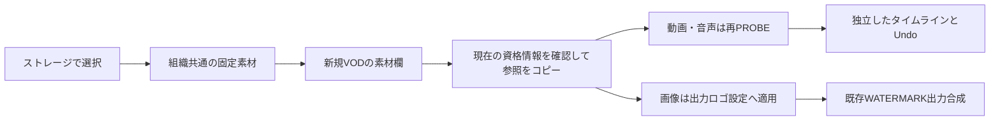

# VODの固定素材

毎回使う動画・音声・PNG/JPEGを組織共通の固定素材として保存する。新しいVOD作成画面の素材欄にも表示し、ストレージを探し直さずに使用できるようにする。

## 保存と編集の境界

既存の組織別AppSettingに専用キー `vod.input-favorites.v1` を設け、schemaVersion:1と最大64件の一覧を保存する。各要素はサーバー生成UUID、credentialId、bucket、objectKey、label、kind（VIDEO/AUDIO/IMAGE）のみ。秘密情報・署名URL・任意のURL・ローカルパス・メディア本体は保存しない。DB migrationは追加しない。

固定素材は一覧の参照であり、編集中のdocumentへ自動混入させない。使用時に新しいinput/source keyを割り当てて参照をコピーし、動画・音声は既存のPROBEを通す。固定素材を外しても、編集中・保存済みの入力参照やclipは変更しない。clipの編集・Undo/Redoはコピー後のdocumentだけに作用する。Redoに必要なsource参照は保持する。

snapshotは素材の参照と編集内容のコピーを指す。同じS3 objectKeyの内容が外部で更新された場合まで過去バイト列を保存するものではない。previewでは既存のidentity検証により変更を検出する。

## APIと並行更新

専用の `GET/POST /api/vod/input-favorites` と `DELETE /api/vod/input-favorites/[id]` を追加する。GETは最大64件を返す有限一覧。POSTはstrictな入力schemaで検証し、同じcredential/bucket/objectKeyの再登録は既存要素を返す。DELETEは冪等で、元オブジェクトやprojectを削除しない。

AppSettingを読むたびにschemaを検証し、破損データを空一覧として保存し直さない。変更はJSON値の一致条件を付けたupdateManyによるCASで行う。初回createのunique競合、CAS競合は最新値を読んで有限回再試行し、解決できない場合は409。これにより複数ブラウザーでの追加・削除が互いを消さない。APIテストに加え、PostgreSQLで同時更新と組織分離を確認する。

## 認可・秘密情報

GETを含め既存VOD編集と同じOPERATOR floorを適用し、impersonationは拒否する。getServerContextのtenant Prisma以外を使わない。orgIdやactorをクライアント入力として受け取らない。資格情報の存在・現在の組織・対応providerを保存時と使用時に再確認する。削除済み資格情報の素材は利用不可として表示し、固定素材から外せる。

一覧取得だけで全オブジェクトへHEAD/PROBEしない。使用時には現在のcredential設定と既存endpoint allowlistを使い、動画・音声は既存PROBE/identity検証を維持する。listの使用可能表示は「現在のcredentialが存在する」範囲に留め、元ファイルの存在や品質を確認済みとは表示しない。全応答はprivate/no-store、クライアントqueryは組織に結び付ける。

## UI

現行の小さな素材行・Button・StoragePickerを使う。読み込んだ素材に「固定素材へ保存」、固定素材の動画・音声に「素材へ追加」、画像に「出力ロゴに使用」を設ける。画像へタイムライン挿入の＋を出さない。資格情報が使えない場合は理由と削除操作を示す。取得失敗を空一覧と同じ表示にはしない。

画像を選ぶ際に入力previewへ出るようには見せず、「出力ロゴに使用」という動詞で最終出力の合成設定へ適用されることを明示する。現入力previewはロゴ合成を描画しない。適用したロゴは既存のフィルター設定で確認・調整できる。説明は短い補助文または注釈に留める。

## PNG/JPEGの実接続

PNG/JPEGの参照を入力ストレージへコピーし、既存WATERMARK filterのinputKey/imagePathへ接続、video renditionのfilter attachmentへ追加する。workerは既存signWatermarkImageで実行直前だけURLを生成し、ログ・plan・favoriteには残さない。既存署名経路で対応しているAWS S3・S3互換・GCS HMACだけをロゴの選択肢にする。未対応providerをダミーのボタンで受け付けない。

WATERMARK画像の参照は動画・音声PROBEの対象から除外する。コピー元favoriteを削除しても出力のロゴ設定は保持する。ロゴ設定の追加はWizardStateの変更であり、現タイムラインdocumentのUndo対象とは区別する。

利用者の追加指定により、画像のV1配置も今回実装する。固定画像行の「V1へ配置」から表示時間と保存先を選び、専用のIMAGE_PREPARE taskで通常MP4へ準備する。元の固定素材は画像のまま保持する。ロゴ合成との入口を分け、画像をそのままAV PROBEへ送らない。[静止画クリップの設計](vod-input-still-images-design.md)

Wizard下書きには画像専用purpose、許可したWATERMARKの参照・位置と各video renditionへの適用順だけを保存する。任意のfilter/options JSONや署名URLは保存しない。復元時に画像が動画扱いになったり、出力ロゴだけが消えたりしないことを確認する。

## 受け入れ確認

- 再読込・新しいVOD画面でも固定素材が残り、未使用素材がPROBEや16素材上限に混入しない。
- favorite変更・削除は既存のproject入力やclipを変更しない。
- 別組織・VIEWER・impersonation・削除済み資格情報・URL混入・壊れたJSONを安全に扱う。
- PostgreSQL上の同時追加/削除で更新を失わない。64件上限と重複登録を検証する。
- PNG/JPEGの出力ロゴ適用が既存WATERMARKへ到達し、署名URLを保存しない。動画・音声previewを壊さない。
- focused unit/API/component tests、PostgreSQL integration、typecheck、Biomeを実行する。既存のgate件数は実測した追加分だけ更新する。
