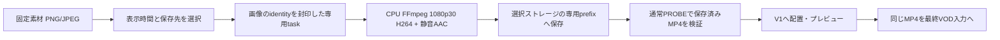

# VOD静止画クリップ

PNG/JPEGを表示時間1〜60秒（初期5秒）のV1クリップとして扱う。CPUでH.264/静音AAC入りMP4へ準備し、利用者が選んだ出力ストレージへ保存する。準備後のMP4を既存の素材確認・プレビュー・最終Bitmovin入力へ共通して渡す。タイムラインV2形式は変更しない。

## API仕様の判断

SDK1.287.0の公開InputStreamType/IngestInputStreamには、画像を指定時間保持するVOD入力型・loop属性がない。PNG/JPEGを明示するInsertableContentはLive用である。VODでの静止画読み込みが絶対に不可能とは断定せず、公開契約で確認できる通常MP4経路を採用する。

- [公式InputStreamType](https://github.com/bitmovin/bitmovin-api-sdk-javascript/blob/v1.287.0/src/models/InputStreamType.ts)
- [公式IngestInputStream](https://github.com/bitmovin/bitmovin-api-sdk-javascript/blob/v1.287.0/src/models/IngestInputStream.ts)
- [公式InsertableContent](https://github.com/bitmovin/bitmovin-api-sdk-javascript/blob/v1.287.0/src/models/InsertableContent.ts)
- [公式FFmpeg image2 demuxer](https://ffmpeg.org/ffmpeg-formats.html#image2-1)

## 契約と永続化

公開submissionはkind:IMAGE_PREPARE、source（既存のcredentialId/bucket/objectKey/key）、durationMs（1000〜60000）、output（credentialId/bucket/prefix）。サーバーは元画像をHEADし、sizeとetag/versionId/generationの少なくとも一つでsourceIdentityを封印してから、immutable requestとして保存する。旧PROBE/PREVIEWのproperty順とhashは維持する。

結果のpreparedはsource（新しいimg_taskUUID keyを持つ通常素材参照）、facts（通常SourceFacts）、requestedDurationMs、sha256。GET/cancelを含め元画像と保存先の両credentialの現権限を確認する。

VodInputPreviewTaskのSQL CHECKはPROBE/PREVIEWのみを許すため、IMAGE_PREPAREを追加する新規migrationが必要。既存kindやsource auditionを流用しない。task行の有効期限は24時間、MP4は通常の保存済み入力素材としてtask期限後も残す。ローカルtmp・artifactPathを最終入力には用いない。

## CPU・ストレージ境界

入力32MiB以下、縦横8192以下、解凍画素数は既存CPU予約に収まる4096×2160以下。PNG/JPEGの実header・1frame・EXIF orientationを確認してからdecodeする。APNG/複数JPEG等は拒否。FFmpegのthread数・allocation・出力64MiB・180秒timeoutを制限する。PNGの透明部は黒へ合成し、縦横比を保って1920×1080/30fpsへ収める。画像を引き伸ばさない。
出力は現在putObjectを持つS3family（AWS_S3/AKAMAI_OBJECT_STORAGE/OCI_OBJECT_STORAGE/GENERIC_S3/GCS_HMAC）のみ。元画像のbucket/keyへ書き戻さず、選択prefix配下のbitovp-generated-inputs/org/task/attempt.mp4へ保存する。attempt単位で一意のkeyとし、古いleaseが採用済み素材を上書きしない。PUT後にHEAD、封印した全量GETのSHA-256照合、通常のrange PROBE、再HEADを行い、size/codec/実clock/sha/identityを確認してからREADYとする。

末尾追加では静音AACもA1へ加え、新たな末尾空白を作らない。V1上書きでは既存A1を保持する。利用者のUndoは配置だけを戻し、保存済みMP4を消さない。クライアントが署名URL・秘密情報・ローカルパスを保存することはない。

## 実装と検証

共通契約はpackages/core/src/vod-input-timeline、永続taskの受付はapps/web/src/lib/server/vod-input-previews.ts、CPU準備はapps/worker/src/vod-input-preview/still-image.ts、画面と配置はapps/web/src/app/vod/new/input-timelineに置く。固定素材registryとは分け、IMAGE参照を受け取って通常素材へ準備する。

TDDでkind・サイズ・時間・identity、元画像変更、EXIF8方向・透明PNG・複数frame・寸法/解凍量、PUT未対応・PUT/HEAD不一致・remote probe失敗・取消/lease喪失・credential失効を確認する。実FFmpegで静止画の表示、黒い余白、音声、期間と通常previewを確認する。SQLの新kind許可とtenant/intent保持も確認する。課金API・SSHは使わない。

## 時間と編集の扱い

30fpsへ丸めると1234msが37frame＝1233.333msになり、指定尺に足りなくなる。そのため準備素材は必要frame数を切り上げて作り、映像・音声の実尺が指定以上であることを検証する。配置する区間のoutMsはrequestedDurationMsを使い、切り上げた自然尺をそのまま置かない。

V1への配置は既存editorの1回のcommitとし、Undoで配置・全体尺を戻し、Redoで復元できる。入力参照はUndo時にも残す。再読込のWizard下書きにはgenerated MP4の参照、displayName、timelineを保持する。元の固定画像から別の表示時間で再度準備することもできる。

## 保管と今後の課題

利用していない準備MP4をtask期限だけで自動削除すると、保存済み編集や後のエンコードを壊す。現在は永続保持とし、保存先で保管・削除を管理する。将来は編集・履歴・提出済みplanを横断した参照確認と保管方針を備えた回収を検討する。画像をタイムライン上で伸ばした際の自動再準備や、4Kを含む準備プロファイルの選択は別の改善項目とする。

## 実装後の検証

worker/coreの担当実装をfreezeした。core focused97件、worker focused67件、実CPU FFmpegの既存gate2件（skip0）が成功し、core/worker型検査と所有10TSファイルのBiome strict checkも成功した。実メディアでは透明PNG、JPEG EXIF1〜8、静音AAC、保存先全量SHA/HEAD、通常previewを確認した。新しいgated testやtimeout緩和は追加していない。

端数の1234msを30fps素材で確実に覆うため、準備MP4は38フレーム=1266.667msまで生成する。video/audio両方が指定時間以上であることを実測し、タイムライン上のoutはrequestedDurationMs=1234を使う。短い素材を通す例外は設けない。

PNGの圧縮ancillary text/profileはdecode用コピーから除去する。元画像を何度もdecodeせず、縮小後の1フレームだけをFFmpeg loop filterで保持する。解凍量とCPU処理を抑えつつ、原画像の向きと透明部の黒マットを保持する。[FFmpeg loop公式仕様](https://ffmpeg.org/ffmpeg-filters.html#loop)に基づく。

初回の画素検証ではYUV420を2×2へ縮小したためchromaが混ざるfixtureの問題を検出し、RGB化してから縮小する測定へ修正した。独立cropでは入力赤255・出力赤252、透明部黒0を確認した。製品側の誤りとしては端数msの生成不足を検出し、必要な完全フレームを生成する処理へ修正して再検証した。