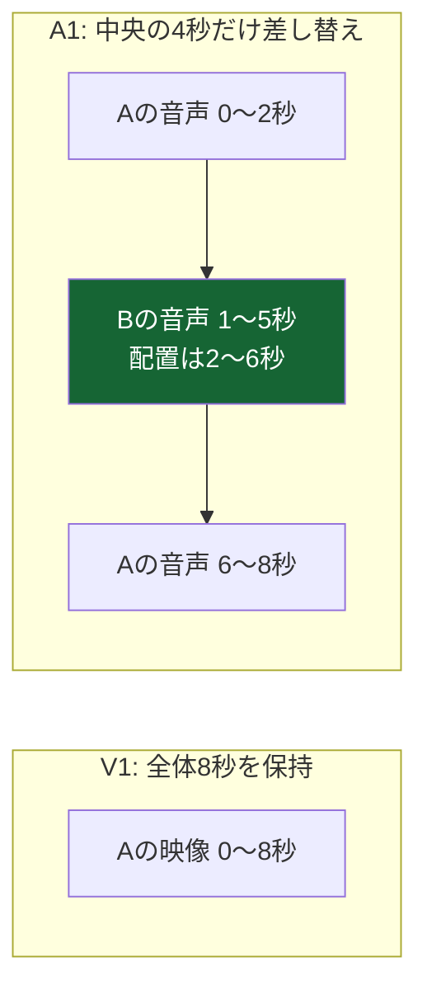

# VOD入力タイムライン：映像・音声の個別差し替え

## 目的と受け入れ条件

同じブランチのUnreleased機能として、V1の映像を維持したA1だけの差し替え、およびA1を維持したV1だけの差し替えを実装する。利用者が説明した「対象トラックを3分割し、中央だけ別素材へ入れ替える」手順をGUIで表現する。

- 「末尾に追加」は素材を選択トラックへ連結する。「選択区間を差し替え」は選択クリップの全体時刻と長さを保持して素材を置換する。
- 独立操作では反対側のトラックとプログラム全体尺を変更しない。差し替え区間外の元素材時刻も保持する。
- 初期のAV連動編集は、ID・素材・開始位置・in/outが一致する相手に対して維持する。リンクを外せばV1/A1を個別に分割・トリム・削除できる。
- 1映像・1音声トラック、ハードカットを対象とする。隙間は黒／無音。音声の混合、速度変更、トランジションは今回の対象外。
- WAV/MP3の音声素材を取り込み・試聴・A1へ配置できる。カバー画像を実映像と誤認しない。
- 旧下書き・旧プレビュー要求のhashと権限制御を維持する。出力形式は通常のVOD設定を保持する。

## データ契約

wireは旧v1と新v2の損失のないunionにする。旧v1のキー順・省略状態・値を変更するdefault/transformは追加しない。Workerで保存済み要求のhashを確認してから、明示的な正規化ヘルパーを使う。

```ts
type Track = "video" | "audio";
type PlacedClip = {
  id: string; sourceKey: string; startMs: number; inMs: number; outMs: number;
};
type V2Document = {
  schemaVersion: 2; id: string; audioEnabled: boolean; durationMs: number;
  videoClips: PlacedClip[]; audioClips: PlacedClip[];
};
```

各トラックは時刻順・重複なし、IDは同一トラック内で一意、範囲は整数msの半開区間とする。配置終端はdurationMs以内。最大16素材、各64クリップ、24時間、プレビュー180秒、リクエスト64KiBの既存上限を保つ。

v1は累積時刻でstartMsへ変換し、音声無効時も潜在的なaudioClipsを残して再有効化に備える。音声の検証は有効なときだけ行う。素材factsはvideoをnullableにし、実映像または実音声の少なくとも一方を要求する。

共通resolverは全体の映像main、実プレビュー窓の尺、V/Aそれぞれのsource/gap区間を返す。mainは窓を切る前の全体プログラムから決める。V/Aは独立して解決し、反対側のカット点を注入しない。

素材試聴要求だけは`PREVIEW.sourcePreviewKey`を任意指定する。このフィールドはwireの`range`より後へ追加し、未指定の旧要求のJSON・hashを変えない。共通builderは素材の主尺・測定済みV/A尺の最大値を試聴全体尺とし、各トラックはその実尺まで配置する。validatorは、参照素材、全体尺、有効音声、トラック数、配置とin/outが未編集1素材の自然な構成へ完全一致することを確認する。UUIDは構造検証を保ちつつ値を固定しない。

この厳密な素材試聴だけは、映像が先に終わる場合などの長い黒／無音を許可する。編集済み要求、他素材への差し替え、偽の尺・開始位置では試聴の例外を使えない。通常プログラムと最終nativeグラフには先頭・末尾10秒、中間20秒の上限を保ち、資格情報・版・組織・時間・CPU・容量の制限は素材試聴にも適用する。素材試聴のtask kindは既存の`PREVIEW`を使う。後から追加した画像準備は別の`IMAGE_PREPARE`として扱う。

## 操作とUI

V1/A1の両方をクリップとして選択できる。既存の固定尺度、末尾余白、ズーム、明示Fit、シーク、Undo/Redo、ドラッグ中の最大キャンバス保持を保つ。操作手順の常時説明は追加しない。



- 対象のクリップを選び、リンクを外すと対象トラックだけを分割する。
- 素材モニターで使用範囲を指定し、「末尾に追加」または「選択区間を差し替え」を選ぶ。対象トラックと区間は短いラベルで示す。
- 差し替えは選択区間と同じ長さを使う。素材の残りが足りない場合は拒否し、暗黙のループ・引き延ばし・全体尺変更をしない。
- 独立トリムは非リップルで、ソースinの変化を配置startへ反映する。空いた部分は隙間になり、延長時の重なりは同じトラックの上書きとして扱う。
- 連動する完全一致AVペアの尺変更・削除・並べ替えは、両トラックの同じ時間区間へ適用して既存の挙動を保つ。
- 単独トラックへの追加はそのトラックの末尾、AV同時追加はプログラム末尾へ配置する。
- 使用可能な素材範囲は対象の実ストリーム尺で判定する。V1+A1の初期範囲は両方に存在する共通範囲、単独A1は映像の主尺を超えて音声末尾まで指定できる。明示した範囲を暗黙に短縮しない。
- ドラッグ／キーボード操作の連動は、以前の選択ではなく操作対象の完全一致ペアと利用者のリンク設定から決定する。追加可能数は対象トラックごとに判定する。
- 分割対象が選択中クリップと別なら選択を保持し、Undoで無関係な編集対象を変えない。
- ポインターの捕獲先は、並べ替えでDOM移動するクリップではなく固定したタイムライン枠とする。クリックのシーク、実際のキャンセル、Escape、アンマウント時の解除を保つ。[DOM移動時のpointer captureに関する仕様上の注意](https://developer.mozilla.org/en-US/docs/Web/API/Pointer_events#capturing_the_pointer)は、実ブラウザーのイベント履歴と前方向ドラッグ試験で検証する。

## プレビューと最終グラフ

CPU FFmpegは映像・音声の区間を別々に生成・連結し、最後にmuxする。音声の差し替えで映像のエンコード境界を増やさず、映像の差し替えで元音声を再分割しない。AACは最後に一度だけエンコードする。素材単体の試聴はプロジェクトをspreadせず新しい単体用文書を作り、音声専用素材には中立な黒背景を付ける。

最終出力は既存のVIDEO_RELATIVE/AUDIO_RELATIVE→TimeBasedTrimming→Concatenationへ別々に変換する。隙間は既存のpaddingBefore/paddingAfterを秒で指定する。公式SDKのPaddingSequenceは1個10秒以内とし、先頭・末尾は10秒、中間は前後へ分配して20秒以内に制限する。それを超える状態はプレビュー／生成の前に明示する。[分配の設計](vod-input-timeline-positioning-design.md)。空のconcatは作らない。音声が空なら音声出力を作らず、映像出力があるのに実映像がない場合はプロバイダー呼び出し前に拒否する。

版付きRange、資格情報失効、組織分離、read-onlyなWeb側volume、lease・キャンセル・期限・バイト上限・CPU制御は維持する。

ローカル合成fixtureの既存A/Bは、再生成したAACのhashと比較しない。`-shortest`と無期限音声によるAAC終端の非決定性が実測されたため、既知タグ・保存SHA・版を固定した実オブジェクトbytesの一致を上限付きで確認して保持する。欠損時だけ生成し、条件付きPUTを使う。追加WAVは固定8秒とし、既存fixtureのbyteとETagを変えず反復実行できることを検証する。

## 分担と実行順序

1. 共通契約・純粋編集操作・ネイティブ変換を先に確定する。
2. WorkerのAV別レンダー／音声素材対応と、GUIのトラック選択・分割・差し替えを並行する。
3. WebのAPI・下書き・readinessを接続し、旧要求と新要求を確認する。
4. 実FFmpeg、実PostgreSQL、Docker実画面、独立2系統レビュー、CIで検証する。mainへマージせずDraft PRへ反映する。

## 検証とコマンド

A（赤→緑／440Hz）とB（青／880Hz）を使い、音声だけ差し替えた際の映像の同一性、映像だけ差し替えた際の音声PCMの同一性を確認する。WAV/MP3、ギャップ、区間外、境界ぴったり、素材不足、上限、分割・差し替え後の履歴と下書きも確認する。

```sh
rtk proxy mise exec node@24.22.2 -- pnpm --filter @bitovp/core test
rtk proxy mise exec node@24.22.2 -- pnpm --filter @bitovp/web test --maxWorkers=2
rtk proxy mise exec node@24.22.2 -- pnpm --filter @bitovp/worker test --maxWorkers=2
rtk proxy mise exec node@24.22.2 -- pnpm typecheck
rtk proxy mise exec node@24.22.2 -- pnpm check
rtk proxy mise exec node@24.22.2 -- pnpm test:postgres
rtk proxy mise exec node@24.22.2 -- pnpm preview:editing up --port 3192
rtk proxy mise exec node@24.22.2 -- pnpm preview:editing timeline
```

既存のTypeScript/Zod/React/FFmpegとテスト基盤を使い、新規依存・DBスキーマ変更・CIの閾値緩和は行わない。新規条件はRED→GREENで確認する。課金ジョブ、SSH、本番配備、タグ、リリースは作成しない。

公式SDKの根拠: [PaddingSequence（最大10秒）](https://github.com/bitmovin/bitmovin-api-sdk-javascript/blob/main/src/models/PaddingSequence.ts)、[ConcatenationInputConfiguration（黒／無音のpadding）](https://github.com/bitmovin/bitmovin-api-sdk-javascript/blob/main/src/models/ConcatenationInputConfiguration.ts)。
