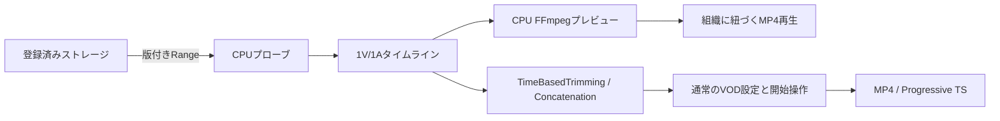

# VOD入力タイムライン編集

VOD作成画面の「入力」で **タイムラインで編集** を選ぶと、複数の入力ファイルから出力シーケンスを組み立てられます。映像1トラックと音声1トラックを連動して編集します。

1. **素材を追加** から登録済みストレージのファイルを選びます。Workerが長さ・映像・音声を調べます。
2. 素材名の横にある追加ボタンでタイムラインへ配置します。同じ素材を複数回使えます。
3. クリップの両端をドラッグして範囲を変更します。右側の開始・終了欄では秒単位の数値を指定できます。
4. クリップをドラッグして順序を変えるか、前へ・後へ移動ボタンを使います。再生位置での分割、削除、元に戻す・やり直すも利用できます。
5. **素材／シーケンス** を切り替えてプレビューを確認します。タイムラインをクリックするとシークします。
6. 出力形式を **MP4** または **TS（単一ファイル）** にし、通常のVOD設定・確認へ進みます。クラウドエンコードは最後に開始ボタンを押したときにだけ実行します。

音声がない素材を使う場合は、音声を含める設定をオフにできます。音声あり・なしの混在へ自動的に無音を足す機能、音声だけの独立配置、トランジション、多段合成は初期実装の対象外です。既存の詳細な入力グラフ編集も引き続き利用できます。

## プレビュー

GPU・Local LLMを使わず、WorkerのCPUとFFmpegで低画質MP4を作ります。初期設定では再生位置付近の最大30秒を優先します。シーケンスが180秒以内なら全体プレビューも選べます。編集後の古いプレビューには更新状態を表示します。

初回はストレージからの読み取り・メタデータ取得が必要です。ネットワークや入力形式によって待ち時間は変わります。大きなファイルを編集のたびに丸ごとダウンロードする方式ではなく、版を固定したRange読み取りを使います。

映像の縦横比はシーケンス先頭素材を基準にし、ほかの素材は余白を付けて収めます。プレビューは最大640×360相当・30fpsの確認用であり、最終エンコードの画質やプロバイダーのフレーム丸めを保証するものではありません。

初期上限は16素材、64クリップ、合計24時間です。プレビュー対象の入力はMOV/MP4、Matroska/WebM、MPEG-TSの対応映像で、画素数は4096×2160以内に制限します。暗号化入力、未知の長さ、対応しない音声構成は編集を進める前に表示します。

プレビューは取得時のETag等を使って素材の版を確認します。クラウド側の通常入力APIはファイルのパスを読み取るため、プレビュー後に同じストレージキーを上書きすると最終入力が変わる可能性があります。変更を検出した場合は素材を再取得してください。

## Dockerでブランチを確認する

このブランチの作業ディレクトリで実行します。既存環境とは別のDB・Redis・S3互換ストレージを使い、リポジトリの通常の`.env`は読み込みません。

```sh
pnpm preview:editing up --port 3192
pnpm preview:editing timeline
```

`http://127.0.0.1:3192/vod/new` の「入力」へ進みます。ストレージ認証情報 **VOD timeline local S3 (synthetic only)** を選び、`bitovp-editing-preview` バケットの `fixtures/vod-timeline/v1/a.mp4` と `b.mp4` を使えます。色・音・縦横比・フレームレートが異なる合成素材です。

このローカル環境のプレビュー操作から課金エンコードは作成しません。新しいエンコードの通し試験は別途明示して実行します。

```sh
pnpm preview:editing status
pnpm preview:editing stop
```

Docker以外では、WebとWorkerの両方に同じ絶対パスの`VOD_INPUT_PREVIEW_DIR`を設定します。Workerは書き込み、Webは読み取りが必要です。Composeでは専用ボリュームを共有し、Web側を読み取り専用にしています。素材の秘密鍵や一時パスはブラウザーへ返しません。

## 構成と検証



共通モデルと入力グラフ変換は`packages/core/src/vod-input-timeline`・`packages/core/src/wizard/input-timeline.ts`、GUIは`apps/web/src/app/vod/new/input-timeline`、CPU処理は`apps/worker/src/vod-input-preview`にあります。

実FFmpegのオフライン試験では、2素材をA後半→B先頭→A先頭へ編集し、切替直前・直後の色と音、長さ、縦横比、読み取り量を確認します。PostgreSQL試験では組織分離・期限・同時リクエスト・キャンセル・認証情報削除を確認します。SDK送信内容の試験は実クラウドエンコードの実行とは区別しています。
