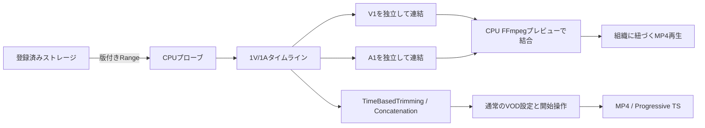

# VOD入力タイムライン編集

VOD作成画面の「入力」で **タイムラインで編集** を選ぶと、複数の入力ファイルから出力シーケンスを組み立てられます。映像1トラック（V1）と音声1トラック（A1）を連動、または個別に編集できます。

1. **素材を追加** から登録済みストレージのファイルを選びます。Workerが長さ・映像・音声を調べます。
2. 素材を選び、**末尾に追加** で使用範囲をタイムラインへ配置します。素材一覧の **+** は選択トラックで使える範囲全体を追加します。同じ素材を複数回使えます。音声だけの素材はA1へ追加します。
3. クリップの両端をドラッグして範囲を変更します。右側の開始・終了欄では秒単位の数値を指定できます。
4. クリップをドラッグして順序を変えるか、前へ・後へ移動ボタンを使います。再生位置での分割、削除、元に戻す・やり直すも利用できます。
5. **素材／シーケンス** を切り替えてプレビューを確認します。タイムラインをクリックするとシークします。
6. 通常のVOD設定・確認へ進みます。出力ステップでMP4、TS（単一ファイル）、HLS/DASHなど用途に合う形式を選べます。タイムライン編集を有効にしても、選択済みの出力設定は変わりません。クラウドエンコードは最後に開始ボタンを押したときにだけ実行します。

映像だけを残して音声を変更する場合は、A1を選んで開始・終了位置で分割し、中央の区間を選びます。素材とその開始位置を選び、**選択区間を差し替え** を押すと、その区間だけを置き換えます。V1の内容と全体の長さは変わりません。V1を選ぶと、同じ操作で音声を残して映像だけを変更できます。

**末尾に追加** は選択したトラックを伸ばし、**選択区間を差し替え** は既存区間の長さを保ちます。差し替え素材の残りが短い場合は実行できません。選択した側だけのトリミング・削除では、後続区間を動かさず空白を残します。V1+A1が連動した状態では従来どおり両方を編集します。

素材の使用可能な長さは選択トラックで判定します。V1+A1では両方にある範囲を初期値にし、A1単独では音声ストリームの末尾まで指定できます。映像と音声の末尾に数ミリ秒の差があっても、初期範囲から追加できます。

空白は映像では黒、音声では無音になります。クラウドエンコーダーのパディング上限に合わせ、素材のあるトラックの空白は1区間10秒以内です。A1全体が空、または音声を含める設定がオフの場合は、音声なしで出力します。トランジション、音声ミックス、複数レイヤーの重ね合わせは対象外です。既存の詳細な入力グラフ編集も引き続き利用できます。

タイムラインは固定の尺度で表示し、末尾に余白を残します。トリミングしても他のクリップの表示幅は変わりません。ズームを選ぶか「全体」を押したときだけ尺度が変わり、その後の編集でも維持されます。

V1/A1を個別に編集するときは、端をドラッグして他のクリップの切れ目へ近づけると吸着します。吸着中は破線と時刻が両トラックに表示されます。目盛りをクリックして分割位置を決めるときも吸着します。磁石ボタンでオン／オフ、Alt／Optionを押している間は一時解除できます。数値入力とキーボードの細かな調整は吸着させません。[判定と検証の設計](vod-input-timeline-snapping-design.md)

## プレビュー

GPU・Local LLMを使わず、WorkerのCPUとFFmpegで低画質MP4を作ります。初期設定では再生位置付近の最大30秒を優先します。シーケンスが180秒以内なら全体プレビューも選べます。編集後の古いプレビューには更新状態を表示します。

初回はストレージからの読み取り・メタデータ取得が必要です。ネットワークや入力形式によって待ち時間は変わります。大きなファイルを編集のたびに丸ごとダウンロードする方式ではなく、版を固定したRange読み取りを使います。

映像の縦横比はシーケンス全体の最初の映像素材を基準にし、サンプルアスペクト比と通常の90度単位の回転を反映します。後半だけをプレビューしても基準は変わりません。ほかの素材は余白を付けて収めます。音声単独の試聴では黒い画面を使います。特殊な拡大・反転・変形を含む表示行列は初期対応外です。プレビューは最大640×360相当・30fpsの確認用であり、最終エンコードの画質やプロバイダーのフレーム丸めを保証するものではありません。

未編集の素材試聴では映像・音声それぞれの末尾まで再生し、先に終わる側を黒／無音で補います。この試聴には最終編集の10秒の空白上限を適用しません。編集したシーケンスのプレビューと最終出力では10秒上限を保ちます。

初期上限は16素材、各トラック64クリップ、合計24時間です。プレビュー対象の入力はMOV/MP4、Matroska/WebM、MPEG-TSの対応映像と、WAV・MP3音声です。映像の画素数は4096×2160以内に制限します。暗号化入力、未知の長さ、対応しない音声構成は編集を進める前に表示します。

プレビューは取得時のETag等を使って素材の版を確認します。クラウド側の通常入力APIはファイルのパスを読み取るため、プレビュー後に同じストレージキーを上書きすると最終入力が変わる可能性があります。変更を検出した場合は素材を再取得してください。

## Dockerでブランチを確認する

このブランチの作業ディレクトリで実行します。既存環境とは別のDB・Redis・S3互換ストレージを使い、リポジトリの通常の`.env`は読み込みません。

```sh
pnpm preview:editing up --port 3192
pnpm preview:editing timeline
```

`http://127.0.0.1:3192/vod/new` の「入力」へ進みます。ストレージ認証情報 **VOD timeline local S3 (synthetic only)** を選び、`bitovp-editing-preview` バケットの `fixtures/vod-timeline/v1/a.mp4` と `b.mp4`、音声単独の `fixtures/vod-timeline/v2/c.wav` を使えます。色・音・縦横比・フレームレートが異なる合成素材です。

このローカル環境のプレビュー操作から課金エンコードは作成しません。新しいエンコードの通し試験は別途明示して実行します。

```sh
pnpm preview:editing status
pnpm preview:editing stop
```

Docker以外では、WebとWorkerの両方に同じ絶対パスの`VOD_INPUT_PREVIEW_DIR`を設定します。Workerは書き込み、Webは読み取りが必要です。Composeでは専用ボリュームを共有し、Web側を読み取り専用にしています。素材の秘密鍵や一時パスはブラウザーへ返しません。

## 構成と検証



解像度・FPSが異なる入力も連結できます。Bitmovin Encoder v2.36以降は、連結の主素材を基準に各入力を揃えてから出力設定を適用します。このGUIでは先頭クリップを主素材とし、異なる縦横比は余白を付けて収めます。最終出力の解像度・FPSは通常のVOD設定で指定します。[公式仕様](https://developer.bitmovin.com/encoding/docs/stitching-and-trimming-getting-started)

共通モデルと入力グラフ変換は`packages/core/src/vod-input-timeline`・`packages/core/src/wizard/input-timeline.ts`、GUIは`apps/web/src/app/vod/new/input-timeline`、CPU処理は`apps/worker/src/vod-input-preview`にあります。

実FFmpegのオフライン試験では、2素材をA後半→B先頭→A先頭へ編集し、切替直前・直後の色と音、長さ、縦横比、読み取り量を確認します。片側だけの差し替えでは、反対側のデコード済み全フレーム／全音声サンプルが変更前と一致することも調べます。PostgreSQL試験では独立した配置の保存とハッシュ、組織分離・期限・同時リクエスト・キャンセル・認証情報削除を確認します。SDK送信内容の試験は実クラウドエンコードの実行とは区別しています。
