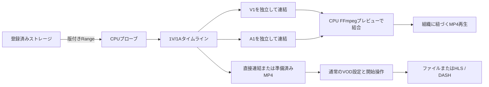

# VOD入力タイムライン編集

VOD作成画面の **ソース → タイムラインで編集** で、複数の入力ファイルから出力シーケンスを組み立てられます。映像1トラック（V1）と音声1トラック（A1）を連動、または個別に編集できます。

1. **素材を追加** から登録済みストレージのファイルを選びます。Workerが長さ・映像・音声を調べます。
2. 素材を選び、**末尾に追加** で使用範囲をタイムラインへ配置します。素材一覧の **+** は選択トラックで使える範囲全体を追加します。同じ素材を複数回使えます。音声だけの素材はA1へ追加します。
3. クリップの両端をドラッグして範囲を変更します。右側の開始・終了欄では秒単位の数値を指定できます。
4. V1/A1の個別編集では、クリップの中央をドラッグして空白へ移せます。素材範囲と尺を保ち、重なった同じトラックの区間は上書きします。リンクしたAVペアのドラッグや前へ・後へボタンは並べ替えです。再生位置での分割、削除、元に戻す・やり直すも利用できます。
5. **素材／シーケンス** を切り替えてプレビューを確認します。タイムラインをクリックするとシークします。
6. 通常のVOD設定・確認へ進みます。出力ステップでMP4、TS（単一ファイル）、HLS/DASHなど用途に合う形式を選べます。タイムライン編集を有効にしても、選択済みの出力設定は変わりません。クラウドエンコードは最後に開始ボタンを押したときにだけ実行します。

映像だけを残して音声を変更する場合は、A1を選んで開始・終了位置で分割し、中央の区間を選びます。素材とその開始位置を選び、**選択区間を差し替え** を押すと、その区間だけを置き換えます。V1の内容と全体の長さは変わりません。V1を選ぶと、同じ操作で音声を残して映像だけを変更できます。

**末尾に追加** は選択したトラックを伸ばし、**選択区間を差し替え** は既存区間の長さを保ちます。差し替え素材の残りが短い場合は実行できません。選択した側だけのトリミング・削除では、後続区間を動かさず空白を残します。V1+A1が連動した状態では従来どおり両方を編集します。

素材の使用可能な長さは選択トラックで判定します。V1+A1では両方にある範囲を初期値にし、A1単独では音声ストリームの末尾まで指定できます。映像と音声の末尾に数ミリ秒の差があっても、初期範囲から追加できます。

空白は映像では黒、音声では無音になります。クラウドエンコーダーのパディング上限に合わせ、素材のあるトラックの空白は先頭・末尾で10秒以内、中間では20秒以内です。A1全体が空、または音声を含める設定がオフの場合は、音声なしで出力します。トランジション、音声ミックス、複数レイヤーの重ね合わせは対象外です。既存の詳細な入力グラフ編集も引き続き利用できます。

タイムラインは固定の尺度で表示し、末尾に余白を残します。トリミングしても他のクリップの表示幅は変わりません。ズームを選ぶか「全体」を押したときだけ尺度が変わり、その後の編集でも維持されます。

V1/A1を個別に編集するときは、本体の移動や端の調整でクリップ境界、再生位置、シーケンスの端に近づけると吸着します。吸着中は破線と時刻が両トラックに表示されます。目盛りをクリックして分割位置を決めるときも吸着します。磁石ボタンでオン／オフ、Alt／Optionを押している間は一時解除できます。数値入力とキーボードの細かな調整は吸着しません。

十分な表示幅があるクリップでは、未選択でもホバーすると端をつかめます。素材の先頭・末尾やシーケンスの端に達すると止まります。素材の開始が0秒の場合は、本体をドラッグして位置を移してください。ドラッグ中はEscapeで取り消せます。

## クラウド出力とエンコード用素材

映像と音声で素材、切り出し位置、区切り、余白が異なる構成は、Bitmovinへの直接連結で `PLAN_CONCATENATION_AV_UNQUALIFIED` になります。両トラックの構成を揃えるか、次の手順で1本の入力素材にまとめてください。連結を使わない別映像・別音声入力や片方だけの出力は引き続き使えます。 [Bitmovinの連結ガイド](https://developer.bitmovin.com/encoding/docs/stitching-and-trimming-getting-started)

1. 読み書きできるS3互換またはGCS HMACの出力ストレージを選びます。
2. ソースのタイムラインに戻り、**エンコード用素材を準備** を押します。WorkerがV1/A1を1本のMP4にまとめて保存します。出力先や編集を変えた場合は再準備してください。
3. **エンコード用素材：準備済み** を確認して通常の設定を進めます。Bitmovinのエンコードは確認画面で開始します。

準備は最大1時間かつ4 GiBです。映像は8bit・BT.709 SDR、プログレッシブ、正方画素、回転なしの素材に対応します。主映像の解像度とフレームレートを保ち、H.264 CRF 12とAAC 320 kbpsで再エンコードするため、画質の変化も確認してください。HDRを保ったまま独立編集を出力したい場合は、対応する環境で合成済みの入力を用意してください。

## 固定素材・蓋画像

素材行の星ボタンで動画・音声を固定素材へ保存します。固定素材欄の＋からPNG/JPEGも登録できます。1組織につき64件まで保存でき、使用時に現在の編集へ参照をコピーします。一覧から外しても、編集中の素材やクリップは消えません。元のストレージファイルの版は、素材を使うときに確認します。

画像の **V1へ配置** では、表示時間（1〜60秒、初期5秒）と保存先を指定します。**末尾に追加** は画像と無音を追加し、**再生位置から映像を上書き** はA1を残してV1だけを差し替えます。Undo／Redoの対象は配置です。準備したMP4は通常の素材としてプレビュー・最終エンコードに使い、元画像の参照は固定素材に残ります。

準備したMP4の保存先は、読み書き可能なS3互換またはGCS HMACストレージを選びます。元画像とは別の専用キーへ保存し、プレビューの期限後も保持します。利用しなくなった素材の保管・削除は保存先で管理してください。画像は向きと縦横比を保って1080p・30fpsへ収め、透過部と余白は黒にします。入力は32 MiB以内、一辺8192画素以下で総画素数が4096×2160以下の単一フレームPNG/JPEGです。

**ロゴ** は出力フィルターへ画像を適用します。位置と各映像レンディションへの適用は通常のフィルター設定で調整します。合成結果はエンコード後の出力で確認できます。

## プレビュー

GPU・Local LLMを使わず、WorkerのCPUとFFmpegで低画質MP4を作ります。初期設定では再生位置付近の最大30秒を優先します。シーケンスが180秒以内なら全体プレビューも選べます。編集後の古いプレビューには更新状態を表示します。

初回はストレージからの読み取り・メタデータ取得が必要です。ネットワークや入力形式によって待ち時間は変わります。大きなファイルを編集のたびに丸ごとダウンロードする方式ではなく、版を固定したRange読み取りを使います。

映像の縦横比はシーケンス全体の最初の映像素材を基準にし、サンプルアスペクト比と通常の90度単位の回転を反映します。後半だけをプレビューしても基準は変わりません。ほかの素材は余白を付けて収めます。音声単独の試聴では黒い画面を使います。特殊な拡大・反転・変形を含む表示行列は初期対応外です。プレビューは最大640×360相当・30fpsの確認用であり、最終エンコードの画質やプロバイダーのフレーム丸めを保証するものではありません。

未編集の素材試聴では映像・音声それぞれの末尾まで再生し、先に終わる側を黒／無音で補います。この試聴には最終編集の空白上限を適用しません。編集したシーケンスのプレビューと最終出力では、先頭・末尾10秒、中間20秒の上限を保ちます。

初期上限は16素材、各トラック64クリップ、合計24時間です。プレビュー対象の入力はMOV/MP4、Matroska/WebM、MPEG-TSの対応映像と、WAV・MP3音声です。映像の画素数は4096×2160以内に制限します。暗号化入力、未知の長さ、対応しない音声構成は編集を進める前に表示します。

プレビューは取得時のETag等を使って素材の版を確認します。クラウド側の通常入力APIはファイルのパスを読み取るため、プレビュー後に同じストレージキーを上書きすると最終入力が変わる可能性があります。変更を検出した場合は素材を再取得してください。

## Dockerで動作を確認する

リポジトリのルートで実行します。プレビュー専用の設定と、既存環境とは別のDB・Redis・S3互換ストレージを使います。

```sh
pnpm preview:editing up --port 3192
pnpm preview:editing timeline
```

`http://127.0.0.1:3192/vod/new` の **ソース** へ進みます。ストレージ認証情報 **VOD timeline local S3 (synthetic only)** を選び、`bitovp-editing-preview` バケットの `fixtures/vod-timeline/v1/a.mp4` と `b.mp4`、音声単独の `fixtures/vod-timeline/v2/c.wav` を使えます。色・音・縦横比・フレームレートが異なる合成素材です。

このローカル環境のプレビュー操作から課金エンコードは作成しません。新しいエンコードの通し試験は別途明示して実行します。

```sh
pnpm preview:editing status
pnpm preview:editing stop
```

Docker以外では、WebとWorkerの両方に同じ絶対パスの`VOD_INPUT_PREVIEW_DIR`を設定します。Workerは書き込み、Webは読み取りが必要です。Composeでは専用ボリュームを共有し、Web側を読み取り専用にしています。素材の秘密鍵や一時パスはブラウザーへ返しません。

## 構成と検証



解像度・FPSが異なる入力も連結できます。Bitmovin Encoder v2.36以降は、連結の主素材を基準に各入力を揃えてから出力設定を適用します。このGUIでは先頭クリップを主素材とし、異なる縦横比は余白を付けて収めます。最終出力の解像度・FPSは通常のVOD設定で指定します。[公式仕様](https://developer.bitmovin.com/encoding/docs/stitching-and-trimming-getting-started)

共通モデルは旧v1の保存済み要求とハッシュを保ち、検証後にV1/A1の配置を独立したv2へ正規化します。配置区間は整数msの半開区間です。直接連結の中間空白が10秒を超える場合は前の素材の後ろと次の素材の前に分け、各パディングを10秒以内にします。素材単体の試聴で自然尺を保つ例外は、未編集の同じ素材を使うときに限ります。 [共通モデル](../packages/core/src/vod-input-timeline) · [SDKのPaddingSequence](https://github.com/bitmovin/bitmovin-api-sdk-javascript/blob/v1.287.0/src/models/PaddingSequence.ts)

スナップは8px以内で始まり、12pxまで維持します。同じ距離では早い時刻を優先します。本体の移動は4pxから開始し、両端をスナップ候補にします。ポインターを固定のタイムライン枠で捕獲し、クリップの並べ替え中もドラッグを継続します。 [ドラッグ処理](../apps/web/src/app/vod/new/input-timeline/use-timeline-gesture.ts) · [スナップのテスト](../apps/web/src/app/vod/new/input-timeline/timeline-snapping.test.ts)

固定素材のAPIは組織別設定に参照を保持し、OPERATOR以上の本人操作に限定します。同じオブジェクトの登録と一覧からの削除は冪等で、同時更新は比較して保存します。静止画の準備は専用の `IMAGE_PREPARE` を使い、指定時間以上のフレームを生成します。タイムライン上の尺には指定値を使います。保存済みMP4の版とSHA-256は再取得して照合します。 [API利用ガイド](API-USAGE.md) · [固定素材のPostgreSQLテスト](../apps/web/src/lib/server/vod-input-favorites.integration.test.ts) · [静止画準備のテスト](../apps/worker/src/vod-input-preview/still-image.test.ts)

実FFmpegのオフライン試験では、区間の切替前後の色・音、尺、縦横比、読み取り量を確認します。片側だけの差し替えでは反対側のデコード済み全フレームまたは音声サンプルの一致も調べます。PostgreSQL試験では配置の保存・組織分離・期限・同時リクエスト・キャンセル・認証情報削除を確認します。クラウド側の受理と再生は実際の出力で確認してください。
